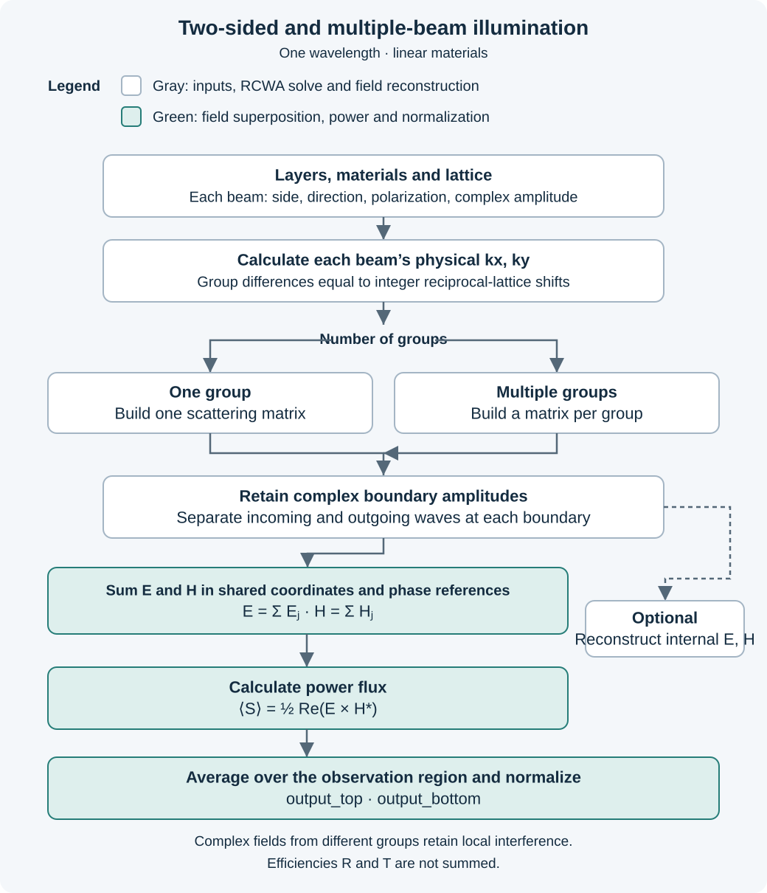

# Coherent illumination and internal sources

Use a source list or a side-keyed `excitation` map when plane waves need their own direction, polarization or
phase, or when light arrives from both half-spaces. Every beam shares the scene's
vacuum wavelength. The calculation assumes linear materials.

```python
import numpy as np
import wavebit

solver = wavebit.rcwa(
    wavelength=600.,                    # all lengths in nm
    period=(900., 850.),
    top=1., bot=2.25,                   # relative permittivities
    structure=[dict(background=4.+0.6j, shapes=[])],
    thickness=[100.],
    truncation_order=0,                 # this example is a uniform slab
    kx=0.002, ky=0.,                    # shared transverse wavevector, nm^-1
    answers="field",
    excitation={
        "top": wavebit.PlaneWave(polarization=(1., 0.)),
        "bottom": wavebit.PlaneWave(
            polarization=(1., 0.),
            amplitude=np.exp(1j*np.deg2rad(90.)),
        ),
    },
)
result = solver.solve()
print(result.output_top, result.output_bottom, result.absorption)
# 0.7398795147, 0.0593631288, 0.2007573565
```

`top` and `bot` still describe materials above and below the layer stack. The
excitation keys are `"top"` and `"bottom"`; omit `incidence_side` for this input form.
Layer order stays bottom to top, starting at `z=0`.

## What each PlaneWave specifies

| PlaneWave argument | Meaning |
| --- | --- |
| `theta`, `phi` | Direction angles in radians, evaluated using the material on that beam's incident side. |
| `kx`, `ky` | Real Cartesian transverse wavevector components, in inverse scene length units. Do not combine with angles on the same PlaneWave. |
| `polarization=(a_s, a_p)` | Electric s/p coefficients, normalized by their Euclidean length. Defaults to s polarization. |
| `psi`, `chi` | Alternative polarization angles, using the same convention as ordinary `rcwa`. Do not combine with `polarization`. |
| `amplitude` | Complex multiplier of that beam's normalized s/p pair. `0.5*np.exp(1j*np.deg2rad(45.))` specifies magnitude 0.5 and phase +45°. |

Angles use the normal pointing into the stack: −z from the top, +z from the bottom.
The azimuth sets the transverse direction in the same xyz frame on both sides.
Normal incidence with no azimuth uses the φ=0 s/p basis. Relative s/p signs follow
Wavebit's electric-amplitude convention; at normal incidence its basis vectors are
s=+y and p=−x on both incident sides.

An omitted direction inherits common `kx`, `ky`, if supplied to `rcwa`; otherwise
it is normal incidence. Common `polarization` or `psi`, `chi` may also supply
beam defaults. A beam-local direction or polarization overrides the corresponding
default. A side can take a list of plane waves to describe several directions or polarizations.

PlaneWave amplitudes are referenced at **x=y=0 on that beam's outside interface**:
`z=sum(thickness)` for top, `z=0` for bottom. Their phase difference is between those
two reference points. Translating either reference plane would require a propagation
phase factor. Equal amplitude magnitudes do not in general mean equal normal powers,
because the two media, angles and polarizations can have different admittances.

### Different outer media, common kx and ky

In the example, the top index is 1 and the bottom index is 1.5. The same
`kx=0.002 nm^-1` gives a top angle of about 11.01° and a bottom angle of 7.31°.
Both beams are valid inputs on the same diffraction grid; their normal wavenumbers
and power weights are calculated from their respective materials.

At the reference points, changing the bottom beam phase gives:

| Bottom phase | `output_top` | `output_bottom` | `absorption` |
| --- | --- | --- | --- |
| 0° | 0.481181 | 0.242506 | 0.276313 |
| 90° | 0.739880 | 0.059363 | 0.200757 |
| 180° | 0.393406 | 0.411418 | 0.195176 |

The material and the two individual incident powers are unchanged. Interference
changes the outgoing fields and the field inside the absorbing slab.

## Several beams from the same side

Put a list of `PlaneWave` objects under `"top"` or `"bottom"`. Omit the other key when
that side has no incident beam; both outer materials still belong in `top` and
`bot`. Every beam shares `wavelength`, but can have its own direction,
polarization, amplitude magnitude and phase.

This complete example illuminates a uniform absorbing slab from the top with
two s-polarized beams: one normal, the other tilted 20° toward +x.

```python
import numpy as np
import wavebit

beams = [
    wavebit.PlaneWave(
        theta=0., phi=0., polarization=(1., 0.), amplitude=1.,
    ),
    wavebit.PlaneWave(
        theta=np.deg2rad(20.), phi=0., polarization=(1., 0.),
        amplitude=0.5 * np.exp(1j * np.deg2rad(90.)),
    ),
]
same_side = wavebit.rcwa(
    wavelength=600., period=(900., 850.),
    top=1., bot=2.25,
    structure=[dict(background=4.+0.6j, shapes=[])],
    thickness=[100.], truncation_order=0,  # uniform slab
    excitation={"top": beams},
)
same_side_result = same_side.solve(power_region="infinite")
print(same_side_result.output_top)     # total reflectance
print(same_side_result.output_bottom)  # total transmittance
print(same_side_result.absorption)
```

The indices in `beams[0]` and `beams[1]` are list positions, not diffraction orders.
Add more `PlaneWave` objects to specify more inputs. For bottom-only illumination,
`output_bottom` is reflectance and `output_top` is transmittance.

The second beam has half the electric amplitude magnitude and +90° phase relative
to the first at **x=y=0 on the top interface**. Different transverse wavevectors
make this phase difference position-dependent, while it stays fixed in time at
each position. `polarization` sets the relative s/p components within a beam;
`amplitude` multiplies the whole normalized pair. Change only the second beam's
`polarization` to `(0., 1.)` to make that input p polarized.

Amplitude magnitude is not a power fraction. For this lossless isotropic incident
medium, each beam's inward normal flux is proportional to `abs(amplitude)**2 *
cos(theta)`. The second beam therefore carries about `0.25*cos(20°) = 0.235` times
the first beam's normal incident flux.

These directions form two calculation groups, so an explicit `power_region` is
required. Their cross terms vanish in the infinite-area average, even though the
local fields remain coherent. To include interference over a finite rectangle:

```python
window_power = same_side_result.boundary_power(
    ((-450., 450.), (-425., 425.)),  # x and y bounds, nm
)
print(window_power.output_top, window_power.output_bottom)
```

These fractions use the incident-only flux averaged over that same rectangle.
See the observation-area section below for finite-window power and absorption.

### PlaneWave lists and illuminated orders

Use a list for independently chosen directions and polarizations. Use `orders`
within an `OrderExcitation` for directions offset from a reference by integer reciprocal
lattice vectors, all with the same s/p coefficients:

```python
order_result = same_side.solve(
    truncation_order=dict(x=1, y=0),
    excitation={
        "top": wavebit.OrderExcitation(
            theta=0., phi=0., polarization=(1., 0.), amplitude=1.,
            orders={0: 1., 1: 0.5 * np.exp(1j * np.deg2rad(90.))},
        ),
    },
    power_region="cell",
)
```

Here the keys are x orders: `kx_m = kx_reference + m*2*pi/Px`, with `ky=0`.
At wavelength 600 nm and period 900 nm in air, the +1 input has angle about 41.81°,
not the 20° angle of the earlier list. In 2D the keys `(m, n)` multiply the first
and second reciprocal lattice vectors. The full electric s/p amplitude is
`OrderExcitation.amplitude * orders[key] * normalized_polarization`. Specify separate plane waves
to assign different polarizations to different orders. Explicit order keys must
fit `truncation_order`, and each input must carry positive inward normal power.

## Independent angles and the calculation flow

You may specify independent angles on both sides:

```python
result = solver.solve(
    excitation={
        "top": wavebit.PlaneWave(theta=np.deg2rad(20.), phi=0.),
        "bottom": wavebit.PlaneWave(
            theta=np.deg2rad(35.), phi=0., amplitude=0.7j,
        ),
    },
    power_region="infinite",
)
print(result.group_count)  # 2 for these parameters
```

The solver first evaluates each beam's physical transverse wavevector. Two inputs
can share a diffraction grid when their difference equals `m*b1+n*b2`, with integer
m,n and reciprocal lattice vectors b1,b2. Such inputs form a **Bloch sector**, or
calculation group. Inputs that do not satisfy this relation require separate RCWA
matrices. `group_count` reports their number.



Within each group, the solver builds one two-port scattering matrix. The retained
rectangular order window includes `truncation_order` neighbours about every input
in that group. Explicit `OrderExcitation.orders` keys must be within the declared order range;
separate PlaneWave directions can widen the combined window further. Widely separated
inputs can therefore cost more than a single normally incident solve.

The two outgoing amplitudes have contributions from both sides:

```{math}
\begin{pmatrix}b_\mathrm{bottom}\\ b_\mathrm{top}\end{pmatrix}
=
\begin{pmatrix}S_{11}&S_{12}\\S_{21}&S_{22}\end{pmatrix}
\begin{pmatrix}a_\mathrm{bottom}\\ a_\mathrm{top}\end{pmatrix}.
```

Here a denotes incoming electric s/p amplitudes and b outgoing amplitudes in this
calculation's boundary basis. For different groups, the physical Cartesian fields
are reconstructed with their respective spatial phases before addition:

```{math}
\mathbf E=\sum_j\mathbf E_j,\qquad
\mathbf H=\sum_j\mathbf H_j,\qquad
\langle\mathbf S\rangle=\tfrac12\operatorname{Re}(\mathbf E\times\mathbf H^*).
```

This retains coherent cross terms. Computing efficiencies from each solve and
adding them would discard those terms. Only boundary fields are needed for output
power; recovering fields throughout the layers is optional.

## Choosing the area over which power is averaged

For multiple groups, explicitly set `power_region`. Their superposition generally
does not repeat on one structural cell, so the averaging area is part of the question.

| `power_region` | Average |
| --- | --- |
| `"cell"` | The centred lattice parallelogram. Default only when there is one group. |
| `"infinite"` | Infinite transverse-plane average. Distinct transverse wavevectors have zero cross contribution to this average. |
| `((xmin, xmax), (ymin, ymax))` | A finite Cartesian rectangle in scene length units, including all cross terms. |

The integrations use analytic integrals of the Fourier exponentials. Infinite-area
averaging removes some interference contributions **spatially**, even for coherent
beams. It does not change the local field or declare the beams incoherent. Finite
rectangles can show interference that disappears from the infinite-area average.

## Reading the result

`CoherentResult` names outputs by their **exit side**. Light leaving the top can
contain reflection of the top input and transmission of the bottom input, so it has
no single reflection/transmission label.

| Result | Meaning |
| --- | --- |
| `output_top` | Outgoing top normal power divided by the sum of incident-only powers on both sides. |
| `output_bottom` | Corresponding outgoing bottom fraction. |
| `power.incoming_top`, `power.incoming_bottom` | Incoming-only average normal fluxes, positive into the stack. |
| `power.outgoing_top`, `power.outgoing_bottom` | Outgoing-only average normal fluxes, positive away from the stack. |
| `power.net_into_stack` | Bottom total z flux minus top total z flux, including incoming/outgoing interference. |
| `absorption` | `net_into_stack / power.incident` for one periodic group averaged over a cell, or for an infinite-plane average. `None` for finite rectangles or a multi-group cell average. |

Flux values omit the common factor `1/Z0`, consistently with reconstructed fields
whose magnetic components are `Z0*H_SI`. They are area averages, not watts. To obtain
SI power from physically scaled inputs, restore `1/Z0` and integrate over physical
area. Output fractions cancel this factor.

With lossless outer media and a periodic or infinite-plane average,
`absorption = 1 - output_top - output_bottom`. With absorbing outer media, use
`absorption`: the net flux can also contain incoming/outgoing interference.
A finite observation rectangle can exchange power through its lateral faces, so
its two horizontal boundary fluxes alone are not assigned a total absorption.
An outgoing-only flux through a finite rectangle can even be locally negative;
these regional ratios are not bounded probability-like efficiencies.

```python
regional = result.boundary_power(((-400., 400.), (-300., 300.)))
print(regional.output_top, regional.net_into_stack)
```

## Boundary and internal fields

Fields give the complex electric and magnetic components at each position,
including the coherent sum of all input beams. They are not power fractions.
Boundary fields require `answers="amplitude"` (the default) or `"field"` at solve
time. Internal fields require `"field"`, which retains the modal data needed for
later sampling. It does not evaluate a spatial grid in advance.

`answers="efficiency"` retains the power evaluated over the selected `power_region`
in `result.power`, together with its output fractions where defined. It does not
retain complex boundary fields. Reintegrating with `result.boundary_power(region)`
also requires `"amplitude"` or `"field"`. These are the same answer levels used for
ordinary incidence.

### Boundary fields

The following examples continue the 100 nm slab above.

```python
x = np.linspace(-300., 300., 61)
y = np.array([0.])

incoming = result.boundary_fields("top", x, y, part="incoming")
outgoing = result.boundary_fields("top", x, y, part="outgoing")
above = result.boundary_fields("top", x, y, part="total")

print(above.shape)  # (1, 61, 6); above = incoming + outgoing
```

| Argument | Meaning |
| --- | --- |
| `side` | Required: `"top"` or `"bottom"`. Returns the field at that outer interface, approached from the corresponding half-space. |
| `sample_x`, `sample_y` | Positive integer sample counts or one-dimensional physical coordinate arrays. Each defaults to `(0.,)`, the cell centre. |
| `part="incoming"` | Only waves entering the stack from the selected side. |
| `part="outgoing"` | All waves leaving the stack through that side. In two-sided illumination these combine reflection of inputs on that side and transmission of inputs on the other side. |
| `part="total"` | Sum of incoming and outgoing fields; the default. |

For this slab, `"top"` samples z=100 nm from the upper half-space and
`"bottom"` samples z=0 from the lower half-space. No arbitrary half-space
height is accepted by this method.

### Internal fields

The solver above already specifies `answers="field"`. If the original solve
omitted it, run `result = solver.solve(answers="field")` before sampling inside.

```python
inside = result.reconstruct_field(x, y, sample_z=[0., 50., 100.])

print(inside.shape)  # (3, 1, 61, 6)
middle = inside[1]  # z=50 nm plane, shape (1, 61, 6)
```

| Argument | Meaning |
| --- | --- |
| `sample_x`, `sample_y` | Positive integer sample counts or one-dimensional coordinate arrays. Each defaults to `20`. |
| `sample_z` | Positive integer count per layer (default `20`), or an array of absolute heights in `[0, sum(thickness)]`, measured upward from the stack bottom. |

Internal fields include both propagation directions and every beam's contribution.
There is no `part` argument. For `thickness=[100., 200.]`, the layers occupy
z=0–100 and z=100–300; z does not restart in each layer. An internal interface
point such as z=100 uses the layer above the interface. At the two outer
endpoints, the bottommost and topmost layer values are returned.

Thus `boundary_fields("top", ...)` and
`reconstruct_field(..., sample_z=[sum(thickness)])` approach the same interface
from different materials. Normal E/H components can jump; tangential Ex, Ey, Hx
and Hy are continuous in the retained Fourier representation.

### Coordinates, array axes and components

Both methods share the [common field sampling rules](guide/fields.md#coordinates).
Integer counts sample the cell; a z count samples each layer separately.
Explicit coordinates, such as `[0.]` or `np.linspace(...)`, use the scene's length unit and
cell-centred Cartesian x,y, including on an oblique lattice. All combinations
of the x and y coordinates are evaluated, and internal sampling repeats the
plane at each supplied z in the requested order.

| Method | Result shape |
| --- | --- |
| `boundary_fields` | `(Ny, Nx, 6)` |
| `reconstruct_field` | `(Nz, Ny, Nx, 6)` |

Both return complex `(Ex, Ey, Ez, Z0Hx, Z0Hy, Z0Hz)` in the public xyz frame.
Wavebit formulates the equations using the normalized magnetic field
`H_tilde = Z0 H` from the outset, with vacuum impedance Z0 ≈ 376.73 Ω.
The last three returned components retain that normalization.

```python
Ey = inside[1, 0, :, 1]  # z=50 nm, y=0, all requested x positions
Ey_amplitude = np.abs(Ey)
Ey_phase_deg = np.angle(Ey, deg=True)
E_squared = np.sum(np.abs(inside[..., :3])**2, axis=-1)  # (3, 1, 61)
H_normalized = inside[..., 3:]  # Z0 H, shape (3, 1, 61, 3)
Z0 = 376.730313668
H = H_normalized / Z0  # A/m when the electric-field scale is V/m
```

`Ey.real` is the instantaneous field at t=0; at another time use
`Re[Ey exp(-i omega t)]`. `E_squared` is squared electric-field magnitude.
Power flux requires both E and H through `Re(E × H*)/2`.

Fields are not area-averaged or divided by incident power. Doubling every
input beam amplitude doubles these fields. Changing only `power_region` does
not change the fields at a fixed position. See [Fields](guide/fields.md) for
phasor interpretation; that chapter's ordinary solver has its own sampling API.

### Magnetic-field normalization and physical units

Using `H_tilde = Z0 H` puts electric and magnetic fields on the same unit scale.
To obtain the magnetic field in A/m, first assign the input electric amplitude
a physical scale in V/m, then divide the returned magnetic components by Z0.
For example, if input amplitude 1 represents 1 V/m and a returned magnetic
component equals 1, that component represents about 0.00265 A/m. Relative input
amplitudes require a physical electric-field reference before both E and H can
be converted to absolute units.

Division by the positive constant Z0 changes the magnitude and units while
preserving the spatial pattern and phase. Time-averaged power flux is

```{math}
\langle\mathbf S\rangle
=\frac12\operatorname{Re}(\mathbf E\times\mathbf H^*)
=\frac{1}{2Z_0}\operatorname{Re}
  (\mathbf E\times\widetilde{\mathbf H}^{\,*}).
```

With E in V/m and H in A/m, this yields W/m². The `power` object's fluxes omit
the common `1/Z0` factor. For total SI power, restore the factor after assigning
the physical field scale, and multiply by the observation area in m². The
factor cancels in power ratios: do not divide returned R/T or
`output_top`/`output_bottom` by Z0.

Other RCWA packages also return magnetic fields in normalized units, often
using simply the name `H`:

| Package | Magnetic-field convention |
| --- | --- |
| <span style="white-space:nowrap">Meent</span> | The normalized scale follows from its [material matrices](https://github.com/kc-ml2/meent/blob/main/meent/on_numpy/emsolver/transfer_method.py) and [field reconstruction](https://github.com/kc-ml2/meent/blob/main/meent/on_numpy/emsolver/field_distribution.py); the returned magnetic components are not converted to A/m. |
| <span style="white-space:nowrap">S4</span> | The [original paper, §3.1](https://web.stanford.edu/group/fan/publication/Liu_ComputerPhysicsCommunications_183_2233_2012.pdf), explicitly defines the change from SI magnetic fields to `Z0 H_SI`. |
| <span style="white-space:nowrap">FMMAX</span> | The [documented conventions](https://facebookresearch.github.io/fmmax/#fmm-conventions) set vacuum permittivity, permeability and c to 1, giving the same relative E/H unit scale. |
| <span style="white-space:nowrap">RETICOLO</span> | The [manual, p. 4](https://arxiv.org/pdf/2101.00901#page=4), sets vacuum permittivity, permeability and c to 1 in Maxwell's equations; the H components returned by `res3()` use that unit system. |

Comparing complex field values across packages also requires matching the input
amplitude scale, coordinate axes and phase conventions.

## Execution scope and validation

The side-keyed form returns `CoherentSolver` and uses the Cartesian **first-order formulation
with SMM**. NumPy, JAX and PyTorch are supported in eager execution. PlaneWave grouping requires
concrete directions; this facade is not a JAX pytree and does not support
`jit`, `vmap`, or `JobSpec` serialization. Under `torch.compile` it runs eagerly inside the
compiled caller, as every public wavebit callable does ([`torch-compile.md`](torch-compile.md)
§6). Its autodiff behavior is not a supported contract. It does not expose the ordinary single-sided `R`, `T`,
Jones-response or `ScatteringMatrix` result interfaces.

External plane waves have one wavelength, real kx/ky and positive incident normal power.
The outer half-spaces remain uniform and isotropic; passive absorbing and magnetic
half-spaces are supported. This feature does not establish a gain-medium branch
prescription. Layer materials retain their Li/NVF and anisotropy restrictions.
This path does not silently detune a wavelength at a Rayleigh singularity; choose
and verify a nearby common parameter point if the matching becomes singular.

An order-keyed map such as `excitation={0: 1., 1: .5j}` continues to return the
ordinary single-sided solver. Its complex weights use the centre reference stated
above, exactly as `OrderExcitation.orders` does, so the two forms take the same
weights and light the same light (since 2026-09-27; until then the ordinary weights
were referenced at the cell corner). The ordinary door also answers per-order `R`,
`T` and amplitudes; its fields and boundary waves equal this path's for the same
weights on the same side.

Validation covers independent four-equation slab matching for both polarizations,
unequal magnetic and absorbing half-spaces, phase-dependent slab absorption,
legacy one-sided field and efficiency limits, rotated tensor layers, coherent
field superposition on oblique patterned cells, reciprocal-order grouping,
finite-area integration, and a thick absorber without growing exponentials.
See [the tests](../tests/test_coherent_illumination.py) and
[the executable example](../examples/coherent_illumination.py).

## Source objects

`excitation` accepts a `Source` object or a nonempty list of sources. A `PlaneWave`
represents exactly one incident plane wave. `OrderExcitation` represents several
plane waves via reciprocal-order weights. A `GaussianBeam` describes a localized
external incident field; an `ElectricDipole` describes a prescribed internal current.
Every source in one solve shares the scene wavelength and is combined coherently.

```python
sources = [
    wavebit.PlaneWave(side="top", kx=.002, ky=0., amplitude=1.),
    wavebit.PlaneWave(side="bottom", kx=.002, ky=0., amplitude=.5j),
]
# Pass excitation=sources to rcwa.
```

`side` defaults to top in a list. A boundary dictionary can supply the side instead;
conflicting declarations are rejected. Internal sources belong in a source list,
not in a top/bottom dictionary. `Beam` is retained as a compatibility name for
`OrderExcitation`; new code should name the physical source explicitly.

## Gaussian angular spectrum

`GaussianBeam` uses a propagating angular spectrum weighted by
`exp(-waist**2 * (ku**2 + kv**2)/4)`, where ku and kv are perpendicular to the
central propagation direction. Each electric vector is projected perpendicular
to its wavevector, and its magnetic field follows from Maxwell's equations.
Components that cannot propagate or point away from the stack are excluded.
This defines a vector beam; at large angular spread it need not have an exactly
scalar Gaussian envelope.

```python
gaussian = wavebit.rcwa(
    wavelength=600., period=(900., 850.), top=1., bot=2.25,
    structure=[dict(background=4., shapes=[])], thickness=[100.],
    truncation_order=0,
    excitation=wavebit.GaussianBeam(
        side="top", theta=0., phi=0., polarization=(1., 0.),
        waist=1500., focus=(0., 0., 100.), sampling=(9, 9),
    ),
)
gaussian_result = gaussian.solve(power_region=((-3000., 3000.), (-3000., 3000.)))
```

`waist` is the scalar envelope's 1/e amplitude radius. `focus` is global xyz in
scene lengths; `amplitude` is the electric vector norm and common phase at the
focus in the absence of the structure. The incident medium must be isotropic,
lossless, and have positive epsilon and mu: a beam launched from a negative-index side is
refused, because its angular spectrum, transversality and focal phase are written for waves
whose phase and power travel together. A `PlaneWave` from a negative-index side is supported,
with `theta` and `phi` meaning what they mean to the ordinary solve -- the light's direction
([`negative-index-media.md`](negative-index-media.md) §7) -- so such a beam can be built from
`PlaneWave` sources lit from that side. `sampling` gives the midpoint grid
sizes; `spectral_extent` (default 4) covers +/-spectral_extent/waist in each beam
transverse direction. Converge both parameters. A finite k spacing produces
spatial replicas, so increase sampling to move them away from the observation area.

A finite rectangular `power_region` is required. Output fractions compare powers
collected in that same rectangle; enlarge the collection area to approach total
beam power. These are coherent fields, not an incoherent average of plane-wave
intensities. No scalar paraxial H approximation is used in the angular components.

## Electric dipoles inside a layer

An `ElectricDipole` specifies the complex electric moment p in C m, not a
self-consistently induced particle polarizability. With exp(-i omega t), its
current is J=-i omega p delta(r-r0). All position coordinates are global xyz;
z=0 is the bottom of the first layer and +z points upward.

```python
dipole = wavebit.rcwa(
    wavelength=600., period=(900., 850.), top=1., bot=2.25,
    structure=[dict(background=1., shapes=[])], thickness=[300.],
    truncation_order=dict(x=1, y=1), length_unit=1e-9, answers="field",
    excitation=wavebit.ElectricDipole(
        position=(0., 0., 150.), moment=(0., 1e-29, 0.),
        repetition="periodic", bloch_k=(0., 0.),
    ),
)
dipole_result = dipole.solve(power_region="cell")
print(dipole_result.power.outgoing_top / 376.730313668)  # mean W/m^2
```

`length_unit` is metres per scene length, required for SI moments. The electric
field is then V/m and the magnetic components are Z0 H. For a coherent mixture
with external waves, give their electric amplitudes in V/m too. BoundaryPower's
raw mean fluxes omit 1/Z0; divide by Z0 to obtain W/m^2, then multiply by the
observation area in m^2 for watts.

The host layer must use shapes=[] or a raster with identical material values
in every spatial cell, for both epsilon and mu; uniform tensor
materials are supported, and other layers may be patterned. The source must be
strictly inside a layer. The solver splits at its height, inserts the integrated
current jump, and cascades affine scattering maps (scattering matrices plus
source-generated outgoing amplitudes). This includes multiple reflection of
emission and supports several internal and external sources together. Fields on
the singular source plane itself are rejected; sample above or below it.

`repetition="periodic"` places a copy in every lattice cell with phase
exp(i bloch_k dot R); omitted bloch_k is zero. `repetition="isolated"` instead
uses Brillouin-zone midpoint quadrature with `sampling=(5,5)` by default. Do not
supply bloch_k in that case. A finite observation rectangle is required. Finite
quadrature is equivalent to a repeated larger supercell: converge the grid and
Fourier order and keep replicas outside the region of interest. Guided-mode or
Rayleigh singularities still require a well-defined limiting prescription; the
source interface does not silently change wavelength or add loss.

With any internal source, `output_top`, `output_bottom`, and `absorption` are
None. The unnormalized incoming/outgoing boundary fluxes and `net_into_stack`
remain available. Boundary net flux includes source supply and material loss;
it is not material absorption alone. Source work, regularized self-fields, and
Purcell factors are not returned. All typed sources use eager first-order SMM; JIT,
autodiff and JobSpec serialization are outside this API's supported scope.

Validation includes homogeneous dyadic Green-function spectra for all three
electric-moment directions, SI length scaling, tangential current jumps,
internal/external superposition, Bloch quadrature versus an explicit supercell,
and Gaussian focal profiles and vacuum transmission on NumPy, JAX and PyTorch.
See [source tests](../tests/test_sources.py).
