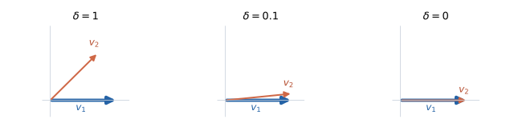

# Exceptional points: why changing the basis fixes propagation

An exceptional point (EP) is a parameter value where eigenvalues coincide **and their eigenvectors no longer provide enough independent directions**. The physical field still has the same number of components. What fails is its representation as a sum of independent eigenmodes.

This page explains the numerical problem, the distinction between an auxiliary x-cutoff and physical grazing, and why a replacement basis must carry a coupled propagation matrix. The appendices expand every step of the coordinate change.

## 1. What exactly becomes dependent?

Consider a small propagation block, with $\tau\ne0$:

$$
Q_\delta=\begin{pmatrix}q_0&\tau\\0&q_0+\delta\end{pmatrix},\qquad
v_1=\begin{pmatrix}1\\0\end{pmatrix},\quad
v_2=\begin{pmatrix}\tau\\\delta\end{pmatrix}.
$$

For $\delta\ne0$, these are eigenvectors with different eigenvalues, $q_0$ and $q_0+\delta$. They span the two-dimensional space. As $\delta$ approaches zero, their directions approach one another. At zero, both lie along the first coordinate axis.

To see why no second eigenvector can be chosen at that point, solve

$$
(Q_0-q_0I)\begin{pmatrix}x\\y\end{pmatrix}
=\begin{pmatrix}\tau y\\0\end{pmatrix}=0.
$$

Since $\tau\ne0$, every eigenvector has $y=0$. There are two copies of the eigenvalue but only one independent eigenvector: algebraic multiplicity two, geometric multiplicity one. This is an EP. If $\tau=0$ as well, $Q_0=q_0I$ and any two independent vectors are eigenvectors; that ordinary degeneracy is not an EP.

Here $\delta$ is an illustrative separation parameter. In a grating calculation, wavelength, angle, material or geometry changes the matrix and can bring it to such a point. A patterned layer does not encounter an EP at every wavelength.

## 2. Why the usual modal calculation loses accuracy

Put the eigenvectors in columns:

$$
V=\begin{pmatrix}1&\tau\\0&\delta\end{pmatrix},\qquad
V^{-1}=\begin{pmatrix}1&-\tau/\delta\\0&1/\delta\end{pmatrix}.
$$

For $\tau=1$, representing the perfectly finite field $F=(0,1)^T$ requires

$$
a=V^{-1}F=\begin{pmatrix}-1/\delta\\1/\delta\end{pmatrix}.
$$

| Separation $\delta$ | First modal coefficient | Second modal coefficient |
| --- | ---: | ---: |
| $10^{-1}$ | $-10$ | $10$ |
| $10^{-4}$ | $-10^4$ | $10^4$ |
| $10^{-8}$ | $-10^8$ | $10^8$ |

The field stays small while its coefficients grow. Reconstructing it subtracts large nearly equal quantities, so small numerical errors can dominate the answer. At $\delta=0$, $V$ is singular and cannot represent arbitrary fields at all. The conditioning of the eigenvector basis is the issue; a small determinant by itself is not a general, scale-independent diagnostic.

## 3. The field remains well defined

Use the propagation convention

$$
\frac{dF}{du}=-QF,\qquad u=k_0z,\qquad k_0=2\pi/\lambda.
$$

Here $z$ measures depth along the layer normal and $u$ is dimensionless depth. At oblique incidence it is not distance along the light ray. $Q$ is a dimensionless decay generator in this illustration; its eigenvalues should not be identified directly with a physical longitudinal wave number without the solver's sign and phase conventions.

At the EP, write $Q_0=q_0I+N$, where

$$
N=\begin{pmatrix}0&\tau\\0&0\end{pmatrix},\qquad N^2=0.
$$

The exponential series therefore stops after its linear term in $N$:

$$
e^{-uQ_0}=e^{-uq_0}(I-uN)
=e^{-uq_0}\begin{pmatrix}1&-u\tau\\0&1\end{pmatrix}.
$$

Nothing diverges. The missing second eigenvector is replaced by a generalized vector $g=(0,1/\tau)^T$, satisfying $(Q_0-q_0I)g=v_1$. Two independent solutions are

$$
e^{-uq_0}v_1,\qquad e^{-uq_0}(g-uv_1).
$$

The second solution contains a polynomial factor in depth. Independent pure exponentials alone cannot describe it.

Near the EP, the upper-right entry of the exponential is

$$
\tau e^{-uq_0}\frac{e^{-u\delta}-1}{\delta}
\ \longrightarrow\ -u\tau e^{-uq_0}.
$$

Its limit is finite. Stable divided differences or a suitable matrix exponential evaluate this limit without dividing a cancellation-damaged numerator by a tiny number.

## 4. What “x-cutoff” means in the 1D conical case

A 1D grating varies along $x$, is invariant along $y$, and is layered along $z$. Conical illumination may still have nonzero $k_y$ even though the structure does not vary with $y$.

The 1D construction first solves auxiliary eigenproblems for the x-pattern. In the code, their eigenvalues are represented by `wA` and `wB`; after including the normalized y component, a family has the relation

$$
q_1^2=w_A+k_y^2,\qquad w_A=q_1^2-k_y^2.
$$

An **auxiliary x-cutoff** means $w_A=0$ (or the analogous $w_B=0$). It does not mean light stops moving in the x direction. For a patterned layer, $w_A$ is an eigenvalue of a matrix coupling Fourier orders, not simply the wave number of one plane wave. The conventional family reconstruction becomes ill conditioned when it divides by this small auxiliary quantity; a patterned layer can have coalescing modes there.

A homogeneous, isotropic medium makes the distinction especially clear. Use dimensional wave numbers $\kappa_x,\kappa_y,\kappa_z$ and refractive index $n$:

$$
\kappa_x^2+\kappa_y^2+\kappa_z^2=n^2k_0^2.
$$

The auxiliary x-only threshold is $\kappa_x^2=n^2k_0^2$. Substituting it into the full equation gives

$$
\kappa_z^2=-\kappa_y^2.
$$

For real, nonzero $\kappa_y$, this has an imaginary, nonzero $\kappa_z$: an evanescent z dependence, not physical grazing. Actual grazing requires $\kappa_z=0$, hence $\kappa_x^2+\kappa_y^2=n^2k_0^2$. The thresholds coincide when $\kappa_y=0$. The homogeneous example explains the threshold distinction; it does not assert that every homogeneous cutoff is a defective EP.

## 5. What the repair changes

The repair detects the relevant near-degenerate modes, constructs an independent regular basis for their subspace, and retains the coupling in its propagation block. Wavelength, angle and material inputs stay at the requested values. This is separate from the grazing policy that may explicitly detune a physical Rayleigh point.

Replacing vectors alone is insufficient. If $F=Bc$, the generator in the new coordinates is

$$
T=B^{-1}QB,\qquad c'=-Tc,\qquad F(u)=B e^{-uT}c(0).
$$

At an EP, $T$ generally contains an off-diagonal coupling. Discarding it would change the field evolution. The same representation must reach layer matching, propagation, internal-field reconstruction and derivatives; changing only the eigensolver output cannot complete the repair.

In a large RCWA problem the regular vectors must span the appropriate invariant modal subspace. Arbitrary independent vectors cannot simply replace a selected pair while leaving every other mode untouched. The small examples below isolate the coordinate algebra from that subspace construction.

## 6. A concrete patterned example and the scope of validation

One regression scene, called PA616 in the numerical records, uses:

| Quantity | Value |
| --- | --- |
| x period / rectangular ridge width / layer thickness | 1000 nm / 400 nm / 300 nm |
| Ridge / void / incidence / substrate relative permittivity | 12.25 / 1 / 1 / 2.1025 |
| Relative permeability | 1 throughout |
| Incidence parameters | $\theta=0.3$, $\phi=\pi/2$, $\psi=\pi/2$ radians |
| Fourier truncation | 5 in x |
| Auxiliary-cutoff wavelength | approximately 616.515732741827 nm |

This wavelength belongs to that truncated numerical model. It is not a universal material constant or a truncation-independent physical prediction.

The implemented work includes the 1D conical path, the 2D path, and the first-order formulation, including patterned double-negative material cases. Existing validation includes genuinely y-varying 2D patterns, not just a 1D grating represented on a 2D grid. That evidence does not cover every possible EP: coincident clusters and traced slot limits have explicit restrictions and warning/failure behavior.

For the measured cases, algorithms and remaining limits, see [Rayleigh points and patterned exceptional points](../../theory/rcwa/rayleigh-points.md), especially sections 7–9. For the surrounding grazing workflow, see [the Rayleigh handling walkthrough](rayleigh-handling-walkthrough.md). Current implementation entry points are `src/wavebit/rcwa/_engine/solve_1d.py`, `src/wavebit/rcwa/_engine/solve_2d.py` and `src/wavebit/rcwa/_engine/solve_2d_first_order.py`.

## Appendix A. Basis vectors, coefficients and the field

Take two fixed independent basis vectors $b_1,b_2$ within a layer. The field changes with depth through its coefficients:

$$
F(u)=c_1(u)b_1+c_2(u)b_2=Bc(u),\qquad
B=\begin{pmatrix}|&|\\b_1&b_2\\|&|\end{pmatrix},\quad
c(u)=\begin{pmatrix}c_1(u)\\c_2(u)\end{pmatrix}.
$$

The notation $b_1,b_2$ names vectors; $c_1(u),c_2(u)$ names their depth-dependent weights. $u$ is a coordinate along the layer normal, not another basis vector. In this derivation $B$ is fixed with respect to $u$.

Each column of $B$ is written in the **original component coordinates**. Consequently $c$ contains the new-basis coordinates, while $Bc$ gives the original components of the same physical field. If

$$
b_1=\begin{pmatrix}b_{11}\\b_{21}\end{pmatrix},\quad
b_2=\begin{pmatrix}b_{12}\\b_{22}\end{pmatrix},
$$

then

$$
Bc=\begin{pmatrix}b_{11}&b_{12}\\b_{21}&b_{22}\end{pmatrix}
\begin{pmatrix}c_1\\c_2\end{pmatrix}
=\begin{pmatrix}b_{11}c_1+b_{12}c_2\\b_{21}c_1+b_{22}c_2\end{pmatrix}=F.
$$

The output consists of sums of original components. It is not a second set of new-basis coefficients.

## Appendix B. A numerical coordinate example

Choose $b_1=(1,1)^T$ and $b_2=(1,-1)^T$. If $c=(2,3)^T$, then

$$
F=2b_1+3b_2
=2\begin{pmatrix}1\\1\end{pmatrix}+3\begin{pmatrix}1\\-1\end{pmatrix}
=\begin{pmatrix}5\\-1\end{pmatrix}.
$$

Thus $(2,3)$ and $(5,-1)$ describe the same field in different bases. The conversion back is

$$
B^{-1}=\frac12\begin{pmatrix}1&1\\1&-1\end{pmatrix},\qquad
B^{-1}\begin{pmatrix}5\\-1\end{pmatrix}=\begin{pmatrix}2\\3\end{pmatrix}.
$$

This is a coordinate example, separate from the EP block below. The vector does not physically rotate because we choose different coordinates for it.

## Appendix C. Deriving the transformed generator step by step

Start with $F'=-QF$ and substitute $F=Bc$. Since $B$ is constant within the layer,

$$
F'=\frac{d(Bc)}{du}=Bc',\qquad Bc'=-QBc.
$$

Multiply **both sides from the left** by $B^{-1}$:

$$
B^{-1}Bc'=-B^{-1}QBc.
$$

On the left, $B^{-1}B=I$, so

$$
c'=-(B^{-1}QB)c=-Tc.
$$

On the right, $Q$ lies between $B^{-1}$ and $B$. They cannot be cancelled across it; matrix multiplication generally does not commute.

Read $Tc=B^{-1}Q(Bc)$ from right to left:

1. $B$ converts new coordinates to original field components.
2. $Q$ acts on those original components.
3. $B^{-1}$ expresses that result in the new coordinates.

The columns of $T$ are therefore the new-basis coordinates of $Qb_1$ and $Qb_2$. If $Qb_2$ contains a contribution along $b_1$, $T$ has a coupling from coefficient 2 into coefficient 1.

If the basis itself varied with $u$, differentiation would also give $B'c$ and the coefficient equation would contain $-B^{-1}B'c$. That is not the fixed-layer basis used here.

## Appendix D. Why a second independent vector is not enough

At an exact EP, take

$$
Q=\begin{pmatrix}2&1\\0&2\end{pmatrix},\qquad
b_1=\begin{pmatrix}1\\0\end{pmatrix},\quad
b_2=\begin{pmatrix}0\\1\end{pmatrix}.
$$

These vectors are independent, so $B=I$ is a valid regular basis. But only $b_1$ is an eigenvector:

$$
Qb_1=2b_1,\qquad Qb_2=b_1+2b_2.
$$

The second vector generates a component along the first. Starting from $F(0)=b_2$, a small step $h$ gives

$$
F(h)=F(0)-hQF(0)+O(h^2)
=-h b_1+(1-2h)b_2+O(h^2).
$$

Calling the vectors independent does not remove this coupling. Expand the full differential equation:

$$
c_1'b_1+c_2'b_2
=-Q(c_1b_1+c_2b_2)
=-(2c_1+c_2)b_1-2c_2b_2.
$$

Because $b_1,b_2$ are independent, their coefficients can be equated separately:

$$
c_1'=-2c_1-c_2,\qquad c_2'=-2c_2.
$$

The $-c_2$ term is exactly the coupling lost by treating both vectors as independent eigenmodes.

## Appendix E. Solving the coupled coefficients

Use $c_1(0)=0$, $c_2(0)=1$. First,

$$
c_2'=-2c_2\quad\Longrightarrow\quad c_2(u)=e^{-2u}.
$$

Insert this into the first equation:

$$
c_1'+2c_1=-e^{-2u}.
$$

Multiply by the integrating factor $e^{2u}$. The left side becomes a product derivative:

$$
\frac{d}{du}\left(e^{2u}c_1\right)=-1.
$$

Integrating from zero to $u$ gives $e^{2u}c_1(u)-c_1(0)=-u$, hence

$$
c_1(u)=-ue^{-2u},\qquad
F(u)=Bc(u)=e^{-2u}\begin{pmatrix}-u\\1\end{pmatrix}.
$$

Equivalently,

$$
e^{-uQ}=e^{-2u}\begin{pmatrix}1&-u\\0&1\end{pmatrix}.
$$

If we replaced the basis but incorrectly propagated both coefficients using only the diagonal entries, we would get $c_1(u)=0$ and miss the entire first field component. The repair preserves the coupling and thereby the original field evolution. It does not create a second ordinary eigenvector at the EP.
