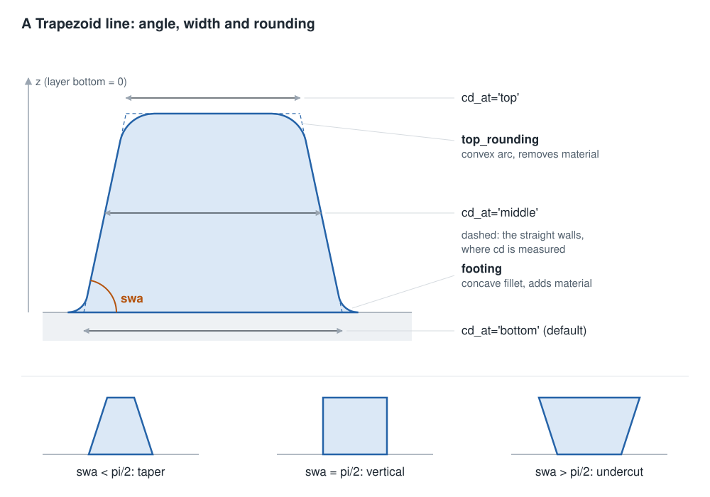
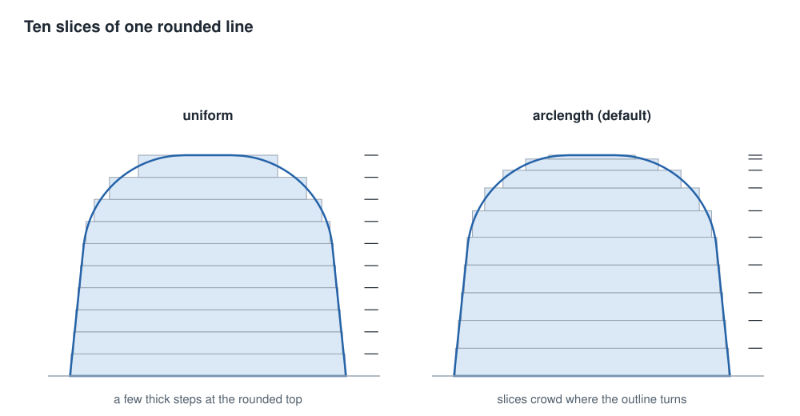

# Profiled layers: sidewall angles, rounding and automatic z slicing

`rcwa.ProfiledLayer` holds a cross-section that changes with height -- a line with a sidewall
angle, rounded top corners and a footing, or a pillar whose outline shrinks toward the top --
and Wavebit cuts it into slices itself. The materials may change with height too: a graded
index, or an interface layer mixing two materials. You declare the shape's parameters; the preparation
chooses the slices, the run reports how many it used and the estimated error of the staircase
in `z`, and every parameter differentiates on PyTorch and JAX.

```python
import math
from wavebit import Material, Units, rcwa

silicon = Material(epsilon=15.2 + 0.16j)
line = rcwa.ProfiledLayer(thickness=0.1, regions=(rcwa.Region(
    geometry=rcwa.Trapezoid(cd=0.045, cd_at='middle', swa=math.radians(86.),
                            top_rounding=0.005, footing=0.003),
    material=silicon),))
problem = rcwa.Problem(
    units=Units(length='um'),
    stack=rcwa.Stack(period=(0.12, 0.12), bottom=silicon, layers=(line,)),
    excitation=rcwa.Excitation(wavelength=0.5, sources=(rcwa.PlaneWave(theta=1.13, polarization='p'),)))
numerics = rcwa.Numerics(orders=(12, 0), factorization='li', slicing=rcwa.Slicing(count='auto', tolerance=1e-4))
result = rcwa.run(problem, numerics=numerics)
report = result.diagnostics['z_slicing'][0]
print(report['count'], report['staircase_error'])
```

[`examples/rcwa/tapered_line_swa.py`](../../../examples/rcwa/tapered_line_swa.py) sweeps the
reflection spectrum of a tapered silicon line over its sidewall angle.

## The shapes

A `ProfiledLayer` takes `thickness`, `background` and `regions` as `rcwa.Layer` does, and its
regions are painted in order, later over earlier. Any region may hold one of three shapes whose
outline depends on the height `z`, measured up from the layer's bottom face in the problem's
length unit. Ordinary shapes (`Rectangle`, `Circle`, ...) may sit beside them and are the same
at every height.

| Shape | Describes | Each slice becomes |
| --- | --- | --- |
| `rcwa.Trapezoid(cd, swa, top_rounding, footing, center, cd_at)` | a line invariant along `y`, spanning the cell in `y`, with this `x`-`z` cross-section | a `Rectangle` of the slice's width: closed form, no lateral staircase |
| `rcwa.Loft(bottom, top)` | an outline whose vertices move linearly from `bottom` (at `z = 0`) to `top` (at `z = thickness`), matched in order | a `Polygon` on the painting route |
| `rcwa.Profile(section)` | any outline: `section(z)` returns its vertices, the same number at every height | a `Polygon` on the painting route |

The slices are internal. Results and layer indices refer to the one public layer, and a
`ProfiledLayer` and an ordinary `Layer` may be stacked freely. `result.field(z=...)` takes
heights in the stack as usual; given an integer count instead of heights, it samples each slice
as it samples a layer, so the faces between slices appear in its `z`. Where
two layers' lines are offset laterally -- an overlay error -- give each its own `center`: lateral
positions are absolute, from the cell centre, in every layer.

## The sidewall angle and the rounding



| Quantity | Convention |
| --- | --- |
| `swa` | the angle between the base and the sidewall, measured **inside the material**, in **radians** (as `Rectangle.angle`): `math.radians(86.)` |
| `swa = pi/2` | a vertical wall |
| `swa < pi/2` | the line narrows upward: an ordinary taper |
| `swa > pi/2` | the line widens upward: an undercut (re-entrant) wall |
| `swa=(left, right)` | each wall its own angle; one number means both |
| `cd` | the width, on the straight walls before any rounding, at the height `cd_at` names |
| `cd_at` | `'bottom'` (the default), `'middle'` or `'top'` of the layer. A fit usually takes `'middle'`, whose width moves least with the angle |
| `center` | the `x` of that width's midpoint, from the cell centre |
| `top_rounding` | the radius of the convex arc that replaces each top corner; it removes material |
| `footing` | the radius of the concave fillet between each wall and the base; it adds material |

Each arc is tangent to both faces it joins, so the width at any height is a continuously
differentiable function of every parameter: a derivative does not jump where a slice crosses
from a straight wall onto an arc. Internally a wall is offset by `(z - z_cd)·tan(pi/2 - swa)`,
which is exactly zero at `swa = pi/2`: a vertical, unrounded Trapezoid is the same structure, to
the bit, as a `Rectangle(size=(cd, Ly))` layer.

A shape that does not fit its layer is refused with `shape.profile` when the problem is
prepared: walls that meet inside the layer, a rounding wider than the top, a rounding and a
footing that together climb higher than the wall, or a line that reaches its own periodic
image. A `Trapezoid` needs the cell as `Stack(period=...)` (`shape.profile_cell` otherwise).

## How the layer is sliced

`rcwa.Numerics(slicing=rcwa.Slicing(...))` controls every profiled layer of the stack.

| Field | Default | Meaning |
| --- | --- | --- |
| `count` | `'auto'` | slices per profiled layer, or `'auto'`: start at `min_count` and double until the estimated staircase error is at most `tolerance`, or `max_count` is reached |
| `rule` | `'arclength'` | where the slice boundaries go: equal steps of the sidewall's arc length in the `x`-`z` plane, or `'uniform'` thicknesses |
| `tolerance` | `1e-4` | the largest estimated change of any efficiency still to come from finer slicing |
| `min_count`, `max_count` | `4`, `64` | the first and largest counts `'auto'` tries |
| `estimate` | `'prepare'` | when the error is estimated: `'prepare'`, `'run'` (every run, by also solving with half the slices, about 1.5 times the cost) or `None` |

Each slice takes the cross-section at its **midpoint** height. The midpoint rule's staircase
error falls as `N**-2` for a smooth profile, which is what the error estimate assumes and what
was measured (below). A rounded corner breaks smoothness where the arc turns horizontal: cut
uniformly, the order falls toward 1.4, and cut at equal arc length -- the default -- it stays at
2, because the slices crowd where the outline moves fastest.



**The boundaries are fixed when the problem is prepared**, as fractions of the layer's
thickness. A run moves only the thickness and the slice widths, so a sidewall-angle, rounding or
height derivative is the derivative of one fixed staircase and smooth in every parameter. A
fresh `rcwa.run` at another design plans its own boundaries; to compare designs on one
staircase -- or to take a finite difference -- run them through one `rcwa.prepare`.

### Choosing the count

- **Let `'auto'` choose** for a single design or a short sweep. It solves the stack at 4, 8,
  16, ... slices until the [Richardson](https://doi.org/10.1098/rsta.1911.0009) estimate
  `max|R_N - R_N/2| / (2**p - 1)` is below `tolerance` (`p` is the observed order from the last
  three counts, and never more than 2). Preparation costs the sum of those solves.
- **Fix `count` for a fit or an optimization**: run `'auto'` once at a representative design,
  read `report['count']`, and prepare with `Slicing(count=N)`. Every iteration then solves one
  staircase, and its derivative is that staircase's.
- **Ask for `estimate='run'`** when the design moves far from where the count was chosen, to
  see the estimate follow it.
- **`'uniform'`** is for comparing with another code's uniform staircase; it converges more
  slowly on rounded profiles.

If `max_count` is reached first, the run uses the last count, emits
`rcwa.diagnostics.SlicingWarning` and records `z_slicing_converged` as false in
`result.validity.checks`.

### What the run reports

`result.diagnostics['z_slicing']` has one entry per public layer: `None` for an ordinary layer,
and for a profiled one a mapping of

| Key | Value |
| --- | --- |
| `count` | slices solved in this run (1 when the layer was solved whole, below) |
| `planned_count` | the count the preparation chose |
| `rule`, `fractions` | the rule and the slice boundaries, as fractions of the thickness |
| `merged` | whether the layer was solved as one layer |
| `staircase_error` | the estimated staircase error of the efficiencies; `0.0` when every profiled layer was solved whole |
| `observed_order`, `order_used` | the convergence order seen over the last three counts, and the one the estimate used |
| `levels`, `converged`, `tolerance` | the counts `'auto'` solved and whether it met `tolerance` |
| `source` | `'prepare'`, `'run'` or `'merged'`: where the estimate came from |

The estimate is for the whole stack, since every profiled layer is refined together; each
profiled layer's entry carries the same number.

### A layer that does not change with height

When every slice of a profiled layer would be the same -- a vertical, unrounded `Trapezoid`, a
`Loft` whose outlines are equal -- the layer is solved as one ordinary layer, identical to the
bit to writing it that way. That holds only while no geometry value carries a derivative. A
sidewall angle that is a JAX tracer or a tensor with `requires_grad` keeps the layer sliced, so
that the derivative at `swa = pi/2` sees the taper it would make; the value then agrees with the
single layer to round-off (1e-12 is tested).

## Materials that change with height

The background of a `ProfiledLayer`, and the material of any of its regions, may be an
`rcwa.Graded`: a callable that returns a material model at a height. Each slice takes the
material at its midpoint, as it takes the cross-section there.

```python
from wavebit.materials import Bruggeman

silicon, oxide, air = Material(epsilon=15.2 + 0.16j), Material(epsilon=2.1025), Material(epsilon=1.0)

# A graded-index film: eps rises linearly from 2.25 at the bottom to 4.0 at the top.
graded = rcwa.ProfiledLayer(thickness=0.3, background=rcwa.Graded(
    material=lambda u: Material(epsilon=2.25 + 1.75*u), relative=True))

# An interface layer: oxide mixing into silicon, linearly, as a Bruggeman effective medium.
interface = rcwa.ProfiledLayer(thickness=0.003, background=rcwa.Graded.interface(below=silicon, above=oxide))

# Surface roughness: one uniform layer of silicon and 50% void. It needs no slicing.
roughness = rcwa.Layer(thickness=0.002, background=Bruggeman(host=silicon, inclusion=air, fraction=0.5))
```

| Declaration | What it is |
| --- | --- |
| `rcwa.Graded(material, relative=False)` | `material(z)` returns a material model at the height `z` above the layer's bottom face; with `relative=True`, `material(u)` at `u = z / thickness` in `[0, 1]`, so the grading keeps its shape when the thickness changes |
| `rcwa.Graded.interface(below, above, fraction=None)` | a mixed layer: `above` at volume fraction `fraction(u)` in `below`, as a Bruggeman medium; `fraction` defaults to `u`, a linear ramp from `below` at the bottom to `above` at the top |
| `wavebit.materials.Bruggeman(host, inclusion, fraction)` | the two-phase Bruggeman effective medium, a material model like any other; see [materials](../common/materials.md#effective-media) |

A grading is sliced uniformly: the midpoint staircase of a smooth permittivity profile converges
at second order without moving the boundaries, as the measurements show. The arc-length rule
still places the slices of a layer whose outline moves. A grading that returns the same material
at every height is solved as one layer, as a height-independent outline is.

`thickness`, the `fraction` of a `Bruggeman` mixture and every parameter a grading closes over
differentiate on PyTorch and JAX. A `Graded` material belongs in a `ProfiledLayer` only: in an
ordinary `Layer` it is refused with `layer.profile_material`, and as a half-space with
`stack.graded_half_space`. A problem holding one cannot be saved as a job, since a callable has
no portable form; a `Bruggeman` mixture can.

## Why the region path, and not a raster

Every slice is built from regions: a line's slices are `Rectangle`s on the closed-form route,
a `Loft`'s and a `Profile`'s are `Polygon`s on the painting route of
[boundary modeling](boundary-modeling.md). A sampled (raster) layer quantizes each width to
pixels, so the width would move in steps as the sidewall angle changes: the reflectance would be
a staircase in the angle and its derivative zero between steps. A stack holding a raster layer
therefore refuses a `ProfiledLayer` with `layer.profile_raster`, and a profile shape in an
ordinary `Layer` is refused with `layer.profile_geometry`.

## Factorization and cost

A `Trapezoid`'s slices are full-height rectangles, whose interfaces are all normal to `x`.
`factorization='li'` is exact for them and costs about 12 ms a slice at 31 orders on one CPU
core, on NumPy and PyTorch alike; the default NVF reaches the same answer (to 1e-14) but builds
a normal field per slice, about 1.3 s each. Prefer `'li'` for lines. A `Loft` or a `Profile`
takes the factorizations a `Polygon` takes: not `'li'`.

Each slice is one more layer to solve, and on JAX that is where the cost is:

- **Eager JAX** costs about 170 ms a slice once warm. The first run in a process is slower,
  while JAX compiles each operation it meets for the first time.
- **`jax.jit` with the default exceptional-point handling** compiles in about 30 s per slice and
  runs a value and its gradient in about 0.5 s per slice, with 0.6 to 1 GB of memory each:
  under a trace the handling cannot branch on values, so it carries every layer's rebuild.
- **`jax.jit` with `rcwa.Numerics(exceptional_points='off')`** compiled four slices in 6 s and
  ran a value and its gradient in 72 ms, in 0.5 GB. That setting skips the handling, so at and
  near an exceptional point the answer can be wrong with no warning
  ([exceptional points](exceptional-points.md)). For a fit or an optimization under `jax.jit`,
  run the design eagerly first at a few representative points; if no
  `rcwa.diagnostics.ExceptionalPointWarning` appears, `'off'` is the fast choice.

These costs are the same for hand-written layers; they are not the slicing's. See the
[measurements](../../validation/rcwa/profiled-layers.md#cost).

## Derivatives

Every number in a profile shape differentiates as region geometry does
([autodiff guide](../common/autodiff.md)): `cd`, `swa`, `top_rounding`, `footing`, `center` and
the layer `thickness` on PyTorch and under eager `jax.grad`; a `Trapezoid`'s slices are
axis-aligned rectangles, so under `factorization='li'` they also run under `jax.jit`. A `Loft`'s
vertices differentiate as a `Polygon`'s. On one rounded profile, automatic derivatives with
respect to each of these matched central differences on the same preparation to within 4e-9
relative ([measurements](../../validation/rcwa/profiled-layers.md)).

A `Profile`'s `section` is called with the slice's midpoint height, which is a traced value when
the thickness is; write it with operations of the backend it runs on. A problem holding a
`Profile` cannot be saved as a job, since a callable has no portable form; `Trapezoid` and
`Loft` problems can.

## What is not here

- Effective media other than the two-phase, spherical-inclusion Bruggeman rule (Maxwell
  Garnett, more phases, shaped inclusions) and anisotropic or magnetic mixtures.
- There is no continuous-`z` formulation; the layer is always a staircase, with its error
  reported.
- 3D CAD, STEP, STL and GDS input are not read.

## References

- L. F. Richardson, *The approximate arithmetical solution by finite differences of physical
  problems involving differential equations*, Phil. Trans. R. Soc. A **210**, 307-357 (1911).
  [doi:10.1098/rsta.1911.0009](https://doi.org/10.1098/rsta.1911.0009) -- the error estimate.
- E. Popov, M. Nevière, B. Gralak and G. Tayeb, *Staircase approximation validity for
  arbitrary-shaped gratings*, J. Opt. Soc. Am. A **19**, 33-42 (2002).
  [doi:10.1364/JOSAA.19.000033](https://doi.org/10.1364/JOSAA.19.000033) -- how a staircase
  converges, and where it does not.
- D. A. G. Bruggeman, *Berechnung verschiedener physikalischer Konstanten von heterogenen
  Substanzen*, Ann. Phys. **416**, 636-664 (1935).
  [doi:10.1002/andp.19354160705](https://doi.org/10.1002/andp.19354160705) -- the mixing rule.
- D. E. Aspnes, J. B. Theeten and F. Hottier, *Investigation of effective-medium models of
  microscopic surface roughness by spectroscopic ellipsometry*, Phys. Rev. B **20**, 3292 (1979).
  [doi:10.1103/PhysRevB.20.3292](https://doi.org/10.1103/PhysRevB.20.3292) -- roughness as a
  Bruggeman layer.
- J. P. Hugonin and P. Lalanne, *RETICOLO software for grating analysis*,
  [arXiv:2101.00901](https://arxiv.org/abs/2101.00901) -- the external reference the slicing is
  checked against.
