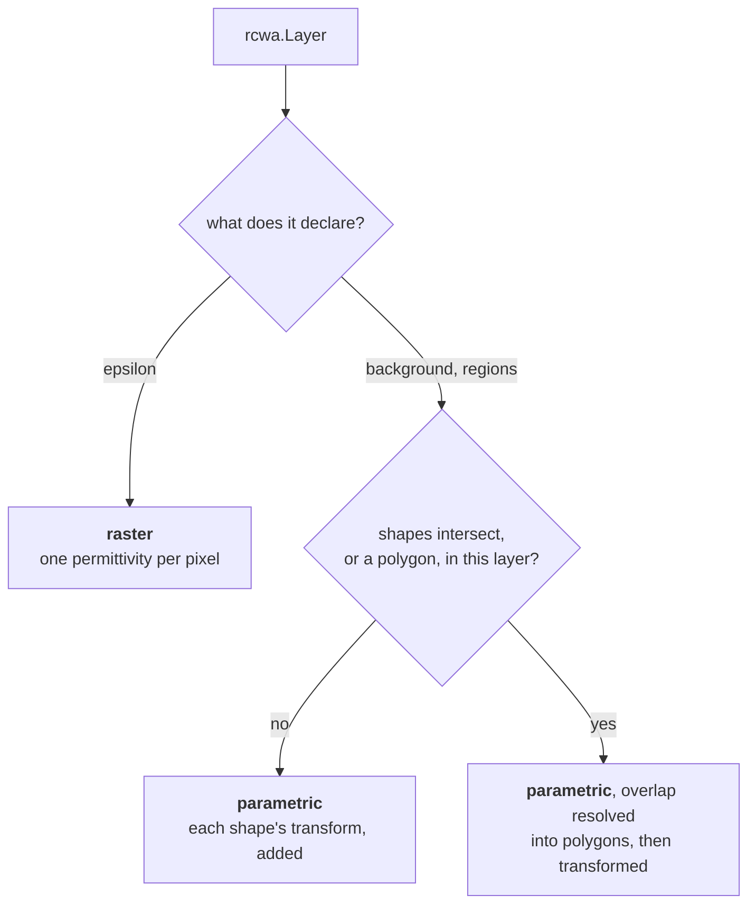

# Declaring an RCWA stack

Use `rcwa.Problem(stack=..., excitation=..., outputs=..., units=...)`. A `rcwa.Stack` contains bottom-to-top `Layer` declarations and physical `top`/`bottom` half-spaces. Each analytic layer has a `background` material and an ordered tuple of `Region` declarations; later regions paint over earlier ones.

```python
from wavebit import Material, rcwa
layer = rcwa.Layer(
    thickness=.18, background=Material(epsilon=1.),
    regions=(rcwa.Region(geometry=rcwa.Circle(radius=.12),
                         material=Material(epsilon=12.25)),))
stack = rcwa.Stack(period=(.6, .6), layers=(layer,),
                   top=Material(epsilon=1.), bottom=Material(epsilon=2.25))
```

Lengths use the enclosing problem's `Units`. `Circle` takes a radius, `Ellipse` principal radii, and `Rectangle` full widths. Shape rotations are radians. `Polygon` takes its `vertices`: `(x, y)` pairs measured from the centre of the cell, in order around the boundary, either way round. The outline must be simple, without crossing or touching itself, and enclose an area. It may reach past the cell edge, but not into a periodic copy of itself or of another region. A raster layer instead takes sampled `epsilon` and optional `mu`; it cannot simultaneously declare a background and analytic regions. A rectangular cell uses `period=(Lx,Ly)`; an oblique cell uses `lattice`, with lattice vectors as columns. Do not provide both.

The [complete quickstart](../../getting-started/rcwa.md) connects this geometry to sources and execution.

What the stack is made of and what cell it repeats in. The declarations themselves, with their
fields and defaults, are in the [RCWA API reference](../../reference/rcwa/index.md); this page is
what they mean and how they are chosen between.

## Materials are relative permittivity

`wavebit.Material(epsilon, mu=None)` -- **relative** permittivity and the permeability that goes
with it, because a medium has both. Every material slot of `rcwa.Stack`, `rcwa.Layer` and
`rcwa.Region` takes a material model; a bare number is refused there (code `material.type`)
rather than read as the `Material(epsilon=x)` the earlier interface took it for. Non-magnetic is
the overwhelming default and costs nothing to write.

```python
from wavebit import Material, eps_from_refractive_index, refractive_index_from_eps

Material(12.25)                   # a dielectric, n = 3.5, non-magnetic
Material(-12.2475 + 0.35j)        # a metal, n = 0.05 + 3.5j; Im(eps) > 0 is loss
Material(4.0, mu=1.5)             # magnetic
eps_from_refractive_index(3.5)    # 12.25 -- the conversion for a datasheet index
refractive_index_from_eps(12.25)  # (3.5+0j) -- and back, on the passive root
```

The values are **permittivity, not refractive index**, and that is the one thing to carry over
from older scripts. An index cannot hold the pair -- `mu` was always taken raw, so a single
material spelled as an index would mean "index" for one of its two numbers and "permeability"
for the other. It is also the direction with no branch cut in it: `eps = n**2` is unambiguous
where `n = sqrt(eps)` is a choice, and `refractive_index_from_eps` is that choice made explicitly,
taking the passive root (`Im(n) >= 0`).

`Material` is frozen and a registered JAX pytree whose children are `(epsilon, mu)`, so a
material is a design variable like any other -- `jax.grad` reaches inside it.

For wavelength-dependent materials, assign `wavebit.materials.catalog.load(name)`. RCWA then evaluates the table at each solve wavelength. See
[Materials and wavelength sweeps](../common/materials.md) for constants, tables and raster inputs.

## The stack
What a `Layer` declares selects the modeling path; there is no separate mode switch. There are
two: sampled `epsilon` is the raster path, a `background` with `regions` the parametric one, and
one stack holds layers of one kind (a mixture is refused, code `rcwa.mixed_layer_encoding`). What
an overlap does is a property of the parametric path rather than a path of its own — decided per
layer, not per stack, so one stack can hold parametric layers of both kinds.



Nothing selects between the last two: the geometry does, per layer, and a layer pays for the
question only when its own shapes raise it.

Shapes in a layer **paint**: a later shape covers an earlier one. While no two intersect, each
shape's Fourier transform is simply added, which is exact and cheap because with nothing
overlapping the sum *is* the painting; where they do intersect, the overlap is resolved into
disjoint polygons first, so a layer can be painted *and* keep a tilted edge exact. Nothing has
to be said either way.

On the parametric path a shape's sizes -- a `Rectangle`'s full widths `size`, a `Circle`'s
`radius`, an `Ellipse`'s `radii` -- are absolute lengths in the problem's `Units`, the units of
`period` — **not fractions of it** — and `center` is measured from the centre of the cell, so a
centred shape is `center=(0., 0.)`, which is also what omitting it means. (The earlier
interface's shape dictionaries spelled these `lx` / `ly` and `cx` / `cy`, with `lx` a circle's
diameter.)

```python
layer = rcwa.Layer(thickness=100., background=Material(epsilon=1.), regions=(
    rcwa.Region(geometry=rcwa.Circle(radius=100., center=(0., 0.)),
                material=Material(epsilon=12.25)),))
```

A polygon is `rcwa.Polygon(vertices=...)`, its vertices in the same frame as `center`. It takes
no `center`, size or `angle`: the vertices place, size and turn it, and a field beside them would
be dropped, so it is refused (`TypeError`). A layer holding a polygon is always resolved into
disjoint polygons, whatever it overlaps -- the closed-form transforms are written per primitive.
Its periodic images are judged on the outline: it may reach past the cell edge, but not into a
periodic copy of itself or of another region.

A shape wider than the period is refused: its transform is a single sinc, which is not the
transform of any periodic indicator, so the layer would not be the structure its parameters
name — and it would otherwise solve and conserve energy. Sample it onto a raster instead. A
negative length is refused for the same reason it used to be dangerous: it *subtracted* the
shape. Both are refused when the problem is prepared (`ValidationError`, code `rcwa.invalid`)
and when a prepared calculation is run on one (code `prepared.topology`); `rcwa.check` does not
run these two checks yet.

See [`../parametric-modeling.md`](parametric-modeling.md) and
[`../boundary-modeling.md`](boundary-modeling.md).

## The cell
`rcwa.Stack` takes the cell as `period` or `lattice`. Naming it twice is refused rather than
resolved; naming it not at all is not refused yet:

* **Both** `period` and `lattice` raises (`ValidationError`, code `stack.cell_ambiguous`). They
  are two spellings of one cell — on a skewed one `period` is `(|a1|, |a2|)` with the angle
  already gone, so the two cannot both be honoured.
* **Neither** falls back to `period=(1., 1.)` in the problem's length unit. The earlier interface
  refused this while a structure was given: `(1., 1.)` is the normalized-units cell, not a guess
  at yours, and a raster carries no length that would let anything downstream notice the
  omission. `rcwa.Stack` does not refuse it yet, so name the cell.

Four constructors sit on the type, and `rcwa.Stack(lattice=...)` takes what they return:

```python
import numpy as np
import wavebit

wavebit.Lattice.hexagonal(400.)                       # 120-degree rhombus, the crystallographic setting
wavebit.Lattice.hexagonal(400., np.radians(60))       # the 60-degree alternative basis
wavebit.Lattice.oblique(400., 520., np.radians(105))  # angle BETWEEN a1 and a2, in radians
wavebit.Lattice.rectangular(700., 1100.)              # diag(700, 1100) as an object
wavebit.Lattice.from_columns(np.column_stack((a1, a2)))
```

They store no angle, so building one *inside* a differentiated function makes the cell's shape
a design variable — through `prepared.run` that is a PyTorch or an eager `jax.grad` derivative;
a cell traced under `jax.jit` is refused (code `prepared.host_topology`); see
[`autodiff.md`](../common/autodiff.md).

**The raster is read in lattice coordinates.** A raster layer's `epsilon[j, i]` is the
permittivity at `u = (i + 0.5)/Nx`, `v = (j + 0.5)/Ny`, which — the cell being centred on the
origin — is `r = (u - 0.5) * a1 + (v - 0.5) * a2`. Building a raster on a Cartesian grid and
passing a tilted basis therefore describes a *different structure*, silently, with energy still
conserved to 1e-15. `meshgrid_xy` exists so you need not write either form:

```python
A = wavebit.Lattice.hexagonal(400.)
X, Y = A.meshgrid_xy((256, 256))      # == wavebit.lattice.meshgrid_xy((256, 256), lattice=A)
layer = rcwa.Layer(thickness=100., epsilon=np.where(X ** 2 + Y ** 2 < 90. ** 2, 12.25, 1.))
stack = rcwa.Stack(lattice=A, layers=(layer,))
```

`A.meshgrid_uv(...)` gives the same points as lattice coordinates instead, which is the frame
the raster is actually read in. On the earlier interface `A.drawn(array)` declares that an array
was drawn on *this* cell, so that solving it on another is refused rather than answered;
`rcwa.Layer(epsilon=...)` does not take that declaration yet (it is refused as `rcwa.invalid`,
"must be real number, not DrawnOn"), so through the current interface that check is yours.

Write it as `A.meshgrid_xy(...)` and pass the same `A` to `rcwa.Stack(lattice=...)`. The cell
is needed in **two** places — to place the pixels and to solve them — and a raster drawn on one
cell and solved on another is a different structure with nothing to say so. **Change the cell
and redraw the array.** Parametric shapes are immune, their lengths being absolute Cartesian
quantities.

One build is refused on a skewed cell rather than answering, because it runs and returns a
plausible wrong number: `factorization='li'` on a raster, whose inverse rule follows the raster
axes, which are `a1` / `a2` once skewed. Li is the raster default, so a skewed raster names
`rcwa.Numerics(factorization='nvf')`.

See [`../oblique-lattice.md`](../../theory/rcwa/oblique-lattice.md) and
[`tutorial 05`](https://github.com/fieldalgo/wavebit/blob/main/tutorials/rcwa/05-oblique-lattice.ipynb).

## Inspecting a structure without solving

`rcwa.sample_structure` reads a physical problem directly. It returns an owned
complex NumPy array, with rows along y and columns along x. For an existing
`problem`, inspect relative constitutive values with:

```python
epsilon = rcwa.sample_structure(problem, layer=0, n=192)
mu = rcwa.sample_structure(problem, layer=0, n=192, quantity='mu')
```

No `prepare` or `run` is needed, and no scattering or Fourier operator is
computed. `layer=0` is the bottom finite layer. Region samples are cell-centred
along the two lattice vectors; sampled layers keep their native resolution.
Use `wavelength_index` for a spectrum: material tables are evaluated in the
problem's explicit length unit. Tensor material pictures require a component,
for example `component='xy'`; scalar pictures do not take a component. Values
are relative epsilon or mu, not refractive index or a band-limited Fourier image.

Run inspection outside autodiff transforms. Later regions paint over earlier
ones through the same renderer used by the engine. Its curved-painting
approximation, limited periodic-image sampling and refusal of painted skewed
cells still apply. A selected layer can be pictured independently, including
inside a mixed-encoding stack, without certifying that the whole problem is
accepted by `rcwa.check` or optically converged.

## Passing the scene as objects
The scene is typed objects and nothing else: `rcwa.Stack` carries what the earlier interface's
`Stack` did, `rcwa.Excitation` and its sources what `Incidence` did, and a `Job` holding them is
what [`specs.md`](../common/specs.md) serializes:

```python
from wavebit import Material, Units, rcwa

problem = rcwa.Problem(
    units=Units(length='nm'),
    stack=rcwa.Stack(layers=(rcwa.Layer(thickness=300., epsilon=raster),),
                     top=Material(epsilon=1.), bottom=Material(epsilon=2.25),
                     period=(700., 700.)),
    excitation=rcwa.Excitation(wavelength=900., sources=(
        rcwa.PlaneWave(side='top', polarization='s', theta=0., phi=0.),)))
result = rcwa.run(problem, numerics=rcwa.Numerics(orders=(10, 0)))
```

Each value has one place, so there is no second spelling for it to collide with: the cell,
the half-spaces and the layers in `Stack`, the wavelength in `Excitation`, direction and
polarization in the source, truncation in `Numerics`. The earlier `tetm='te'` is
`polarization='s'` at `phi=0.` here.
