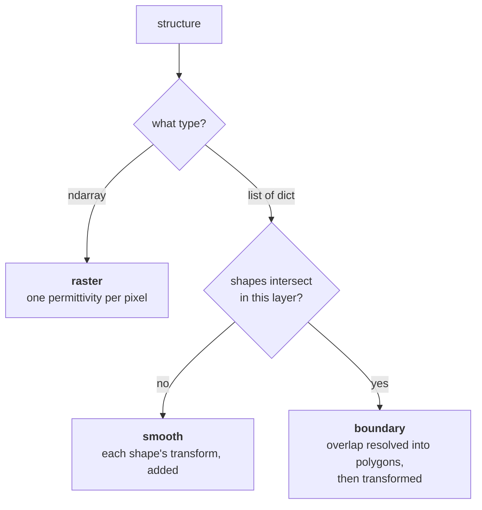

# The scene, keyword by keyword

Every keyword `wavebit.rcwa()` takes, what it accepts, and what it defaults to. Grouped by the
question it answers rather than by the constructor's order, which is chronological.

Two rules cover the whole surface and are worth stating once:

* **An unknown keyword is refused, not swallowed.** `rcwa(thicknes=300.)` raises and names the
  nearest real keyword. So does assignment after construction — `solver.thicknes = 300.` is a
  refusal, not a new attribute.
* **A retired spelling is refused by name**, with the refusal saying that the *quantity* moved
  too. `ucell`, `n_top`, `n_bot`, `n_base` and `n_index` all held a refractive index; the
  fields that replaced them hold a relative permittivity, and `3.5` reread as a permittivity is
  a legal, energy-conserving, different medium.

## The light

| Keyword | Default | What it takes |
| --- | --- | --- |
| `wavelength` | `1.` | free-space wavelength, in whatever unit `period` and `thickness` share |
| `theta` | `0.` | polar angle from the normal, radians. May be complex — evanescent incidence, float64 only |
| `phi` | `None` | azimuth of the plane of incidence, radians. `None` is "not named", which the pure 1D path requires |
| `tetm` | `None` | `'te'` / `'tm'`. A **declaration** that polarization and azimuth are not degrees of freedom here; 1D structures only, and it is what buys the pure TE/TM formulation |
| `psi` | `pi/2` (s/TE) | polarization angle, radians. `pi/2` is s/TE, `0` is p/TM |
| `chi` | `None` | ellipticity angle. With `psi` it is the canonical chart of any state: `0` linear, `±pi/4` circular |
| `polarization` | `None` | the Jones pair `(a_s, a_p)` itself, complex. The only spelling that carries an overall phase; magnitude is normalized away |
| `excitation` | `None` | which diffraction *orders* the light arrives on: `{0: 1.0, 1: 0.6-0.8j}` on 1D, `{(m, n): amp}` on 2D. `None` is one plane wave on the specular order |
| `incidence_side` | `'top'` | `'top'` / `'bottom'` — which half-space the light arrives from. Scene labels never move; results are incidence-relative, and `theta` / `phi` are measured in the incidence medium |

`tetm`, `psi`/`chi` and `polarization` are three *kinds* of thing, not three spellings of one.
Naming `tetm` with either of the others raises, and so does `psi` with `polarization`. Which to
reach for is usually decided by what you are doing: `(psi, chi)` is two real numbers with
nothing redundant in them, so a gradient over the polarization state is an ordinary 2D problem,
where the pair spends two of its four real numbers on directions that cannot change any power.

Every order named in `excitation` has to propagate in the incidence medium. One past the light
line would drive the structure while contributing nothing to the incident flux every efficiency
is divided by, so `R + T` would exceed one on a passive stack; asking for one is refused by
name. That also caps how many beams can be combined, at roughly `2 * period / wavelength`.

See [`../conventions.md`](../conventions.md) for the normative statement,
[`../multimode-incidence.md`](../multimode-incidence.md) for `excitation`, and tutorials
[`06`](https://github.com/fieldalgo/wavebit/blob/develop/tutorials/06-polarization-pair.ipynb) and
[`07`](https://github.com/fieldalgo/wavebit/blob/develop/tutorials/07-multimode-incidence.ipynb).

## The stack

| Keyword | Default | What it takes |
| --- | --- | --- |
| `structure` | `None` | the layers. An `ndarray` of shape `(n_layers, Ny, Nx)` is a **raster** of relative permittivity; a `list` of `dict(background=..., shapes=[...])` is the **smooth** path |
| `thickness` | `(0.,)` | one length per layer, same unit as `period` |
| `top` | `1.` | superstrate material — a `Material`, or a bare relative permittivity |
| `bot` | `1.` | substrate, read the same way |
| `mu` | `None` | **raster path only**: the permeability field, `(n_layers, Ny, Nx)`, beside `structure`. On the shape paths a permeability belongs to each `Material`, so naming it here is refused |

The type of `structure` selects the modeling path; there is no separate mode switch. A third
path, **boundary**, is what a smooth layer becomes when its shapes actually overlap — decided
per layer, not per solver, so one `structure` can hold layers of both kinds.



Nothing selects between the last two: the geometry does, per layer, and a layer pays for the
question only when its own shapes raise it.

Shapes in a layer **paint**: a later shape covers an earlier one. While no two intersect, each
shape's Fourier transform is simply added, which is exact and cheap because with nothing
overlapping the sum *is* the painting; where they do intersect, the overlap is resolved into
disjoint polygons first, so a layer can be painted *and* keep a tilted edge exact. Nothing has
to be said either way.

On the smooth path `lx` / `ly` are absolute lengths in `period`'s units — **not fractions of
it** — and `cx` / `cy` are measured from the centre of the cell, so a centred shape is
`cx = cy = 0`, which is also what omitting them means:

```python
structure = [dict(background=1.0, shapes=[
    dict(type='circle', cx=0., cy=0., lx=200., material=wavebit.eps_from_index(3.5)),
])]
```

A shape wider than the period is refused: its transform is a single sinc, which is not the
transform of any periodic indicator, so the layer would not be the structure its parameters
name — and it would otherwise solve and conserve energy. Sample it onto a raster instead. A
negative length is refused for the same reason it used to be dangerous: it *subtracted* the
shape.

See [`../analytic-modeling.md`](../analytic-modeling.md) and
[`../boundary-modeling.md`](../boundary-modeling.md).

## The cell

| Keyword | Default | What it takes |
| --- | --- | --- |
| `period` | unset | `(Lx, Ly)`, a list or `dict(x=..., y=...)`. The axis-aligned **spelling** of a cell |
| `lattice` | `None` | the two primitive vectors as the columns of a `(2, 2)`, or a `Lattice` object. The only spelling that can describe a non-rectangular cell |

Two ways of naming the cell wrongly are refused rather than resolved:

* **Both** `period` and `lattice` raises. They are two spellings of one cell — on a skewed one
  `period` is `(|a1|, |a2|)` with the angle already gone, so the two cannot both be honoured.
* **Neither**, while giving a structure, raises too. `period=(1., 1.)` is the normalized-units
  cell, not a guess at yours, and a raster carries no length that would let anything downstream
  notice the omission.

Four constructors sit on the type, and `lattice=` takes what they return:

```python
wavebit.Lattice.hexagonal(400.)                       # 120-degree rhombus, the crystallographic setting
wavebit.Lattice.hexagonal(400., np.radians(60))       # the 60-degree alternative basis
wavebit.Lattice.oblique(400., 520., np.radians(105))  # angle BETWEEN a1 and a2, in radians
wavebit.Lattice.rectangular(700., 1100.)              # diag(700, 1100) as an object
wavebit.Lattice.from_columns(np.column_stack((a1, a2)))
```

They store no angle, so building one *inside* a differentiated function makes the cell's shape
a design variable — see [`autodiff.md`](autodiff.md).

**The raster is read in lattice coordinates.** `structure[layer][j, i]` is the permittivity at
`u = (i + 0.5)/Nx`, `v = (j + 0.5)/Ny`, which — the cell being centred on the origin — is
`r = (u - 0.5) * a1 + (v - 0.5) * a2`. Building a raster on a Cartesian grid and passing a
tilted basis therefore describes a *different structure*, silently, with energy still conserved
to 1e-15. `wavebit.grid` exists so you need not write either form:

```python
A = wavebit.Lattice.hexagonal(400.)
X, Y = A.grid((256, 256))                       # == wavebit.grid((256, 256), lattice=A)
layer = np.where(X ** 2 + Y ** 2 < 90. ** 2, 12.25, 1.)
```

Write it as `A.grid(...)` and pass the same `A` to `lattice=`. The cell is needed in **two**
places — to place the pixels and to solve them — and a raster drawn on one cell and solved on
another is a different structure with nothing to say so. **Change the cell and redraw the
array.** Analytic shapes are immune, their lengths being absolute Cartesian quantities.

One build is refused on a skewed cell rather than answering, because it runs and returns a
plausible wrong number: `factorization='li'` on a raster, whose inverse rule follows the raster
axes, which are `a1` / `a2` once skewed.

See [`../oblique-lattice.md`](../oblique-lattice.md) and
[`tutorial 05`](https://github.com/fieldalgo/wavebit/blob/develop/tutorials/05-oblique-lattice.ipynb).

## The numerics

| Keyword | Default | What it takes |
| --- | --- | --- |
| `truncation_order` | `(0, 0)` | retained Fourier orders per axis. A pair, `dict(x=..., y=...)` or `dict(u=..., v=...)` |
| `backend` | `0` | `0` NumPy, `1` JAX, `2` PyTorch — see [`backends.md`](backends.md) |
| `device` | `0` | `0`/`'cpu'`, `1`/`'gpu'`/`'cuda'`, or the backend's own device object |
| `complex_dtype` | `0` (double) | `0` double, `1` single, or any of the three namespaces' complex spellings |
| `layer_algorithm` | `'ETM'` | `'ETM'` (enhanced transmittance matrix) or `'SMM'` (scattering matrix) |
| `fourier_coefficients` | resolves | `'sampled'` (series off the pixel grid) or `'integrated'` (closed-form transform of the raster's rectangles) |
| `factorization` | resolves | `'li'` (Li's rules along x and y) or `'nvf'` (normal vector field, factorizing along the material interfaces) |
| `normal_method` | `'distance'` | raster NVF only: `'distance'`, `'contour'`, `'spectral'`, `'smooth'` |
| `projector` | `'linear'` | how `P` is formed from that field: `'linear'` (`P = n n^T`) or `'circular'` |
| `normal_grid` | `max(1024, 4*to+1)` | normal-field sampling, per axis |
| `answers` | `'amplitude'` | what the solve keeps the state to answer — see [`fields.md`](fields.md) |

**`fourier_coefficients` and `factorization` resolve per modeling path**, and reading them back
reports the *effective* value rather than what you asked. On a raster they resolve to
`('sampled', 'li')`; on either shape path to `('integrated', 'nvf')`, which is the only build
those paths implement. Naming a value the path does not implement raises `NotImplementedError`
rather than quietly running the one it does. All four pairings work on the raster path,
including `('integrated', 'nvf')` — a staircase-free series *and* a rule that handles
boundaries not aligned with x or y, which is what a fit of a tilted sidewall wants.

**`normal_method` and `projector` are read exactly where a raster normal field is built**, that
is `factorization='nvf'` on a raster. Set explicitly anywhere else they are *refused* rather
than ignored, because a knob whose reader does not exist is a silent non-choice. They compose:
`projector` is a second axis over all four constructions, not a fifth construction.

`'distance'` is the default and the least accurate of the four — on a 60-degree cell it carries
18.5 degrees of mean normal error against `'contour'`'s 0.42. `'circular'` is off by default
because it is a trade rather than a fix: it removes the medial axis's arbitrariness and costs
accuracy in every cell measured, along with exact mirror symmetry. See
[`../nvf-normal-methods.md`](../nvf-normal-methods.md).

Both connecting algorithms share the same eigenmodes and boundary conventions and agree to
~1e-14. SMM costs ~1.1-1.4x, cascades layer responses that can be reused independently, and is
the only one that forms a `solver.scattering` matrix. See
[`../connecting-algorithms.md`](../connecting-algorithms.md).

## Two axis-order rules, and where they meet

**Every array axis runs `v` first. Every hand-written pair runs `x` first.** No exceptions
either way. They meet at `truncation_order`, which is a written pair:

```python
truncation_order = [4, 1]             # x first
result.R.shape                        # (3, 9) -- v first; the leading 4 sized the TRAILING axis
truncation_order = dict(u=4, v=1)     # named, so there is no position to misread
result.orders_u, result.orders_v      # the order each column and each row is
```

`R.shape == (len(r.orders_v), len(r.orders_u))`, so zipping them the wrong way round is a length
mismatch rather than a plausible number. `u` runs along the cell's first basis vector and `v`
along the second — x and y on a rectangular cell. `result.order(m, n)` indexes by order
directly and needs none of this.

## Passing the scene as objects

`Stack` and `Incidence` carry the same values as typed objects, which is what
[`specs.md`](specs.md) serializes:

```python
from wavebit import Layer, Stack, Incidence

solver = wavebit.rcwa(
    backend=0,
    stack=Stack(layers=[Layer(thickness=300., structure=raster)],
                top=1.0, bot=wavebit.eps_from_index(1.5), period=(700., 700.)),
    incidence=Incidence(wavelength=900., theta=0., phi=0., tetm='te'),
    truncation_order=dict(x=10, y=0),
)
```

They adapt in, so do not also pass the keywords they supply — `Stack` covers `structure`,
`thickness`, `top`, `bot`, `period`, `lattice` and `mu`; `Incidence` covers `wavelength`,
`theta`, `phi`, `tetm`, `psi`, `chi`, `polarization` and `incidence_side`.

## Named constants

The integer and string codes have enum equivalents, if you prefer them to the literals:

```python
from wavebit import Answers, Backend, Tetm, FourierCoefficients, Factorization, NormalMethod, Projector

solver = wavebit.rcwa(backend=Backend.JAX, tetm=Tetm.TM, factorization=Factorization.NVF, ...)
```

`Formulation` is the eighth and is not a constructor keyword: it is a settable attribute
defaulting to `'auto'`, which reads the problem — a solve handed any of the four z-row
convolution slots takes `'4ff'`, everything else `'2ff'`. Forcing `'4ff'` on a problem that
does not need it is how the two are cross-checked; forcing `'2ff'` on a z-coupled tensor raises
rather than dropping the row, because dropping it answers a different problem while conserving
energy to machine precision.

## Reading these choices from another program

Which path implements which option, what a skewed cell refuses, which material cases are
unsolvable — all of it is published as one generated JSON document, so a tool that needs it
does not have to read the source and retype what it finds:

```shell
python -m wavebit.manifest > wavebit-manifest.json
```

`tests/test_manifest.py` checks it against the solver's actual behaviour, so a path that grows
or loses an option fails the suite rather than going stale in a consumer. It carries
**capabilities and constraints only** — choosing between the options is advice about your
problem rather than a property of the solver. See
[`../capability-manifest.md`](../capability-manifest.md).
