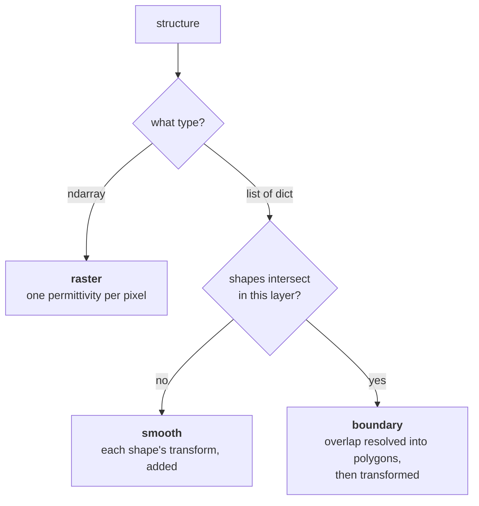

# Describing a scene

What the stack is made of and what cell it repeats in. The keywords themselves, with their
defaults, are in [Keyword reference](../reference/keywords.md#the-stack); this page is what they
mean and how they are chosen between.

## Materials are relative permittivity

`wavebit.Material(epsilon, mu=1.0)` -- **relative** permittivity and the permeability that goes
with it, because a medium has both. Anywhere a material is accepted a bare number is the
shorthand for `Material(epsilon=x)`; non-magnetic is the overwhelming default and costs nothing
to write.

```python
from wavebit import Material, eps_from_index, index_from_eps

Material(12.25)                # a dielectric, n = 3.5, non-magnetic
Material(-12.2475 + 0.35j)     # a metal, n = 0.05 + 3.5j; Im(eps) > 0 is loss
Material(4.0, mu=1.5)          # magnetic
eps_from_index(3.5)            # 12.25 -- the conversion for a datasheet index
index_from_eps(12.25)          # (3.5+0j) -- and back, on the passive root
```

The values are **permittivity, not refractive index**, and that is the one thing to carry over
from older scripts. An index cannot hold the pair -- `mu` was always taken raw, so a single
material spelled as an index would mean "index" for one of its two numbers and "permeability"
for the other. It is also the direction with no branch cut in it: `eps = n**2` is unambiguous
where `n = sqrt(eps)` is a choice, and `index_from_eps` is that choice made explicitly, taking
the passive root (`Im(n) >= 0`).

`Material` is frozen and a registered JAX pytree whose children are `(epsilon, mu)`, so a
material is a design variable like any other -- `jax.grad` reaches inside it.

## The stack
The type of `structure` selects the modeling path; there is no separate mode switch. A third
path, **boundary**, is what a smooth layer becomes when its shapes actually overlap — decided
per layer, not per solver, so one `structure` can hold layers of both kinds.



Nothing selects between the last two: the geometry does, per layer, and a layer pays for the
question only when its own shapes raise it.

Shapes in a layer **paint**: a later shape covers an earlier one. While no two intersect, each
shape's Fourier transform is simply added, which is exact and cheap because with nothing
overlapping the sum *is* the painting; where they do intersect, the overlap is resolved into
disjoint polygons first, so a layer can be painted *and* keep a tilted edge exact. Nothing has
to be said either way.

On the smooth path `lx` / `ly` are absolute lengths in `period`'s units — **not fractions of
it** — and `cx` / `cy` are measured from the centre of the cell, so a centred shape is
`cx = cy = 0`, which is also what omitting them means:

```python
structure = [dict(background=1.0, shapes=[
    dict(type='circle', cx=0., cy=0., lx=200., material=wavebit.eps_from_index(3.5)),
])]
```

A shape wider than the period is refused: its transform is a single sinc, which is not the
transform of any periodic indicator, so the layer would not be the structure its parameters
name — and it would otherwise solve and conserve energy. Sample it onto a raster instead. A
negative length is refused for the same reason it used to be dangerous: it *subtracted* the
shape.

See [`../analytic-modeling.md`](../analytic-modeling.md) and
[`../boundary-modeling.md`](../boundary-modeling.md).

## The cell
Two ways of naming the cell wrongly are refused rather than resolved:

* **Both** `period` and `lattice` raises. They are two spellings of one cell — on a skewed one
  `period` is `(|a1|, |a2|)` with the angle already gone, so the two cannot both be honoured.
* **Neither**, while giving a structure, raises too. `period=(1., 1.)` is the normalized-units
  cell, not a guess at yours, and a raster carries no length that would let anything downstream
  notice the omission.

Four constructors sit on the type, and `lattice=` takes what they return:

```python
wavebit.Lattice.hexagonal(400.)                       # 120-degree rhombus, the crystallographic setting
wavebit.Lattice.hexagonal(400., np.radians(60))       # the 60-degree alternative basis
wavebit.Lattice.oblique(400., 520., np.radians(105))  # angle BETWEEN a1 and a2, in radians
wavebit.Lattice.rectangular(700., 1100.)              # diag(700, 1100) as an object
wavebit.Lattice.from_columns(np.column_stack((a1, a2)))
```

They store no angle, so building one *inside* a differentiated function makes the cell's shape
a design variable — see [`autodiff.md`](autodiff.md).

**The raster is read in lattice coordinates.** `structure[layer][j, i]` is the permittivity at
`u = (i + 0.5)/Nx`, `v = (j + 0.5)/Ny`, which — the cell being centred on the origin — is
`r = (u - 0.5) * a1 + (v - 0.5) * a2`. Building a raster on a Cartesian grid and passing a
tilted basis therefore describes a *different structure*, silently, with energy still conserved
to 1e-15. `wavebit.meshgrid_xy` exists so you need not write either form:

```python
A = wavebit.Lattice.hexagonal(400.)
X, Y = A.meshgrid_xy((256, 256))                # == wavebit.meshgrid_xy((256, 256), lattice=A)
layer = np.where(X ** 2 + Y ** 2 < 90. ** 2, 12.25, 1.)
```

`A.meshgrid_uv(...)` gives the same points as lattice coordinates instead, which is the frame
the raster is actually read in. And `A.drawn(layer)` declares that an array was drawn on *this*
cell, so that solving it on another is refused rather than answered.

Write it as `A.meshgrid_xy(...)` and pass the same `A` to `lattice=`. The cell is needed in **two**
places — to place the pixels and to solve them — and a raster drawn on one cell and solved on
another is a different structure with nothing to say so. **Change the cell and redraw the
array.** Analytic shapes are immune, their lengths being absolute Cartesian quantities.

One build is refused on a skewed cell rather than answering, because it runs and returns a
plausible wrong number: `factorization='li'` on a raster, whose inverse rule follows the raster
axes, which are `a1` / `a2` once skewed.

See [`../oblique-lattice.md`](../oblique-lattice.md) and
[`tutorial 05`](https://github.com/fieldalgo/wavebit/blob/develop/tutorials/05-oblique-lattice.ipynb).

## Passing the scene as objects
`Stack` and `Incidence` carry the same values as typed objects, which is what
[`specs.md`](specs.md) serializes:

```python
from wavebit import Layer, Stack, Incidence

solver = wavebit.rcwa(
    backend=0,
    stack=Stack(layers=[Layer(thickness=300., structure=raster)],
                top=1.0, bot=wavebit.eps_from_index(1.5), period=(700., 700.)),
    incidence=Incidence(wavelength=900., theta=0., phi=0., tetm='te'),
    truncation_order=dict(x=10, y=0),
)
```

They adapt in, so do not also pass the keywords they supply — `Stack` covers `structure`,
`thickness`, `top`, `bot`, `period`, `lattice` and `mu`; `Incidence` covers `wavelength`,
`theta`, `phi`, `tetm`, `psi`, `chi`, `polarization` and `incidence_side`.
