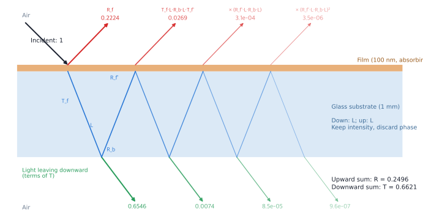
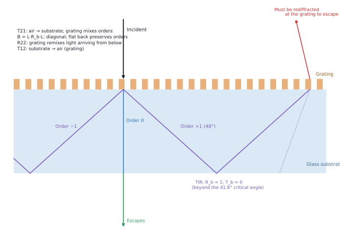
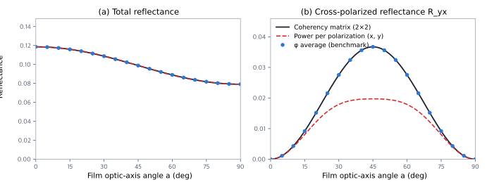

# Appendix C. Thick substrates — back-surface reflection and averaged interference

:::{note}
The runnable examples in this imported course explicitly use `wavebit.compat.legacy` to preserve the workflow behind its historical numerical records. For new work, use the [current getting-started guide](../../getting-started/index.md) and [API migration guide](../../migration/index.md). Historical measurements were not regenerated during this documentation import.
:::

When simulating a film or grating on 0.5–1 mm glass or a wafer, distinguish how the back of the substrate is modeled.
If the substrate is a finite layer followed by air, ordinary RCWA includes back-surface reflection and interference
between repeated round trips. In this note’s 1 mm glass example, reflectance oscillates between 0.08 and 0.38 with
an approximately 0.14 nm wavelength period. A semi-infinite substrate, in contrast, removes the back interface and
all its reflection. When measurement averages away the dense fringes, the model needs to retain back reflection
while averaging its interference. This note starts with thin-film interference, derives the **intensity formula
(incoherent treatment)** that is exact in 1D under its averaging assumptions, then explains the changes and pitfalls for gratings.

Read Sections 1 through 7 in order: 1–3 explain the physics, 4 checks the numbers, 5–6 cover gratings and pitfalls, and 7 discusses a possible Wavebit implementation.

Background: Wavebit’s historical `docs/theory/rcwa/connecting-algorithms.md` cites this case as a reason to expose `ScatteringMatrix`:
“simulating measured samples commonly leads here.” As of the note’s original date, 2026-10-04, there was no implementation,
example, or test of this feature. This is groundwork for a possible implementation, not a claim of current API support.

Written 2026-10-04 · Based on Wavebit `0dfc4ce` (develop) · The original source repository’s
`_incoherent_substrate_figs.py` generated the figures and numerical values, after passing six checks (Section 4 and the polarization check below).

Related reading:
- [Incident light and polarization](light.md) — incident conditions and propagating/evanescent waves
- [Power flow and diffraction efficiency](power-and-efficiency.md) — amplitudes versus power
- [Connecting layers: ETM and SMM](layer-algorithms.md) — scattering matrices and layer connections

---

## 1. Thin-film interference — adding amplitudes

Start with the colors of a soap bubble. Light reflects once at the top of a thin film and once at the bottom; the two
reflected waves add as **complex amplitudes**. Their phase difference from traversing the film produces constructive
interference at some wavelengths and destructive interference at others. Summing all round trips gives the Airy formula.

```
r = (r12 + r23·e^{2iβ}) / (1 + r12·r23·e^{2iβ})        β = kz·h   (phase for one pass through the film)
R = |r|²
```

`r12` and `r23` are the Fresnel coefficients of the upper and lower interfaces. Through `e^{2iβ}`, R varies periodically
with wavelength and thickness. Expressed as a wavelength interval, the period is approximately

```
Δλ ≈ λ² / (2·n·d·cosθ)            (θ is the angle inside the layer)
```

For a 100 nm film, Δλ exceeds the visible spectrum, giving only a broad spectral curve. For 1 mm glass, the same formula
gives **Δλ = 0.141 nm** (at 633 nm and an internal glass angle of 18.6°).

This note uses an absorbing 100 nm film (ε = 4 + 0.2i) on 1 mm glass (ε = 2.25 + 2·10⁻⁶ i), illuminated from air at 0.5 rad.
Permittivities are held constant with wavelength. The tiny imaginary part of the glass retains weak substrate absorption
in the equations.


The blue fringes in (b) are the direct calculation that adds amplitudes throughout the substrate. It is physically valid:
monochromatic plane-wave illumination of perfectly flat 1 mm glass really behaves this way. The issue is whether the measurement resolves it.

---

## 2. Why measured fringes disappear — coherence and averaging

Ordinary RCWA calculates reflectance for one wavelength, substrate thickness, and incident angle. A real measurement may
combine reflected intensities across a finite wavelength range, illuminated area, and angular range. If these ranges
include both interference maxima and minima, averaging reduces fringe contrast. Resolving the approximately 0.141 nm
period here requires a substantially narrower wavelength response and sufficiently little averaging from thickness and angle variations.

| Cause | What changes in the measurement? | Why fringes blur in this example |
|---|---|---|
| **Spectrometer resolution** | A reported “reflectance at 633 nm” is a weighted average over a finite surrounding wavelength range. | A 1 nm response includes about seven fringes with a 0.141 nm period, averaging high and low reflectance together. |
| **Source coherence length** | Front-reflected light and light returning through the substrate entered at different times. The source must preserve their phase relation over that delay. | At 633 nm with a 1 nm bandwidth, the approximate coherence-length scale `λ²/Δλ` is 0.40 mm, shorter than the interference optical-path difference `2nd cosθ ≈ 2.84 mm`. Detecting this whole band strongly reduces interference. |
| **Substrate thickness variations** | Thickness varying across the illuminated area gives different round-trip phases. | A thickness change of about 222 nm changes the phase by one cycle. Different positions favor constructive or destructive interference, so collecting their intensities can blur fringes. |
| **Beam angular spread** | A real beam can contain directions around its nominal incidence. | The round-trip phase is `2k₀nd cosθ`, so different internal angles shift the fringes. Collecting intensities from multiple angles blurs them if the phase variation is large enough. |

**Do not apply spectrometer resolution and source coherence length twice as separate, independent averages.** The first
row describes which wavelengths the detector collects together; the second describes the temporal phase correlation of
the light. The detected interference is determined jointly by the source spectrum and the detector’s wavelength response.
Even a broadband source can show fringes when a narrow wavelength interval is selected. `λ²/Δλ` is an order-of-magnitude
estimate; the precise coherence length depends on the spectrum’s shape and the definition of its width.

**The presence of these effects alone does not eliminate fringes.** They remain if the wavelength response or thickness
and angle distributions are narrow. A sufficiently broad, uniform distribution of round-trip phases, over which interface
reflection, transmission, and absorption vary little, permits a **uniform average over the substrate round-trip phase φ**,
approximated by the incoherent intensity formula below. Partial averaging only weakens fringes; use the actual wavelength, thickness, and angle distributions in that case.

Figure 2 compares averaging over round-trip phase with averaging over the spectrometer’s wavelength response.


In (b), the largest difference between the slit average and intensity formula over the 6 nm interval is 2.8·10⁻⁷.
Thus this example’s 1 nm Gaussian wavelength response closely approximates uniform round-trip phase averaging; the two averages need not coincide for every spectrometer setting.

The opposite situation also occurs: a narrow-linewidth laser illuminating a very flat substrate can resolve real etalon
fringes. A coherent calculation is then appropriate. **Choose the interference treatment from both the sample’s thickness
and uniformity and the source/detection conditions**; Section 7 therefore proposes making this an explicit declaration.

---

## 3. Performing the average — a geometric series of intensities

The average has a closed-form solution. First write the amplitude for each path through the substrate.

```
r(φ) = r_f + t_f·t_f'·r_b·L·e^{iφ} · [ 1 + c·e^{iφ} + c²·e^{2iφ} + … ]        c = r_f'·r_b·L
```

- `r_f, t_f`: film reflection viewed from air, and transmission into the substrate (amplitudes)
- `r_f', t_f'`: film reflection viewed from the substrate, and transmission into air
- `r_b`: reflection at the back surface (glass → air)
- `L`: one-pass intensity attenuation through the substrate, `e^{−2·Im(kz)·d}` (amplitude √L per pass, L per round trip)
- `φ`: substrate round-trip phase

The kth term in brackets makes k+1 round trips and carries phase `e^{i(k+1)φ}`. Expanding `|r(φ)|²` attaches
`e^{i(m−n)φ}` to each pair of paths. Averaging over φ leaves only terms with `m = n`; all others vanish. **Interference
between different paths disappears, leaving each path’s intensity.** Their sum is a geometric series.

```
φ-averaged R = R_f + T_f·L·R_b·L·T_f' · [ 1 + (R_f'·L·R_b·L) + (R_f'·L·R_b·L)² + … ]

R_tot = R_f + T_f·L·R_b·L·T_f' / (1 − R_f'·L·R_b·L)
T_tot = T_f·L·T_b / (1 − R_f'·L·R_b·L)
```

All uppercase quantities are power (intensity) fractions. Transmission is normalized by the fluxes in the two media
(`T_f = |t_f|²·Re(Y_s)/Re(Y_air)`; for TE with electric amplitude, `Y = kz/μ`; for TM with magnetic amplitude, `Y = kz/ε`).
Figure 3 draws the paths represented by this series.



The seven quantities in this example at 633 nm:

| | R_f | T_f | R_f' | T_f' | R_b | T_b | L |
|---|---|---|---|---|---|---|---|
| TE | 0.2224 | 0.7031 | 0.2089 | 0.7031 | 0.0559 | 0.9441 | 0.98613 |
| TM | 0.1401 | 0.7774 | 0.1328 | 0.7774 | 0.0265 | 0.9735 | 0.98613 |

Three points to read from the figure and table:

1. **A semi-infinite substrate retains only the first term.** R_f is its reflectance. It discards the entire 0.027 (TE)
   contribution returning from the back surface.
2. **The series converges quickly.** Each extra round trip reduces the contribution by `R_f'·L·R_b·L` (0.011 for TE,
   0.0034 for TM). Including just the first round trip leaves an R error of 3.1·10⁻⁴ (TE) or 5.4·10⁻⁵ (TM). There is
   little reason to avoid the exact sum, but one back reflection accounts for nearly all the correction.
3. **An absorbing film reflects differently in the two directions:** R_f = 0.2224 and R_f' = 0.2089. Reciprocity gives
   equal directional transmittances (T_f = T_f' = 0.7031), so the film response is needed **from both sides**: illumination
   only from air does not supply R_f'. (With this very weakly absorbing substrate, T_f and T_f' differ by `(Im Y_s / Re Y_s)²` ≈ 4·10⁻¹³.)

---

## 4. Numerical checks

Comparing the three calculations:

| | TE R | TE T | TM R | TM T |
|---|---|---|---|---|
| Coherent (1 mm, phase-dependent) | 0.083 – 0.384 | 0.535 – 0.820 | 0.058 – 0.242 | 0.666 – 0.842 |
| Semi-infinite substrate | 0.2224 | — | 0.1401 | — |
| **Incoherent (intensity formula)** | **0.2496** | **0.6621** | **0.1557** | **0.7489** |

The semi-infinite T entries are blank because that calculation’s T is light entering glass, not the transmitted light
measured beyond the back surface. It underestimates R by 2.7 percentage points for TE and 1.6 for TM, a material difference when comparing with measurements.

The formula was checked five ways. The original script refuses to generate figures if any of these checks fails.

| Check | Recorded result |
|---|---|
| Independently implemented coherent r, R, T versus Wavebit for the same stack (film + 1 mm substrate, TE/TM, 632–634 nm) | Maximum difference 1.3·10⁻¹² |
| Intensity formula versus coherent R, T averaged over φ | 3·10⁻¹⁶ (roundoff from evaluating the same quantity twice) |
| Average of 400 Wavebit substrate-thickness steps (one round-trip phase cycle, 222 nm) | Maximum R difference 5.7·10⁻⁸, T difference 1.2·10⁻⁷ |
| Coherent spectrum averaged with a 1 nm slit | 2.8·10⁻⁷ |
| PyMoosh 4.1.2 `incoherent_coefficient_S` | 7·10⁻¹⁶ |

The residual in the third row does not arise from the formula. Varying thickness over 222 nm also changes absorption
slightly. Evaluating the formula at the original 1 mm thickness gives a T difference of 1.2·10⁻⁶; using the mean thickness
reduces it tenfold to 1.2·10⁻⁷. This is a limitation of thickness averaging. PyMoosh is an oracle only for μ = 1 here: its back-surface Fresnel term omits μ.

---

## 5. Extending to gratings — matrices of diffraction orders

Replacing the film with a grating sends more than one wave into the substrate. Order m has in-plane wavevector
`kx_m = kx_0 + m·2π/P` and travels downward at its own angle inside the glass. Two things change:

- **The grating mixes orders.** It diffracts light arriving from above into several orders, and rediffracts light returning from below.
- **The flat back surface does not mix orders.** A flat interface preserves kx, so order m reflects or transmits only into order m.

The scalar expressions in Section 3 then become matrix expressions. The scalar R_f becomes matrix R11, and division becomes a matrix inverse.

```
B     = L · R_b · L                                   (diagonal — independent for each order)
R_tot = R11 + T12 · B · (I − R22·B)^(-1) · T21
T_tot = T_b · L · (I − R22·B)^(-1) · T21
```

| 1D expression | Grating | Meaning of element [i, j] |
|---|---|---|
| R_f | R11 | Power fraction from incoming order j above to reflected order i above |
| T_f | T21 | Incoming order j above → order i in the substrate |
| R_f' | R22 | Order j returning upward from the substrate → order i sent back downward |
| T_f' | T12 | Order j returning upward from the substrate → order i leaving into air |
| R_b, T_b, L | Diagonal matrices | Order i’s back reflection, back transmission, and one-pass attenuation |



For substrate refractive index n_s, orders fall into three groups:

1. **`|kx_m| < k0` — exits through the back.** As in 1D.
2. **`k0 < |kx_m| < n_s·k0` — propagates in the substrate but is totally internally reflected at the back.** With R_b = 1
   and T_b = 0, it cannot escape on its own. It returns to the grating until R22 diffracts it into an escaping order.
   This is the light responsible for solar-cell light trapping and OLED substrate modes
   (the band `1 < |kx|/k0 < n_glass`, normalized by the air wavenumber).
3. **`|kx_m| > n_s·k0` — evanescent inside the substrate.** After 1 mm, `L ≈ 0`, so it drops out of the round-trip formula.
   It still exists immediately below the grating and must remain in its blocks (R11, T21, …). Solving the grating with
   the substrate as a half-space already accounts for it.

### Which Wavebit pieces are involved?

- **Four grating blocks:** Solve with the substrate as the `bot` half-space and `layer_algorithm='SMM'`, requesting at
  least `answers='amplitude'`. `solver.scattering` then provides a `ScatteringMatrix`: for top incidence, `S11`, `S21`,
  `S22`, and `S12` are amplitude versions of R11, T21, R22, and T12. ETM does not construct this matrix; accessing `solver.scattering` on that route raises an error.
- **Amplitude → power:** Multiply each `|S_ij|²` by the appropriate order-dependent flux ratio. The s and p blocks differ:
  the s port variable is electric field, while the p variable is magnetic field (`S11·δ = −r_p`, `S21·δ = t_p·(n_trn/μ_trn)/(n_ref/μ_ref)`).
  Their normalization therefore differs, as with `Y = kz/μ` and `Y = kz/ε` in Section 3.
- **Back surface:** One flat-interface Fresnel calculation per order; no new grating solve is needed.
- **Cost:** One grating solve plus matrix operations of size N (TE/TM) or 4N (mixed polarization; Section 6).

---

## 6. Pitfalls — where a direct extension fails

### 6-1. Power matrices are insufficient when polarization mixes

The average in Section 3 removes **interference between paths with different phase accumulation**. But s and p within
the same order traverse the substrate at the same angle and acquire the same `e^{iφ}`. Their cross terms survive phase
averaging. Each order therefore needs a **2×2 coherency matrix**, carrying its full polarization state, instead of one
intensity. Replacing a Jones block J by `J ⊗ J*` (4×4) preserves the form of Section 3; a grating uses 4N×4N matrices.

A simple example checks this. Place a retarding film with its optical axis in the plane (n_o = 1.55, n_e = 1.70,
thickness 1055 nm — 90° one-pass retardance at 633 nm) on 1 mm glass. Illuminate normally with x polarization and rotate the axis angle a. The film mixes x and y.



| a | φ average (benchmark), R / R_yx | Power per polarization only, R / R_yx |
|---|---|---|
| 0° | 0.1186 / 0 | 0.1186 / 0 |
| 22.5° | 0.1128 / 0.0184 | 0.1130 / 0.0140 |
| 45° | 0.0988 / 0.0367 | 0.0988 / 0.0197 |
| 67.5° | 0.0849 / 0.0184 | 0.0846 / 0.0140 |
| 90° | 0.0791 / 0 | 0.0791 / 0 |

The coherency calculation agrees with the φ average to 3·10⁻¹⁷. Keeping only polarization powers underestimates R_yx
by 46% at 45°. Light converted from x to y can emerge along two paths, traversing the substrate as x or as y. Their
identical round-trip phases permit interference, constructive here. A power-only calculation discards it.

This pitfall is easy to miss: **the total reflectance is almost unchanged** (0.0988 versus 0.0988 at 45°, a 2·10⁻⁴
difference at 22.5°). Polarization-resolved measurements, such as ellipsometry or Mueller matrices, expose it. When the
axis aligns with x or y (0° or 90°), no polarization mixing occurs and power matrices are sufficient.

For Wavebit, a 1D grating declared TE/TM through `tetm` does not mix polarizations, so an N×N power matrix suffices under
the order-decoherence assumptions below. Conical and 2D gratings mix s and p and need a coherency matrix per order. This
also naturally supports unpolarized incidence and Mueller-matrix output, the quantities used in ellipsometry and scatterometry.

### 6-2. Symmetric orders survive phase averaging

At normal incidence, +m and −m have the same kz and thus the same round-trip phase. As in Section 6-1, varying substrate
thickness does not remove their cross terms. The intensity treatment assumes that measurement removes them by another
mechanism. A 48° order in 1 mm glass moves laterally by `2·d·tan48° ≈ 2.2 mm` per round trip; +m and −m travel oppositely
and return to widely separated positions on the grating. A finite beam can destroy their mutual coherence. The intensity formula assumes this loss of coherence.

An independent grating check using thickness-averaged coherent calculations should therefore use **oblique incidence**.
At normal incidence the two treatments can legitimately differ because of this assumption. (This note did not measure the grating case.)

### 6-3. Neither limit applies near the coherence length

For thin glass (tens of µm) or a narrowband source, the round-trip optical path can approach the coherence length. Neither
the fully coherent nor the fully incoherent limit then suffices. Average directly over the measurement’s wavelength window
(or angle/thickness distribution), as in Figure 2(b). The intensity formula is the limit in which that averaging is complete.

---

## 7. Possible implementation in Wavebit — candidates, not decisions

1. **Start with TE/TM (`tetm`) 1D gratings.** N×N power matrices, one solve plus matrix operations: the smallest scope.
2. **Use coherency blocks for conical and 2D cases.** 4N×4N; the example in Section 6-1 is a candidate regression test.
3. **Declare coherent versus incoherent treatment explicitly.** As discussed at the end of Section 2, choose it from
   the sample and source/detection conditions together (see [Incident light and polarization](light.md) for input distinctions).
4. **A validation ladder:**
   - Zeroth-order uniform stacks: this note’s NumPy formulas (`_incoherent_substrate_figs.py`) and PyMoosh for μ = 1.
   - Gratings: thickness-averaged coherent calculations in the same Wavebit, at oblique incidence (Section 6-2).
   - Check that the coherency route reduces to the power route for TE/TM.
   - Energy conservation (`R + T = 1` when lossless) is a weak check. Intensity calculations readily conserve energy by
     construction, so this check alone rarely detects their mistakes.

## References

The method is established. Cite the following when implementing it; verify bibliographic details against the originals before publication.

- B. Harbecke, "Coherent and incoherent reflection and transmission of multilayer structures,"
  *Appl. Phys. B* **39**, 165 (1986).
- C. C. Katsidis and D. I. Siapkas, "General transfer-matrix method for optical multilayer systems with coherent,
  partially coherent, and incoherent interference," *Appl. Opt.* **41**, 3978 (2002).
- D. Langevin et al., "PyMoosh: a comprehensive numerical toolkit for computing the optical properties of
  multilayered structures," *JOSA B* **41**(2), A67 (2024) — its 1D implementation (`incoherent.py`) was used as the oracle in Section 4.
