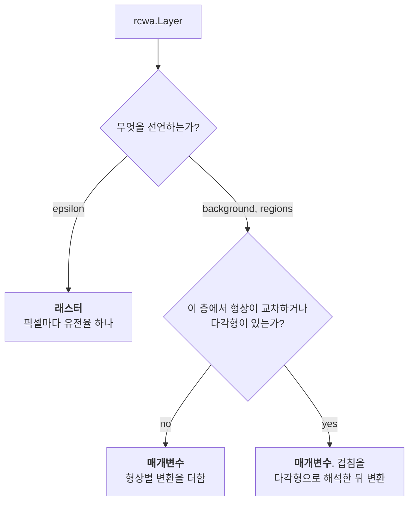

# RCWA 적층 선언하기

`rcwa.Problem(stack=..., excitation=..., outputs=..., units=...)`을 쓰세요. `rcwa.Stack`은 아래에서 위로 놓인 `Layer` 선언들과 물리적인 `top`/`bottom` 반공간을 담습니다. 각 해석적 층은 `background` 재료와 순서가 있는 `Region` 선언 튜플을 가지며, 나중 영역이 앞선 영역 위에 칠해집니다.

```python
from wavebit import Material, rcwa
layer = rcwa.Layer(
    thickness=.18, background=Material(epsilon=1.),
    regions=(rcwa.Region(geometry=rcwa.Circle(radius=.12),
                         material=Material(epsilon=12.25)),))
stack = rcwa.Stack(period=(.6, .6), layers=(layer,),
                   top=Material(epsilon=1.), bottom=Material(epsilon=2.25))
```

길이는 그것을 감싸는 문제의 `Units`를 씁니다. `Circle`은 반지름, `Ellipse`는 주반지름, `Rectangle`은 전체 폭을 받습니다. 형상 회전은 라디안입니다. `center`는 다각형의 꼭짓점처럼 어느 주기에 써도 됩니다. 형상과 `m a1 + n a2`만큼 떨어진 그 사본은 하나의 구조이며, 어떤 인수분해로 만들든 반올림 오차 수준까지 같게 풀립니다 -- 솔버는 각 형상을 셀 자체 안에서 읽으므로, 최적화 중에 셀 모서리를 넘어가는 중심도 감싸 줄(wrapping) 필요가 없습니다. 두 가지는 쓴 그대로 읽습니다. `factorization='li'`는 어디에 썼든 직사각형을 받고, 셀 모서리를 가로지르는 직사각형은 모서리가 자르는 직사각형들로 나누어 받으며, 주기보다 긴 직사각형은 거부합니다. 겹치는 영역은 쓴 그대로 칠합니다. 주기 사본을 통해서만이 아니라 평면에서 겹치도록 쓰세요 -- 그 거부 메시지는 이를 해결하는 정수 주기 이동을 알려 줍니다. `Polygon`은 `vertices`를 받습니다. 셀 중심에서 잰 `(x, y)` 쌍을 경계를 따라 순서대로, 어느 방향으로든 나열합니다. 윤곽은 단순해야 하며, 자기 자신과 교차하거나 닿지 않고 넓이를 감싸야 합니다. 셀 모서리 너머로 뻗을 수는 있지만, 자기 자신이나 다른 영역의 주기 사본 안으로 들어가서는 안 됩니다. 래스터 층은 그 대신 표본화한 `epsilon`과 선택적 `mu`를 받으며, 배경과 해석적 영역을 동시에 선언할 수 없습니다. 직사각형 셀은 `period=(Lx,Ly)`를 쓰고, 비스듬한 셀은 격자 벡터를 열로 둔 `lattice`를 씁니다. 둘 다 주지는 마세요.

[완전한 빠른 시작](../../getting-started/rcwa.md)이 이 형상을 소스와 실행에 연결합니다.

적층이 무엇으로 이루어지고 어떤 셀에서 반복되는지를 다룹니다. 선언 자체와 그 필드, 기본값은
[RCWA API 레퍼런스](../../reference/rcwa/index.md)에 있습니다. 이 페이지는 그 선언들이 무엇을 뜻하고 그중에서
어떻게 고르는지를 설명합니다.

## 재료는 상대 유전율입니다

`wavebit.Material(epsilon, mu=None)` -- 매질은 둘 다 가지므로, **상대** 유전율과 그에 따르는 투자율입니다.
`rcwa.Stack`, `rcwa.Layer`, `rcwa.Region`의 모든 재료 자리는 재료 모델을 받습니다. 맨 숫자는 이전
인터페이스처럼 `Material(epsilon=x)`로 읽지 않고 거부합니다(코드 `material.type`). 비자성이 압도적인 기본값이며
쓰는 데 드는 비용도 없습니다.

```python
from wavebit import Material, eps_from_refractive_index, refractive_index_from_eps

Material(12.25)                   # a dielectric, n = 3.5, non-magnetic
Material(-12.2475 + 0.35j)        # a metal, n = 0.05 + 3.5j; Im(eps) > 0 is loss
Material(4.0, mu=1.5)             # magnetic
eps_from_refractive_index(3.5)    # 12.25 -- the conversion for a datasheet index
refractive_index_from_eps(12.25)  # (3.5+0j) -- and back, on the passive root
```

값은 **굴절률이 아니라 유전율**이며, 오래된 스크립트에서 옮겨 올 때 챙겨야 할 것은 이것 하나입니다. 굴절률로는
쌍을 담을 수 없습니다 -- `mu`는 늘 그대로 받았으므로, 굴절률로 쓴 재료 하나는 두 숫자 중 하나에서는
"굴절률", 다른 하나에서는 "투자율"을 뜻하게 됩니다. 이 방향에는 분지 절단도 없습니다. `n = sqrt(eps)`는
선택이지만 `eps = n**2`는 모호하지 않으며, `refractive_index_from_eps`는 그 선택을 명시적으로 하여 수동 근
(`Im(n) >= 0`)을 취합니다.

`Material`은 고정(frozen)되어 있고 자식이 `(epsilon, mu)`인 등록된 JAX pytree이므로, 재료도 다른 것과
마찬가지로 설계 변수입니다 -- `jax.grad`가 그 안까지 들어갑니다.

파장에 의존하는 재료에는 `wavebit.materials.catalog.load(name)`을 지정하세요. 그러면 RCWA가 풀이하는 각 파장에서 표를 계산합니다. 상수, 표, 래스터 입력은
[재료와 파장 스윕](../common/materials.md)을 참조하세요.

## 적층
`Layer`가 무엇을 선언하는지가 모델링 경로를 고릅니다. 따로 모드 스위치는 없습니다. 경로는 두 가지입니다.
표본화한 `epsilon`은 래스터 경로, `regions`가 있는 `background`는 매개변수 경로이며, 적층 하나는 한 종류의
층만 담습니다(섞으면 거부하며, 코드 `rcwa.mixed_layer_encoding`). 겹침이 어떻게 처리되는지는 별도 경로가
아니라 매개변수 경로의 성질입니다 — 적층이 아니라 층마다 정해지므로, 적층 하나에 두 종류의 매개변수 층을 모두
담을 수 있습니다.



마지막 두 가지 사이를 고르는 설정은 없습니다. 층마다 형상이 고르며, 층은 자기 형상이 그 문제를 일으킬
때에만 그 비용을 치릅니다.

층 안의 형상은 **칠해집니다**. 나중 형상이 앞선 형상을 덮습니다. 어떤 두 형상도 교차하지 않는 동안에는 각
형상의 푸리에 변환을 그냥 더하며, 겹치는 것이 없으면 합이 *곧* 칠하기이므로 이는 정확하고 값쌉니다. 교차하는
곳에서는 먼저 겹침을 서로 떨어진 다각형으로 해석하므로, 층을 칠하면서도 기울어진 모서리를 정확하게 유지할
수 있습니다. 어느 쪽이든 따로 지정할 것은 없습니다.

매개변수 경로에서 형상의 크기 -- `Rectangle`의 전체 폭 `size`, `Circle`의 `radius`, `Ellipse`의 `radii` --
는 문제의 `Units`, 즉 `period`의 단위로 나타낸 절대 길이이며 — **주기에 대한 비율이 아닙니다** —, `center`는
셀 중심에서 재므로 중심에 놓인 형상은 `center=(0., 0.)`이고, 생략해도 같은 뜻입니다. (이전 인터페이스의
형상 사전은 이를 `lx` / `ly`와 `cx` / `cy`로 썼으며, 원에서는 `lx`가 지름이었습니다.)

```python
layer = rcwa.Layer(thickness=100., background=Material(epsilon=1.), regions=(
    rcwa.Region(geometry=rcwa.Circle(radius=100., center=(0., 0.)),
                material=Material(epsilon=12.25)),))
```

다각형은 `rcwa.Polygon(vertices=...)`이며, 꼭짓점은 `center`와 같은 좌표계로 씁니다. `center`, 크기, `angle`은
받지 않습니다. 꼭짓점이 위치, 크기, 회전을 정하므로 그 옆의 필드는 버려질 것이고, 그래서 거부합니다
(`TypeError`). 다각형이 있는 층은 무엇과 겹치든 항상 서로 떨어진 다각형으로 해석됩니다 -- 닫힌 형식 변환은
기본 도형마다 작성되어 있기 때문입니다. 다각형의 주기 이미지는 윤곽으로 판정합니다. 셀 모서리 너머로 뻗을
수는 있지만, 자기 자신이나 다른 영역의 주기 사본 안으로 들어가서는 안 됩니다.

주기보다 넓은 형상은 거부합니다. 그 변환은 단일 sinc인데, 이는 어떤 주기 지시 함수의 변환도 아니므로 층이
매개변수가 가리키는 구조가 아니게 됩니다 — 그런데도 거부하지 않으면 풀이되고 에너지도 보존됩니다. 대신
래스터로 표본화하세요. 음수 길이도 예전에 위험했던 것과 같은 이유로 거부합니다. 형상을 *빼* 버렸기
때문입니다. 둘 다 `rcwa.check`(코드 `rcwa.invalid`인 문제 항목), 문제를 준비할 때(`ValidationError`, 코드
`rcwa.invalid`), 그리고 준비된 계산을 그런 문제로 실행할 때(코드 `prepared.topology`) 거부합니다.

[`../parametric-modeling.md`](parametric-modeling.md)와
[`../boundary-modeling.md`](boundary-modeling.md)를 참조하세요.

## 셀
`rcwa.Stack`은 셀을 `period`나 `lattice`로 받습니다. 두 번 지정하면 해석하지 않고 거부하며, 전혀 지정하지
않는 것은 아직 거부하지 않습니다.

* `period`와 `lattice`를 **둘 다** 주면 오류가 납니다(`ValidationError`, 코드 `stack.cell_ambiguous`). 둘은 한
  셀의 두 가지 표기입니다 — 기울어진 셀에서 `period`는 각도가 이미 빠진 `(|a1|, |a2|)`이므로, 둘을 모두 따를
  수는 없습니다.
* **둘 다 없으면** 문제의 길이 단위로 `period=(1., 1.)`로 대체합니다. 이전 인터페이스는 구조가 주어졌을 때 이를
  거부했습니다. `(1., 1.)`은 정규화 단위의 셀이지 사용자의 셀을 짐작한 것이 아니며, 래스터에는 뒤따르는 어떤
  단계가 그 누락을 알아챌 수 있게 해 줄 길이가 없습니다. `rcwa.Stack`은 아직 이를 거부하지 않으므로, 셀을
  지정하세요.

타입에는 생성자 네 개가 있으며, `rcwa.Stack(lattice=...)`은 그것들이 반환하는 것을 받습니다.

```python
import numpy as np
import wavebit

wavebit.Lattice.hexagonal(400.)                       # 120-degree rhombus, the crystallographic setting
wavebit.Lattice.hexagonal(400., np.radians(60))       # the 60-degree alternative basis
wavebit.Lattice.oblique(400., 520., np.radians(105))  # angle BETWEEN a1 and a2, in radians
wavebit.Lattice.rectangular(700., 1100.)              # diag(700, 1100) as an object
wavebit.Lattice.from_columns(np.column_stack((a1, a2)))
```

`wavebit.Lattice(u, v, axis_aligned)` 자체는 그 플래그를 선언으로 받습니다 -- pytree 재구성과 추적한 `period`에
그것이 필요합니다. 벡터를 읽을 수 있는 곳에서, 벡터와 모순되는 `True`(전단된 셀, 또는 한 변이 음수인 대각
행렬)는 믿지 않습니다. 솔버는 플래그를 편집한 저장 작업에서와 마찬가지로 일반 경로를 택합니다. 두 셀은
벡터와 선언이 같으면 같다고 비교되고 해시도 같습니다.

셀은 각도를 저장하지 않으므로, 미분하는 함수 *안에서* 셀을 만들면 셀의 모양이 설계 변수가 됩니다 —
`prepared.run`을 거치면 이는 PyTorch나 즉시 실행 `jax.grad` 미분이며, `jax.jit` 아래에서 추적한 셀은 거부합니다(코드
`prepared.host_topology`). [`autodiff.md`](../common/autodiff.md)를 참조하세요.

**래스터는 격자 좌표로 읽습니다.** 래스터 층의 `epsilon[j, i]`는 `u = (i + 0.5)/Nx`, `v = (j + 0.5)/Ny`에서의
유전율이며, 셀이 원점에 중심을 두므로 이는 `r = (u - 0.5) * a1 + (v - 0.5) * a2`입니다. 따라서 데카르트 계산
격자 위에 래스터를 만들고 기울어진 기저를 넘기면, 에너지는 여전히 1e-15까지 보존되면서 조용히 *다른 구조*를
기술하게 됩니다. `meshgrid_xy`가 있으므로 어느 형식도 직접 쓸 필요가 없습니다.

```python
A = wavebit.Lattice.hexagonal(400.)
X, Y = A.meshgrid_xy((256, 256))      # == wavebit.lattice.meshgrid_xy((256, 256), lattice=A)
layer = rcwa.Layer(thickness=100., epsilon=np.where(X ** 2 + Y ** 2 < 90. ** 2, 12.25, 1.))
stack = rcwa.Stack(lattice=A, layers=(layer,))
```

`A.meshgrid_uv(...)`는 같은 점들을 대신 격자 좌표로 주며, 이것이 래스터를 실제로 읽는 좌표계입니다. 이전
인터페이스에서 `A.drawn(array)`는 배열이 *이* 셀 위에 그려졌다고 선언하므로, 그것을 다른 셀에서 풀면 답하지
않고 거부했습니다. `rcwa.Layer(epsilon=...)`는 아직 그 선언을 받지 않으므로(`rcwa.invalid`로 거부하며,
"must be real number, not DrawnOn"), 현재 인터페이스에서는 그 확인을 사용자가 해야 합니다.

`A.meshgrid_xy(...)`로 쓰고 같은 `A`를 `rcwa.Stack(lattice=...)`에 넘기세요. 셀은 **두** 곳에서 필요합니다 —
픽셀을 배치할 때와 풀 때 — 그리고 한 셀 위에 그리고 다른 셀에서 푼 래스터는 그렇다고 알려 주는 것 없이
다른 구조가 됩니다. **셀을 바꾸면 배열을 다시 그리세요.** 매개변수 형상은 길이가 절대 데카르트 양이므로 이
문제가 없습니다.

기울어진 셀에서는 한 가지 구성을 답하지 않고 거부합니다. 실행은 되면서 그럴듯한 틀린 숫자를 반환하기
때문입니다. 래스터에 대한 `factorization='li'`인데, 그 역규칙은 래스터 축을 따르고, 래스터 축은 기울어지면
`a1` / `a2`가 됩니다. Li는 래스터의 기본값이므로, 기울어진 래스터에는 `rcwa.Numerics(factorization='nvf')`를
지정하세요.

**한 변이 음수인 대각 기저** -- `lattice=np.diag((-Lx, Ly))` 또는 `Lattice.rectangular(-Lx, Ly)` -- 는
`period=(Lx, Ly)`와 같은 격자를 생성하며, 그 위의 형상은 필드까지 포함해 같은 구조입니다. 기저는 사각이 아닌
모든 기저와 마찬가지로 쓴 그대로 읽습니다. 래스터는 그 기저의 `meshgrid_xy`가 그리듯 `-x` 방향으로 그려지고,
차수 `(m, n)`은 `b1`이 `-x` 방향인 `m*b1 + n*b2`를 지니므로, 차수별 배열은 그 축을 따라 뒤집혀 나옵니다. 그런
셀은 일반 경로를 택하므로 거기서는 `factorization='li'`를 거부합니다(`rcwa.unsupported`). Li를 쓰려면 셀을
양수 변으로 표기하세요.

[`../oblique-lattice.md`](../../theory/rcwa/oblique-lattice.md)와
[`tutorial 05`](https://github.com/fieldalgo/wavebit/blob/main/tutorials/rcwa/05-oblique-lattice.ipynb)를 참조하세요.

## 풀지 않고 구조 살펴보기

`rcwa.sample_structure`는 물리 문제를 직접 읽습니다. 행이 y 방향, 열이 x 방향인 소유권 있는 복소 NumPy
배열을 반환합니다. 기존 `problem`에 대해 상대 구성 값을 다음과 같이 살펴보세요.

```python
epsilon = rcwa.sample_structure(problem, layer=0, samples=192)
mu = rcwa.sample_structure(problem, layer=0, samples=192, quantity='mu')
```

`prepare`나 `run`은 필요 없고, 산란 연산자나 푸리에 연산자도 계산하지 않습니다. `layer=0`은 가장 아래의 유한
층입니다. 영역 층은 두 격자 벡터 각각을 따라 셀 중심 표본 `samples`개를 받고, 표본화한 층은 고유 해상도를
유지합니다. 스펙트럼에는 `wavelength_index`를 쓰세요. 재료 표는 문제의 명시적 길이 단위로 계산합니다. 텐서
재료 그림에는 `component='xy'`처럼 성분이 필요하며, 스칼라 그림은 성분을 받지 않습니다. 값은 굴절률이나 대역
제한 푸리에 이미지가 아니라 상대 epsilon 또는 mu입니다.

살펴보기는 자동 미분 변환 바깥에서 실행하세요. 나중 영역은 엔진이 쓰는 것과 같은 렌더러를 거쳐 앞선 영역
위에 칠해집니다. 그 곡선 칠하기 근사, 제한된 주기 이미지 표본화, 칠한 기울어진 셀에 대한 거부도 그대로
적용됩니다. 선택한 층은 혼합 인코딩 적층 안에 있더라도 따로 그려 볼 수 있지만, 그렇다고 문제 전체가
`rcwa.check`를 통과하거나 광학적으로 수렴했다는 증명이 되지는 않습니다.

## 장면을 객체로 넘기기
장면은 타입이 있는 객체일 뿐 다른 것이 아닙니다. `rcwa.Stack`은 이전 인터페이스의 `Stack`이 담던 것을,
`rcwa.Excitation`과 그 소스는 `Incidence`가 담던 것을 담으며, 이를 담은 `Job`이
[`specs.md`](../common/specs.md)가 직렬화하는 대상입니다.

```python
from wavebit import Material, Units, rcwa

problem = rcwa.Problem(
    units=Units(length='nm'),
    stack=rcwa.Stack(layers=(rcwa.Layer(thickness=300., epsilon=raster),),
                     top=Material(epsilon=1.), bottom=Material(epsilon=2.25),
                     period=(700., 700.)),
    excitation=rcwa.Excitation(wavelength=900., sources=(
        rcwa.PlaneWave(side='top', polarization='s', theta=0., phi=0.),)))
result = rcwa.run(problem, numerics=rcwa.Numerics(orders=(10, 0)))
```

값마다 자리가 하나뿐이므로, 충돌할 두 번째 표기가 없습니다. 셀, 반공간, 층은 `Stack`에, 파장은
`Excitation`에, 방향과 편광은 소스에, 절단은 `Numerics`에 있습니다. 이전의 `tetm='te'`는 여기서
`polarization='s'`입니다. 한 행짜리 `raster`에서 이는 같은 순수 TE/TM 경로를 택하며
(`result.diagnostics['solve_path']`가 `('1d_te',)`), 존스 쌍이라면 conical 경로를 택할 것입니다.
[조명 가이드](light.md#the-words-are-a-declaration-the-pair-is-a-value)를 참조하세요.
