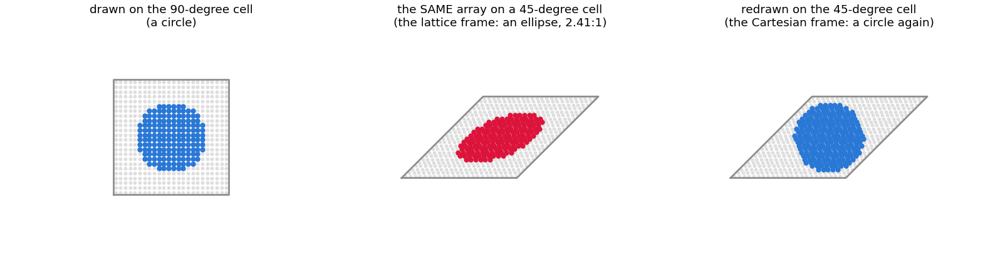
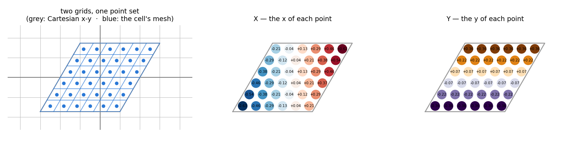
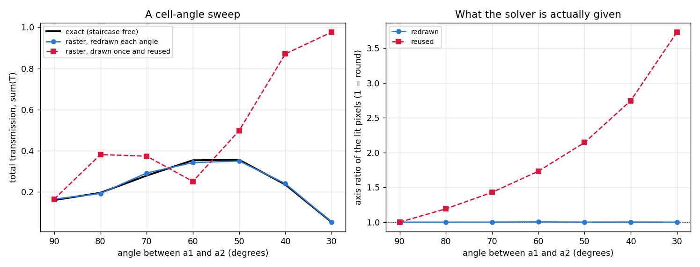

# Non-orthogonal (oblique) unit cells — what `lattice` does and what it costs

Written: 2026-08-09. Measured on CPU, NumPy backend, float64.

Targets:
- `src/wavebit/_core/lattice.py` — the basis, the reciprocal mapping, the Jacobian
- `src/wavebit/_core/solve_2d.py::order_grid_kxy` — the two k-layouts a cell can have
- `src/wavebit/_core/engine.py::CoreSolveMixin.lattice` — the entry point
- `src/wavebit/_core/engine.py::_reject_unsupported_lattice` — what is still refused, and why

---

## TL;DR

A hexagonal array used to be spelled as an `a x a*sqrt(3)` rectangular supercell holding two
motifs. That doubles the cell area, the retained order count scales with area, and the measured
cost exponent is 2.86 -- so it cost **7.3x**. Pass the basis instead:

```python
import numpy as np, wavebit

solver = wavebit.rcwa(
    backend='numpy', structure=cell, truncation_order=dict(x=10, y=10), thickness=[300.0], wavelength=900.0,
    factorization='nvf',                       # required — see "What is refused"
    lattice=wavebit.Lattice.hexagonal(400.0),          # or lattice=np.column_stack((a1, a2))
)
```

`period=(Lx, Ly)` remains the default and means `diag(Lx, Ly)`. Setting `lattice` makes `period`
report the basis-vector lengths `(|a1|, |a2|)`.

If you only want to know which spellings answer, which refuse, and which answer *the wrong
question*, skip to [Every combination, measured](#every-combination-measured) — twelve rows, one
scene, every number taken from a run.

## Spelling the cell

**An orthogonal cell needs none of this.** `period=(Lx, Ly)` is its spelling and remains the
default — no `Lattice`, no import, and the coordinates it gives are bit-identical:

```python
P = [700.0, 1100.0]
X, Y = wavebit.meshgrid_xy((256, 256), period=P)
solver = wavebit.rcwa(period=P, ...)
```

`lattice` is always a 2x2 whose **columns** are `a1` and `a2`, and you can write it by hand.
Four constructors on the type spell the rest:

```python
wavebit.Lattice.hexagonal(400.0)                    # 120-degree rhombus, the crystallographic setting
wavebit.Lattice.hexagonal(400.0, np.radians(60))    # the 60-degree alternative basis
wavebit.Lattice.oblique(400.0, 520.0, np.radians(105))
wavebit.Lattice.rectangular(700.0, 1100.0)          # diag(700, 1100), as an object; `ly` defaults to `lx`
wavebit.Lattice.from_columns(np.column_stack((a1, a2)))   # a basis written out by hand
```

**They sit on the type on purpose.** `hexagonal(400.)` did not say what it returned, and a
hexagon is a perfectly plausible *shape* in a package whose shape types are already `rectangle`,
`circle` and `ellipse`. The sharpest case was `oblique(lx, ly, angle)`, which has the **exact
signature of a rotated rectangle shape** — `{'type': 'rectangle', 'lx':, 'ly':, 'angle':}` —
with `angle` meaning the angle *between the edges* rather than a rotation. `Lattice.oblique(...)`
carries the answer in the call. `Lattice.rectangular` is the object form of `period` and the
exact-diagonal spelling, since `oblique(.., pi/2)` lands 6.1e-17 off it; `from_columns` is what
gives a hand-written 2x2 the same `.meshgrid_xy` the constructors have.

`angle` is the angle between `a1` and `a2`, in radians, like every other angle in this API.
These are spellings and not a new kind of cell — each returns the same object `lattice=` takes,
and nothing stores an angle afterwards. Which is what makes the angle differentiable: build the
basis *inside* the function you differentiate and it is a design variable, for the ordinary
reason any expression is — but the two modeling paths differentiate *different questions*, so
read "Differentiating the cell" before using one. See also "Where the skew actually reaches the
code".

**Building the structure.** `wavebit.meshgrid_xy` gives the Cartesian coordinates of the raster's pixel
centres, so a layer can be written in coordinates rather than indices:

```python
A = wavebit.Lattice.hexagonal(400.0)
X, Y = A.meshgrid_xy((256, 256))                      # == wavebit.meshgrid_xy((256, 256), lattice=A)
layer = np.where(X ** 2 + Y ** 2 < 90.0 ** 2, 12.25, 1.0)
```

`A.meshgrid_xy(grid_shape)` is the free function with `lattice=A`, and it is the spelling to prefer for one
reason: the cell is needed **twice** — here, to place the pixels, and at `lattice=` on the
solver — and the two disagreeing is what goes wrong. See "The two frames a raster can mean"
below for what the disagreement costs.

**The cell is centred on the origin**, so the pillar above needs no arithmetic to be centred.
That matters more than it looks here: a pillar sits at the *lattice point* in most
descriptions, and the lattice point is a **corner** of the cell — put it there and the raster
holds one wedge of it, with the other wedges belonging to the neighbouring copies. Correct as
a periodic structure only if you draw all of them; putting the pillar in the middle of the
cell is the same array, described once, and now it is also the shortest thing to write. Until
2026-08-31 this example opened by computing `0.5*(a1 + a2)` by hand.

On a skewed cell this is the step that is easy to get wrong by hand — the samples are at
`u*a1 + v*a2`, not on a rectangle, and `np.meshgrid` alone will not put them there. An
expression written in `X` and `Y` also cannot get the axis order wrong, since `where` is
elementwise and the layout simply follows; one written in indices (`layer[:2] = ...`) can, and
does so silently on a non-square raster.

## The one thing that will bite you

**The raster is read in lattice coordinates.** `structure[layer][j, i]` sits at the lattice
point `u = (i + 0.5)/Nx`, `v = (j + 0.5)/Ny`, and the cell is centred on the origin:

    r = (u - 0.5) * a1  +  (v - 0.5) * a2

Axis 1 runs along `a1` (and pairs with `truncation_order[0]`), axis 0 along `a2` (with `truncation_order[1]`). Build the
raster on a **Cartesian** grid and hand it a skewed basis and you have described a *different
structure* — and nothing will tell you. There is no error, the transform is still a transform,
and energy still conserves to 1e-15 because the NVF assembly is Hermitian whatever the geometry
says. The way to write it:

```python
X, Y = A.meshgrid_xy((ny, nx))                          # Cartesian position of every pixel
```

then test membership in Cartesian space, with **minimum image over the lattice** (`i*a1 + j*a2`
for `i, j` in `-1, 0, 1`) so a feature straddling an edge wraps correctly. Written out by hand
it is `((np.arange(n) + 0.5)/n - 0.5)` per axis, then `U*a1 + V*a2` — the `- 0.5` being the
centred cell. `wavebit.meshgrid_xy` exists so that neither half has to be remembered.

Parametric shapes do not have this problem *in their lengths*: those are absolute Cartesian
quantities, so a rectangle stays a rectangle under a skew. `cx` / `cy` are Cartesian too, and
they are measured from the same origin the raster grid above uses — the centre of the cell —
so `cx = cy = 0` is a centred shape on every cell, skewed or not.
Their **periodic fold** is a separate thing and it was wrong until 2026-08-23. The nearest
image of a shape sits at `m*a1 + n*a2`; the fold was written `d % Px`, and `period` on a skewed
cell reports `(|a1|, |a2|)`, so it reduced towards a point where no image is. On a 60-degree
cell it looked straight up while the neighbour was up and to the right. It only shows once a
feature is large enough that a neighbour's surface reaches into the sampled cell -- measured on
a disc at `r/a = 0.45`, 21% of the surface band was more than 0.05 out and the solve was
1.1e-3 from the raster path, which the fix brings to 5e-6. Energy conserved to 1e-12 either
way, and an axis-aligned cell is bit-identical, which is why nothing caught it.

## The two frames a raster can mean

A raster records **pixel indices and nothing else**: pixel `(i, j)` is the lattice point
`u = (i+0.5)/Nx`, `v = (j+0.5)/Ny`, and `r = (u-0.5)*a1 + (v-0.5)*a2` is the only thing that
places it. "Radius 100 nm" is not in the array. So writing one down says one of two things, and
which one is not recorded anywhere:



*The lit set is identical in the first two panels — not a pixel moves. What changes is where
those pixels sit, because the basis is what places them. The third panel is the same coordinate
expression evaluated on the 45-degree cell.*

| | the pattern means | when the cell changes | what you do |
|---|---|---|---|
| **Cartesian frame** | absolute lengths — "a 100 nm rod" | shape must be preserved | **redraw** the array |
| **lattice frame** | fractions of the cell — "a rod filling 30% of it" | shape rides the basis | **keep** the array |

**Both are real specifications, and each is wrong in the other's case.** Two measurements fix
which is which.

*The lattice frame, settled by scale invariance.* Scale the whole design — cell, thickness and
wavelength all by `s` — and Maxwell says the answer cannot move. Keeping the array gives
0.124231941 at `s` = 0.5, 1, 2, 4, **identical to nine digits**, because the rod scales with the
cell as it must. Redrawing pins the rod at radius 100 while the cell grows, solves a different
fill fraction at every `s`, and reads 0.330 / 0.124 / 0.99986 / 0.99999. **Here redrawing is the
error.** The same holds for any feature stated as a duty cycle or a fill fraction.

*The Cartesian frame, settled by a feature whose size is fixed.* That is the angle sweep below:
redrawn stays on the staircase-free control at every angle while the held array reaches a
3.73:1 ellipse.

**Tilting and scaling are not one case, and the dividing line is *similarity*.** Holding the
array, the pattern is carried by the basis change, so it keeps its shape exactly when that
change is a similarity. As the axis ratio of the lit pixels: an isotropic 2x scale leaves it at
**1.000** (radius 99.8 -> 199.6, a bigger circle), `Lx` alone at 2x gives **2.000**, and a
45-degree tilt gives **2.414**. So the two frames coincide under a pure scale and separate most
under a tilt.



*Two grids over one point set. The grey one is the Cartesian ruler the values are read against
— axis-aligned, nothing to do with the cell; the blue one is the cell's own mesh, whose lines run
along `a1` and `a2`, so a pixel is a parallelogram with edges `a1/Nx` and `a2/Ny`. The values are
those parallelograms' **centres** — `Nx` per row, not `Nx + 1`. The other two panels are the same
points twice, once holding `x` and once holding `y`. On a tilted cell `X` shifts from row to row,
which is why the pair cannot be separated into 1-D axes the way it can on a rectangle.*

`meshgrid_uv` is the same mesh in the other frame: `U`, `V` in `[-0.5, 0.5]`, fractions of the
cell. It does not read the basis at all, and that is what makes it the lattice frame.

### Calling `meshgrid_xy` puts you in the Cartesian frame

`meshgrid_xy` exists to hand back Cartesian `X`, `Y`, so a pattern written on them is Cartesian by
construction — and then the cell is needed **twice**, once by `meshgrid_xy` to place the pixels and
once by `rcwa` to solve them, and the two disagreeing is what goes wrong. Same indices,
different basis, different points.

Measured on a genuine Cartesian circle of radius 100 in a 640-unit cell at 64 px, drawing at one
cell and solving at another:

| grid's cell | solve's cell | what is solved | `sum(T)` |
|---|---|---|---|
| 90 deg | 90 deg | a circle, 1.00:1 | 0.157 |
| 90 deg | 20 deg | **an ellipse, 5.67:1** | 0.997 |
| 20 deg | 90 deg | **an ellipse, 5.60:1** | 0.532 |
| 20 deg | 20 deg | a circle, 1.01:1 | 0.288 |

Only the diagonal is a circle. **The angle is irrelevant; sameness is the whole rule in this
frame.** The second row is the dangerous one, because it is what a caller who swaps `lattice=`
and reuses the array gets — `sum(T)` from 0.157 to 0.997 with no error, no warning, and energy
conserved throughout. It reads as a lattice effect, and the lattice effect and the *shape
deformed into an ellipse* effect are mixed together with nothing separating them.

`A.meshgrid_xy(grid_shape)` (`Lattice.meshgrid_xy`) is the same call as `wavebit.meshgrid_xy(grid_shape,
lattice=A)` with the basis named once, which is the whole of what it is for. **It is a nudge
and not a guarantee:** `wavebit.meshgrid_xy(grid_shape, lattice=B)` still exists and still answers, and
provenance cannot be
attached to the array either — the first `np.where` turns the coordinates into a permittivity
raster, and a raster is numbers on indices with no record of the cell it was drawn in. So the
rule has to be carried by the reader — or handed to the code, which is what `Lattice.drawn`
is for. Pinned as
`tests/test_lattice_pytree.py::test_the_two_uses_of_a_lattice_have_to_be_the_same_one`.

### Declaring the frame: `Lattice.drawn`

The Cartesian frame is the half with a **checkable invariant** — this array belongs to this
cell — so it is the half worth declaring. The lattice frame has none to check: an array of
fractions is *meant* to be portable, so it stays a bare array, accepted on every cell, which is
also what every existing caller passes.

```python
X, Y = lattice.meshgrid_xy((256, 256))
layer = np.where(X ** 2 + Y ** 2 < 100. ** 2, 12.25, 1.0)
wavebit.rcwa(lattice=lattice, structure=lattice.drawn(layer[None]), ...)
```

Solve that on another cell and it raises instead of answering 0.251270 where 0.350164 was
meant. Hand it the finished structure, layer axis and all — it wraps rather than forwards, so
there is no indexing left to do.

**Why a wrapper and not a tagged array.** An `ndarray` subclass was the obvious mechanism and
it survives only NumPy: `jnp.asarray` and `torch.as_tensor` copy the numbers into their own
type and the attribute is gone, so the guard would have been live on one backend and *silently
absent* on the other two. The wrapper never travels — the `structure` setter takes it apart at
ingest, the array goes on exactly as before, and the declared cell rides as one pytree child
beside the solver's own cell so it survives the jit round trip. Nothing downstream sees the
type. And the tag cannot go on the *coordinates* instead, because `np.where` drops it: measured,
an attribute survives `X**2`, `X**2 + Y**2` and `< R**2` — all ufuncs — and dies at the one
call every raster expression on this page ends with.

**A parametric structure is refused rather than wrapped**, because that path has no frame to
declare: a shape's `lx` and `cx` are absolute lengths, so the same recipe is the same geometry
on every cell and moving the basis is a legitimate thing to do with it. Two shapes on a 640
square give 0.999233 and the identical structure on `hexagonal(640.)` gives 0.999851 — both
right, so declaring one would turn a correct answer into a refusal, which is worse than no
guard at all.

**It is opt-in, and that is the ceiling.** A bare array has to keep working, so this guards the
callers who ask for it and no one else.

**Under JAX the comparison needs a cell with a value.** Under `jax.grad` the cell has one and
is compared. Under `jax.jit` it does not, so the comparison runs where the cell is still
concrete: the jitted `solve_field` compares it on the live solver before its compiled call, and
a solver handed to `jax.jit` whole is compared when it is flattened into the trace. Both the
declared cell and the solver's cell are pytree values rather than static data, so a sweep that
redraws and redeclares the raster on each cell — `lattice=L, structure=L.drawn(raster)` — is
one compiled program, as the same sweep over a bare array is (measured: one compilation for
three cells where the declaration used to take three, about 4 s each). What is refused is a
cell or a declaration first assigned *inside* a `jax.jit` trace, which nothing has compared:
assign it before the trace. And a `tree_map` over every leaf of the solver now reaches the
declared numbers too: one that moves them apart from the cell has the structure refused as drawn
on another cell, never answered.

(The name says three things and needs all three. **`meshgrid`**, because that is what it is —
`numpy.meshgrid` for a unit cell — and because it says the return is two filled 2-D arrays
rather than a pair of 1-D axes. **`_xy`**, because this package names *both* coordinate systems
("Cartesian coordinates" and "lattice coordinates" appear five times each), so `coordinates`
alone would be the ambiguous half; the suffix is also what makes `meshgrid_uv` a matched pair
rather than an afterthought. And its parameter is **`grid_shape`**, not `shape`: plain `shape`
collides with geometry — this package spells a piece of geometry a shape,
`structure=[{'shapes': [...]}]`, `shape_ft`, `shape_geometry` — but the word is
also what says the pair is **rows-first**, the way an array's shape is, so dropping it loses
that: `samples` would collide with `reconstruct_field`'s x-first `sample_x` / `sample_y` and
invite `(nx, ny)`. The prefix disambiguates instead, and `sample_grid` and `boundary.py` were
already spelling it this way.)

### The two ways of naming a cell wrongly, both refused since 2026-09-01

**Naming both `period` and `lattice`.** They are two spellings of one cell, not two cells:
`period` is `(|a1|, |a2|)` with the angle already gone, so on a skewed cell both cannot be
honoured. It used to resolve silently — the basis won and the period was dropped — which reads
as a lattice effect and is not one. It now raises.

That refusal keys on the keyword being **named**, not on the values disagreeing, and that is
what made it delicate: three internal paths legitimately hold both and hand them on, and a
refusal that broke any of them would take jit, the typed container or the document format with
it. `SolverJax._tree_unflatten` (where `period` and `lattice` are both pytree children),
`Stack.as_kwargs`, and the spec round trip — which writes `period` into every saved stack —
all drop `period` when a basis is present. That drop is provably a no-op rather than a loss:
`__init__` assigns `lattice` *after* `period`, and the basis setter overwrites the period slot
with `periods_of(A)`, so a period passed beside a basis had never reached anything.

**Naming neither, and solving a structure anyway.** `period=(1., 1.)` is a real cell and the
coherent partner of the `wavelength=1.` default, so the default itself is not the problem — 35
call sites in this repository rely on it, every one of them building a solver with *no
structure* to exercise the spec plumbing, and those still build. What is refused is solving a
*structure* on a cell nobody chose. A raster carries no length of its own, so nothing
downstream can notice: measured on a hex scene with `lattice=` forgotten, `sum(T)` came back
**0.989790** against the correct **0.927664**, no error and energy conserved throughout.

The parametric path was already safe and this does not duplicate it — a shape's lengths are
absolute, so the same omission raises *"shape is larger than the period"*. The raster was the
only silent one. `wavebit.meshgrid_xy` has refused the same omission since it was written
(`as_lattice: needs one of period or lattice`), so the two doors into a raster now agree. The
check runs at construction *and* at the solve, because a structure can be assigned long after
the solver was built.

### Every combination, measured

One scene answers the whole question: a circle of radius 150 in a 640 cell, 128 px, `nvf`,
truncation 6, 300 thick, index 3.5 at 900 nm. `A` is the 640 square it was drawn on; `B` is
`Lattice.oblique(640., 640., 70.)` — a *different* cell, named to stand for every wrong one.

```
                     structure=
                         |
        +----------------+----------------+
        |                                 |
   list of dicts                    array of numbers
   (parametric)                     (raster)
        |                                 |
   absolute lengths            fractions of the pixel grid,
   -- no frame to declare      and the grid needs a cell
        |                                 |
   .drawn() REFUSES            +----------+----------+
   solves on ANY cell          |                     |
                          bare array          A.drawn(array)
                               |                     |
                       answers on any cell    answers on A,
                       -- lattice frame,      REFUSES on any other
                          you get an ellipse  -- Cartesian frame, pinned
```

| `structure=` | cell named | what happens | `sum(T)` |
|---|---|---|---|
| raster, bare | `period=[640., 640.]` | answers | 0.420214 |
| raster, bare | `lattice=A` | answers — same cell, so byte-identical to the row above | 0.420214 |
| raster, bare | `lattice=B` | **answers, and this is the hazard** | 0.110040 |
| raster, bare | both | refused: *period and lattice both given* | — |
| raster, bare | neither | refused: *no cell was given* | — |
| `A.drawn(raster)` | `lattice=A` | answers, unchanged from bare | 0.420214 |
| `A.drawn(raster)` | `lattice=B` | **refused**: *drawn on a different cell* | — |
| `A.drawn(raster)` | `period=[640., 640.]` | answers — the same cell, spelled the other way | 0.420214 |
| parametric | `lattice=A` | answers | 0.438099 |
| parametric | `lattice=B` | answers, and **0.121451 is correct** — same circle, skewed cell | 0.121451 |
| parametric | neither | refused: *no cell was given* | — |
| `A.drawn(parametric)` | — | **refused at the wrap**: no frame to declare | — |

Read the two bolded rows together, because they are the same input pattern with opposite
verdicts and that is the entire design. `lattice=B` under a bare raster returns 0.110040 rather
than raising, because it is a *legal reading*: the array is fractions of the cell, so the circle
rides along and becomes an ellipse in a skewed cell, which is exactly what a duty cycle or a
fill fraction is meant to do. Nothing downstream can tell that apart from a mistake — the array
carries no length of its own — so the only thing that can is the caller, and `.drawn` is how
they say it. `lattice=B` under a parametric structure returns 0.121451 and that number needs no
declaration at all: `lx=300.` is 300 units on every cell, so there is no second reading to
disambiguate, which is why declaring one is refused rather than allowed-and-ignored.

Two rows are worth noticing for what they *don't* do. `A.drawn(...)` with `period=` still
answers: the check compares the basis matrices, not the keywords, and `period=[640., 640.]` is
the same cell. And declaring costs nothing when it agrees — 0.420214 either way, since the
wrapper is taken apart at ingest and no array downstream ever sees the type.

The rule underneath all twelve rows fits in a line: **a raster belongs to a cell and an
parametric structure does not.** The refusals are the places that sentence is enforced.

## What it buys

Hex array of Si pillars, pitch 400 nm, r = 90 nm, h = 300 nm, lambda = 900 nm, normal incidence.
The supercell and the native cell describe the same infinite array.

| | orders | wall clock |
|---|---|---|
| `a x a*sqrt(3)` supercell, `truncation_order=(14, 24)` | 1421 | 38.9 s |
| native hex cell, `truncation_order=(12, 12)` | 625 | 3.3 s |

**Those two rows are not matched in accuracy**, and the 11.8x they invite is not the number:
1421 against 625 is an order ratio of 2.27, and the supercell's truncation covers *less* of
k-space than the hex row's (0.281 against 0.329 in the same units). They are here because they
are the two spellings a user actually writes.

The ratio that is measured, and that holds:

* **Order density is the cell-area ratio, 2.0.** Retained orders against the k-space area each
  truncation covers: 3719 per unit area on the native cell, 7351 on the supercell -- a ratio of
  **1.98** against a cell-area ratio of 2.00. Half of the supercell's orders are **fictitious**:
  they sit on the coset the finer reciprocal lattice adds, where the structure factor of the
  two-motif basis vanishes identically, so `eps` cannot couple to them and the source never
  excites them. They are carried at `O(N^p)` anyway.
* **The cost exponent is 2.86**, fitted over 529 / 841 / 1225 orders on the native cell
  (4.31 / 15.79 / 47.63 s); per-step exponents 2.80 and 2.94. Sub-cubic because the convolution
  build is.

Together: **2.0x the orders, 4x the eigenproblem array, and `2^2.86 = 7.3x` the time** at
matched k-space coverage.

This page used to add "and better in practice because the supercell converges more slowly than
the native cell does". **That is withdrawn: it was never measured, and it does not resolve.**
Both arms converge oscillatorily with an amplitude around 2e-4 on this structure, so
first-run-below-tolerance gives 7.6x / 2.6x / 2.6x / 33.2x as the tolerance moves from 1e-3 to
2e-4 -- noise, not a measurement. The order ratio is the area ratio and this page claims nothing
beyond it.

Do not confuse this with a convergence fix. On the same structure, `factorization='li'` had not
converged at `truncation_order=(16, 28)` after 72 s while `'nvf'` settled by `truncation_order=(10, 17)` in 5 s. That gap
is the *factorization*, not the lattice, and an oblique cell does nothing about it. The two wins
are independent and multiply.

## What works and what is refused

| | status | note |
|---|---|---|
| `factorization='nvf'`, sampled or integrated | supported | — |
| parametric shapes, summed | supported | lengths are absolute Cartesian; nothing deforms |
| parametric shapes, painted **overlap** | supported | the clipper is Cartesian; only the periodic images and the transform needed the basis |
| every `raster_normal_method` on a raster | supported | since 2026-08-21; **use `'contour'`** for accuracy, including where a feature overlaps its own images (2026-09-01) — see below |
| field reconstruction | supported | output grid is indexed by `(v, u)`, not `(y, x)` — see below |
| `factorization='li'` on a raster | **refused** | see below |

Everything except `li` works on a skewed cell, and `li` has a supported route to the same
structure — parametric shapes, which carry the metric. The block modeller was refused here too,
on the same grounds (it rasterised onto a rectangular grid of its own); that whole path was
removed on 2026-08-26.

**Parametric shapes need no keyword at all.** `factorization` resolves per modeling path, and the
parametric path defaults to `nvf` — it builds `eps` from the shapes' own analytic normal field.
Its only Li build, on axis-aligned rectangles, needs an axis-aligned rectangular cell, so on a
skewed cell `factorization='li'` with parametric shapes raises, as the raster's does. The
`factorization='nvf'` in the example at the top of this page is required for the **raster** it
uses.

The two refusals raise rather than answering, and that matters: both of them *run* on a skewed
cell and return a plausible wrong number, with energy still conserving to 1e-15.

`li` applies the inverse rule along the **raster axes**
(`epx = fourier2d_piecewise_constant(cell, 0, 1)`), and the solve
consumes the result as Cartesian `eps_xx` / `eps_yy`. On a skewed cell those axes are `a1` / `a2`,
not `x` / `y`. Repairing it means Li's covariant formulation (JOSA A **14**(10), 2758).

Before anyone spends that: **`nvf` already contains `li`.** With a constant axis-aligned normal
the projector collapses to `C_xx = I`, `C_xy = C_yy = 0`, and the assembly reduces to
`eps_xx = <1/eps>^-1`, `eps_yy = <eps>` — Li's rules exactly, not an approximation of them (see
`factorization.normal_vector_field`). A rectangle has a constant normal on each face, so `nvf`
reproduces `li` face by face there.

Measured, on the structure most favourable to `li` — a rectangle aligned to the axes, 512x512
raster, square lattice:

| truncation_order | `li` | `nvf` |
|---|---|---|
| 12 | 0.86259051 | 0.86239874 |
| 15 | 0.86204124 | 0.86242349 |
| 18 | 0.86197717 | 0.86186546 |

Same limit to ~1e-4, same cost (30.0 s against 31.1 s at truncation_order 18). On a *curved* boundary the two
part company completely: on a circular pillar `li` had not converged at `truncation_order=(16, 28)` after 72 s
while `nvf` settled by `truncation_order=(10, 17)` in 5 s. No measured case has `li` ahead. One structure, one
wavelength, normal incidence — but the containment above is structural and holds regardless.

## Fields on a skewed cell

`reconstruct_field` works, with one change you have to handle when plotting: **samples land on the
cell's parallelogram**, `r = u*a1 + v*a2` for `u, v` in `[0, 1]`, so the returned grid is indexed
by `(v, u)` and not by `(y, x)`. Convert before drawing:

```python
u = np.linspace(0, 1, sample_x); v = np.linspace(0, 1, sample_y)
U, V = np.meshgrid(u, v)
X = U * a1[0] + V * a2[0]
Y = U * a1[1] + V * a2[1]
plt.pcolormesh(X, Y, np.abs(field[0, z_index, :, :, 0]))    # not imshow
```

Separability survives the skew, which is why this was a few lines: `k.r = u*(k.a1) + v*(k.a2)`,
still an outer product. The incident offset rides inside `kx` / `ky` already, so nothing extra is
carried.

**One thing not to be surprised by.** Comparing a field between two bases that describe the same
lattice will *not* agree near a material boundary, and that is not an error. A change of basis
keeps the lattice but retains a different set of orders — a sheared parallelogram in `(m, n)`
where the other has a square. Converged quantities cannot tell (efficiencies agree to 2e-6), but
a field is a finite sum over exactly that set, and the evanescent tails the two sets disagree
about decay far too slowly to cancel at a discontinuity. Measured: 1.1e-1 at the interface, flat
from `truncation_order=4` to `truncation_order=12`; **2.0e-4** in a homogeneous region of the same run, where every
surviving order is propagating and both sets hold all of them. Compare fields away from
boundaries, or at matched order sets.

## Reading the complex amplitude (not lattice-specific, but everyone hits it)

Efficiencies come out of `result.T` and are polarisation-summed, so they are always safe. The
**complex** amplitudes are split into s and p, and the one carrying the light depends on `psi`:

| `psi` | incidence | the amplitude is in |
|---|---|---|
| `0` | TM (p) | `T_p` — **`T_s` is identically zero** |
| `pi/2` | TE (s) | `T_s` — `T_p` is zero |

Reading the wrong one gives an array of zeros, and `np.angle` of a near-zero complex number is
noise that looks like a plausible phase. The safe route is the pure-TE / pure-TM variants the
solve computes anyway, where the assignment is unambiguous:

```python
res = solver.solve()
ts = np.asarray(res.s_inc.T_s)          # pure-TE incidence: T_s is the whole amplitude
c = (ts.shape[0] // 2, ts.shape[1] // 2)     # the zero order sits at the centre
t0 = complex(ts[c])
amplitude, phase = abs(t0), np.angle(t0)
```

Note that `|t0|**2` is not the transmitted efficiency: power into a substrate of index `n_sub`
carries a factor of `n_sub` (at normal incidence). On a metalens cell with `n_sub = 1.46`,
`|t0|**2 = 0.67` and `sum(T) = 0.98` are the same result — check that they agree before
trusting either.

## How it was validated, and how to validate your own use

Energy conservation is **not** evidence here — `R + T == 1` holds to 1e-15 with the geometry read
wrongly. Four checks that are, the first of them against numbers from the literature:

**Li's checkerboard, against published values.** The benchmark from Li, JOSA A **14**(10), 2758
(1997), as tabulated by Demésy et al. in *Gratings: Theory and Numeric Applications* (2012),
Table 5.4. Parameters: `phi0 = theta0 = 0`, `psi0 = 45 deg`, `dx = dy = 5*lambda*sqrt(2)/4`,
`h = lambda`, `eps+ = 2.25`, `eps- = 1`.

(Run through the *parametric shape* path, where the geometry is exact. Rasterized instead, the
same benchmark lands at 3.1e-3 at N=256 whatever the `raster_normal_method` — that is the staircase,
and it is why this table cannot arbitrate a normal field.)

This is the ideal case for the feature, because a checkerboard **is** an oblique-cell problem: on
a square cell it needs two blocks, and on its own primitive cell — a square rotated 45 degrees,
which `is_axis_aligned` correctly reports as *not* axis-aligned — it needs one. The paper's
`dx = dy = 5*sqrt(2)/4 = 1.767767` is exactly that primitive cell's edge.

| order | Li FMM | FEM | Wavebit | vs FEM |
|---|---|---|---|---|
| T(-1,-1) | 0.04308 | 0.04333 | 0.04318 | -1.5e-4 |
| T(-1,0) | 0.12860 | 0.12845 | 0.12850 | +5e-5 |
| T(-1,+1) | 0.06196 | 0.06176 | 0.06177 | +1e-5 |
| T(0,-1) | 0.12860 | 0.12838 | 0.12850 | +1.2e-4 |
| **T(0,0)** | 0.17486 | 0.17577 | **0.17556** | -2.1e-4 |
| T(0,+1) | 0.12860 | 0.12839 | 0.12850 | +1.1e-4 |
| T(+1,-1) | 0.06196 | 0.06177 | 0.06177 | 0 |
| T(+1,0) | 0.12860 | 0.12843 | 0.12850 | +7e-5 |
| T(+1,+1) | 0.04308 | 0.04332 | 0.04317 | -1.5e-4 |

Worst 2.06e-4 over all nine, at `truncation_order=(16,16)`; sum of reflected orders 0.10057 against the
paper's 0.10040. For scale, the paper's own FMM and FEM differ by 9.1e-4 on T(0,0) — this sits
closer to FEM than those two sit to each other. `tests/test_oblique_lattice.py` has it as
`test_li_1997_checkerboard_matches_the_published_table`, at `truncation_order=(12,12)` so it stays a test
rather than a study.

**Watch the polarisation frame when reproducing it.** `psi0 = 45 deg` in the paper is measured
from *its* cell axes, and those axes are the rotated basis, so in Wavebit's Cartesian frame it
is `psi = pi/2`. Getting this wrong is not subtle if you look at the right thing: the wrong frame
swaps which pairs of orders are degenerate — `psi=0` makes T(-1,-1) equal T(-1,+1) where the
paper has them split — and the error grows to 1.9e-2 while T(0,0) barely moves, because T(0,0) is
polarisation-independent on a C4v cell. **Compare the whole order table, not the zeroth order.**

Three more:

**A unimodular shear.** `a2' = a2 + a1` generates the *identical* point lattice: same cell area,
same reciprocal set. So the two runs must agree, and they do — 1.2e-4 on a raster, 2.0e-6 on
parametric shapes (tighter because there is no staircase in it). This is the cheapest correctness
check available and it is worth running on your own structure; `tests/test_oblique_lattice.py`
has it as `test_unimodular_shear_is_the_same_physics`. With the normal field's metric correction
removed the same comparison drifts to 8.5e-4 — that is the test having teeth.

**S4 as an outside oracle, against a square-lattice control.** S4 supports arbitrary lattice
vectors, so it checks the reciprocal mapping independently. It sits 6.60e-3 from Wavebit on a
square lattice — where none of this code runs — and 6.77e-3 on hex. The gap is S4's own slow
convergence, equal on both, so the oblique path adds **1.7e-4** over the already-validated
orthogonal one. (Use S4's default Laurent rule for this. `PolarizationDecomposition=True`
diverged on *both* lattices in our hands, 0.986 -> 0.933, and is not usable as an oracle.)

**The supercell it replaces.** A native hex cell reproduces its rectangular supercell; the
residual is the two rasters staircasing the feature differently, so it tightens with resolution
rather than with `truncation_order`.

**Which hex spelling.** `wavebit.Lattice.hexagonal(a)` is the 120-degree cell, the crystallographic
setting: `a1 = (a, 0)`, `a2 = (-a/2, a*sqrt(3)/2)`. 60 degrees spans the same lattice and is one
argument away (`hexagonal(a, np.radians(60))`), and it is what the numbers on this page were
originally measured on. They carry over: on the pillar array above the two spellings agree to
**1e-13** at `truncation_order` 6, 9 and 12 — machine precision, because a pillar at the lattice
point has the lattice's own six-fold symmetry, so the orders each truncation keeps and the other
drops are related by it and contribute alike. **That is a property of this structure, not of the
spelling.** Break the symmetry and the two differ by their truncation error, since
`truncation_order` cuts a parallelogram in `(m, n)` and a different basis maps that onto a
different set of `G` — 81 orders either way at `truncation_order=4`, 61 of them shared. And an
*omitted* shape centre moves outright, since the fundamental cell is a different parallelogram:
`(100, 173)` against `(300, 173)` at `a = 400`.

## A worked case: a visible metalens phase library

TiO2 pillars (n = 2.43) on fused silica (n = 1.46), hex pitch 350 nm, height 600 nm, at 532 nm —
the geometry family of Khorasaninejad et al., Science **352**, 1190 (2016). Note the pitch check
this design depends on: `|G|_min = 0.02073 /nm` against `k0*n_sub = 0.01724 /nm`, so nothing but
the zero order propagates into the substrate.

Sweeping the pillar diameter from 80 to 260 nm gives a usable library — phase spans 6.648 rad
(1.06 x 2*pi), **monotonic**, so the phase-to-diameter map inverts. Three diameters (180, 210,
220 nm) sit on resonances and drop to T = 0.50-0.79; excluding them leaves 16 of 19 points with
a worst transmission of 0.936. The whole sweep takes 14 s.

Cross-checked against S4 on the same structure, which is the useful part: at D = 150 nm S4
converges to 0.96675 against Wavebit's 0.96643 (3.5e-4), and at D = 240 nm to 0.99694 against
0.99905 (2.1e-3) while still climbing. Both gaps are S4's own convergence — and Wavebit is
already at its final value with 289 orders, where S4 has not settled at 595. That is the
staircase-free shape transform and NVF together, not the lattice.

The same structure as a rectangular supercell agrees to 6.0e-4 and takes 2.9x as long
(`truncation_order=(8,14)`, 493 orders, 2.57 s against 289 orders, 0.89 s). Note that is **~3x, not the ~7x**
quoted above: 7.3x is the asymptotic ratio on a converged high-contrast structure, and a metalens
library at `truncation_order=8` is not in that regime — the order ratio there is 1.71, not 2. Expect ~3x on
this kind of sweep and ~7x when you genuinely need the harmonics.

## Sweeping the cell angle

The measurement behind "The two frames a raster can mean" — the case where the two separate
most, because a tilt is not a similarity. `studies/sweep_cell_angle.py` runs it three ways and
prints the table below; the figure it writes is `studies/results/sweep_cell_angle.png`.

```python
for gamma in angles:
    A = wavebit.Lattice.oblique(640., 640., np.radians(gamma))   # the cell tilts
    X, Y = A.meshgrid_xy((256, 256))                                    # its Cartesian coordinates
    layer = np.where(X ** 2 + Y ** 2 < 100. ** 2, 12.25, 1.0)    # the circle does not
    solver = wavebit.rcwa(lattice=A, structure=layer[None], factorization='nvf', ...)
```

The same coordinate expression describes the same physical circle at every angle, because
`A.grid` returns genuine Cartesian coordinates. Drawing the raster once and passing it on gives
the other frame: the array holds pixel *indices*, so its lit pixels tilt with the basis and the
circle shears into an ellipse. Measured against parametric circles — which are the Cartesian
frame by construction, and so are the control for *that* frame only — `truncation_order=10`,
N=256:



*Left, `sum(T)`; right, the axis ratio of what the solver was actually handed. The redrawn
raster sits on the staircase-free control at every angle; the held one leaves it.*

    gamma    redrawn     reused      exact   axis ratio redrawn   axis ratio reused
       90   0.164669   0.164669   0.159837              1.0000              1.0000
       80   0.191967   0.381166   0.195321              1.0004              1.1918
       70   0.291714   0.373390   0.279065              1.0006              1.4281
       60   0.342127   0.250499   0.353471              1.0032              1.7321
       50   0.349900   0.497302   0.355619              1.0005              2.1445
       40   0.240133   0.870547   0.235241              1.0012              2.7475
       30   0.052932   0.976169   0.052712              1.0003              3.7321

Worst against that control: **1.26e-02 redrawn, 9.23e-01 reused** — 73x, and the reused arm's
divergence grows with the tilt because the tilt *is* what it is tracking. The axis-ratio columns
are the mechanism rather than a symptom: the redrawn raster stays round to 0.3% at every angle
(that residue is pixelation, not deformation) while the reused one reaches 3.73:1.

This is the two frames separating, not one arm being wrong; "The two frames a raster can mean"
above says which is which and when each is the right one. The angle sweep is where they are
easiest to tell apart, because a tilt is not a similarity — a pure scale would not separate them
at all.

The gap on the redrawn arm is the staircase and nothing else, which the study measures rather
than asserts — at `gamma = 60`, holding the truncation and refining the raster: **5.2e-2,
8.5e-3, 1.1e-2, 6.4e-4** at N = 64, 128, 256, 512.

Parametric shapes need no redrawing at all: `lx` is an absolute Cartesian length, so a circle
stays a circle whatever the basis does. That is also why they are the control here.

**Differentiating the angle is a different question** and has a different answer: redrawing a
*binary* raster inside `jax.grad` does not work, because the redraw flips pixels discretely, but
a *smoothed* one does. See the next two sections.

## Differentiating the cell — which question each path answers

The basis is a design variable (`Lattice` is a pytree; build it *inside* the differentiated
function and the angle is a variable for the ordinary reason any expression is). But the two
modeling paths do not differentiate the same thing, and until 2026-09-01 nothing said so.

**A raster is held in lattice coordinates**, so a fixed array drags its pixels when the cell
moves. Differentiating through one therefore asks *"tilt the cell **and shear the pattern with
it**"*. A parametric shape's lengths are absolute Cartesian quantities, so the same
differentiation there asks *"tilt the cell **only**"*. Both are real questions; they are not
the same number. At `gamma = 75` on the circle above, `d sum(T) / d gamma` per degree:

| | /deg |
|---|---|
| raster `jax.grad` (what `test_the_raster_path_differentiates_the_basis_through_its_index_offsets` computes) | -3.3806e-02 |
| analytic FD, shape **sheared with the cell** | -3.0704e-02 |
| analytic FD, shape **held fixed** | -9.4996e-03 |

The middle row is the identification, and it is made against an independent, staircase-free
path rather than against the raster itself: shearing the circle along the cell makes an ellipse
whose semi-axes and angle are the singular values and left singular vectors of
`A(gamma) @ A(gamma0)^-1`, which the parametric path can state exactly. The raster sits 10% from
it and **3.6x** from the fixed-shape derivative.

Checked for stability rather than asserted from one point: over `truncation_order` 6/8/10/12/14
crossed with rasters of 64/128/256, the raster gradient is **2.8%–23.7%** from the sheared
derivative and **211%–323%** from the fixed one. Below that it is not safe to read — at 48 px
and `truncation_order=5` the two candidates cross (-9.72e-03 against a fixed -8.95e-03 and a
sheared -3.35e-02), which is truncation error and not a change of meaning. Note also that the
raster's derivative inherits the staircase: it wobbles about ±12% as the raster doubles
(-3.4e-02 / -2.7e-02 / -3.1e-02 at 64/128/256) where both analytic arms are smooth.

The raster's `jax.grad` is a *faithful* derivative of the loss it was handed — it agrees with a
finite difference over the frozen array to 0.7% (-3.3806e-02 against -3.3555e-02). Nothing here
is a bug.

**Why this is documented rather than warned about or refused.** The `factorization='li'`
refusal on a skewed raster is the obvious precedent, and it does not carry over; three
measurements say so.

* *The number is right.* `li` on a skewed cell returns a **wrong** answer to the question asked.
  The raster's basis gradient is the exact derivative of the function the caller wrote. Refusing
  a correct derivative because a different one might have been meant is a different act.
* *The redraw is not a fallback, though a smoothed one is — see "What is binary and what is
  not" below.* Asking the raster the fixed-shape question by redrawing a **binary** array at
  each `gamma` does not converge: -2.12e-01, -3.25e-01, -7.64e-01 at `h` = 0.5, 0.25, 0.1
  degrees, because the redraw flips pixels discretely and the quotient differentiates the
  staircase. This page said until 2026-09-02 that the fixed-shape derivative was therefore "not
  reachable from a raster by any means". **That was wrong, and it was wrong in the worst
  direction — it told readers not to try something that works.**
* *The condition is not detectable.* A warning would have to know the lattice is the thing being
  differentiated, and that signal does not exist at the solve. `jax.grad` with respect to
  **anything** traces the whole solver pytree, and the lattice is a child of it. Instrumented
  over the full suite, a guard on the stable public predicate (`isinstance(u, jax.core.Tracer)`)
  fires on **29 tests, 16 of which take no derivative at all** — they are plain `jit`. Narrowing
  to the differentiation-specific tracer leaves 13 tests, of which only **3** are differentiating
  the basis; the other 10 differentiate the azimuth, the polarisation, an excitation amplitude or
  the period. And that narrower predicate is a JAX internal that has already renamed:
  `jax.interpreters.ad.JVPTracer` no longer matches under `jax.grad` in jax 0.11.0 (the class is
  `LinearizeTracer`), so the obvious spelling of the guard would silently never fire — the
  quietest possible failure for something whose whole job is to be loud.

**If you want the fixed-shape derivative, use parametric shapes.** That is not a workaround; it is
the path whose geometry is stated in Cartesian lengths, so the question is expressible there and
is not on a raster. This is also the derivative the application family that motivates an oblique
cell actually needs: monoclinic chiral metasurfaces, where achiral meta-atoms on a cell with
`phi = 75 deg` give circular dichroism from the lattice alone (Toftul et al., *Phys. Rev. Lett.*
**133**, 216901 (2024), arXiv:2406.11300), are optimised by sweeping the angle while the
meta-atoms stay achiral — the shape must **not** shear. A survey for the other side found no
photonic paper wanting the shear-along derivative; strained and graded structures are aperiodic,
so RCWA is not the tool for them.

Pinned as `tests/test_lattice_pytree.py::test_the_raster_basis_gradient_is_the_shear_along_one`.

**Under NVF the raster's normal field moves with the cell too**, and only its `'distance'`
construction carries that derivative: the nearest interface pixel is chosen on the host from the
cell's value, and the distance to it is rebuilt in the traced metric. That holds on JAX and
PyTorch alike since 2026-10-02. Before, it was JAX's alone. PyTorch raised a `TypeError` for a
skewed cell under autograd. A `period` under autograd was detached for the field, so its
derivative lost the field's share, 22% of it on an 8 x 8 raster on a 0.77 x 0.61 cell, with no
error. `'contour'`, `'spectral'` and `'smooth'` build the field in NumPy from the metric, so a
cell derivative through them raises a `TypeError` that says so, on both backends
(`tests/test_lattice_pytree.py::test_the_raster_normal_field_carries_the_cell_on_both_backends`).

## What is binary and what is not — the table that decides the path

Everything above is about *which* derivative you get. This is about *whether* you get one, and
it turns on one thing: **does the variable move a material boundary across the pixel grid?**
Permittivity does not, so a binary raster differentiates fine. A cell basis or a shape position
does, and a binary raster's answer then moves in steps.

| what you are doing | geometry | works | measured |
|---|---|---|---|
| solve only | binary raster | yes | converges with the raster (1.8e-3 at N=512) |
| solve only | parametric shapes | yes | no staircase at all; the control for every row below |
| **permittivity** gradient (topology optimization) | **binary raster** | **yes** | AD against FD, **0.00%** |
| **geometry** gradient (cell lengths / angle, shape position / size) | parametric shapes | yes | -9.4996e-03 /deg; the geometry is exact |
| | binary raster, array **held** | yes, *but a different question* | -3.3806e-02 /deg — see above |
| | binary raster, **redrawn** | **no** | FD diverges: -2.12e-01, -3.25e-01, -7.64e-01 as `h` falls |
| | **smoothed** raster, redrawn | **yes** | `jax.grad` against FD, **0.54%** (-8.0137e-03 vs -7.9710e-03 /deg, float64) |

**Smoothing means the raster stops being two-valued.** Instead of every pixel being the rod or
the background, the pixels within about one pixel of the boundary take intermediate values --
`eps = 1 + (eps_rod - 1) * sigmoid((R - r) / w)` with `w` one pixel. A small change in the cell
then slides those pixels (7.97 -> 7.94) instead of flipping one of them (12.25 -> 1.0), and the
derivative exists. It is the same move density-based topology optimization makes, and this
package already cites its modern form (Hammond & Johnson, in `nvf-normal-methods.md`).

**What it costs is not measured, and that is a gap rather than a claim of "nothing".** A
smoothed raster is a *different structure* — it has a graded rim of a permittivity no material
has. Attempts to price that here failed on the instrument rather than on the answer: the
**binary** arm did not converge on the scenes tried (`sum(T)` 0.1326, 0.1242, 0.1781, 0.1720 at
N = 64, 128, 256, 512 on a square cell at `truncation_order=8`), so there was no baseline to
subtract. Anyone pricing it should start by finding a scene whose binary arm converges.

**The split is not about the angle.** Everything above is written on `gamma` because that is
where it was found, but it applies to any basis component. Holding the angle at 90 degrees and
scaling both edge lengths by `s`, `d(sum T)/ds` reads **-1.80e+01** with the array held against
**+1.62e-01** redrawn — *opposite signs*, because scaling the cell with the array held scales
the rod with it (fixed fill fraction) while redrawing keeps the rod at radius 100 (fixed feature
size). `period` is a far more common design variable than a cell angle, so this is the more
likely place to meet it.

## Where the skew actually reaches the code

Almost nowhere, which is why this was small. Bloch's theorem gives the retained orders Cartesian
components `k_inc + lambda * A^-T @ (m, n)` and that is the whole of it: the eigenproblem reads
only diagonal `Kx` / `Ky`, and substituting `r = u*a1 + v*a2` leaves

    eps_hat[m, n] = \int_0^1 \int_0^1 eps(u, v) exp(-2i*pi*(m*u + n*v)) du dv

an ordinary DFT on the lattice grid for *any* basis — still indexed by integer differences,
still block-Toeplitz. The `dfs2d_*` builders, the Toeplitz builds and `final_matching` are
untouched. Truncation
stays rectangular in `(m, n)`; Li introduced circular truncation *in* the non-orthogonal setting
and still found the parallelogramic one superior, and it measured worse here too.

The one genuinely Cartesian-geometric quantity is NVF's normal field, which is built from a
distance transform and a gradient taken in **index** space and so needs the metric (`J^-T`). That
correction is why NVF rather than Li's nested rule is the factorization that ports: `_nvf_assemble`
is written in Cartesian tensor components, so once the normal is Cartesian nothing else in the
factorization learns the cell was skewed. The same correction fixes an orthogonal case that was
also wrong — a raster whose pixels are not square in real space; see
`tests/test_nvf_non_square_grid.py`.

## Which `raster_normal_method` to use, and what the default costs here

> **`'contour'` used to be the one raster construction that was not fully periodic, and a
> skewed cell was where that bit hardest. It is periodic now (2026-09-01), and this block is
> kept because it was wrong twice before it was right.** Rolling a raster -- the same structure
> written from a different corner, which every answer must be invariant under -- moved `sum(T)`
> by 3.9e-4 on a square cell and 9.7e-4 on a 2:1 cell, where `'distance'`, `'spectral'` and
> `'smooth'` held at 4e-14. There were four causes and they were found one at a time.
>
> *The indicator.* `_two_phase_indicator` read the background off the **corner pixel**, which a
> translation can move inside the feature; it marks the smaller phase now. It was **not**
> `_resample`'s phase, which is what this caveat said until 2026-08-29, and it was not a
> large-feature problem either.
>
> *The tile ring, and the fold.* `9a84f60` reads the ring from the cell and `876c1c4` lands the
> folded representative on the cell rather than on the origin. Together these fixed the skewed
> cell outright, and this block went on telling you to prefer `'spectral'` there for two days
> after they landed: the scene it quoted ("a disc of radius 30 in a 64-px hex cell still moves
> by 2.3e-4") measures **8.1e-15 on 0 of 63 rolls** today, and the annulus 6.1e-15.
>
> *The scene was an ellipse.* That "disc of radius 30" was `_disc(X, Y)` in
> `tests/test_nvf_lattice_translation.py`, whose `X` and `Y` were raster **indices**. The raster
> is read at `(i + 0.5)/Nx * a1 + (j + 0.5)/Ny * a2`, so that mask is the image of a disc under
> the basis: **1.73:1 at 60 degrees, 3.73:1 at 30, 5.67:1 at 20.** The helper is
> `_index_disc(U, V)` since `c59d221` and its docstring says so. That does not invalidate what
> the tests measure -- periodicity is a property of the raster and of the code that reads it,
> not of the shape being round -- but it does invalidate calling the scene a disc.
>
> *Percolation, which is the one this page named as open until 2026-09-01.* A level set that
> crosses the cell is closed on the torus, but `_contour_polylines` handed contourpy a finite
> 3x3 rectangle, and the cut fragments got neither the fold nor the dedup that closed loops
> got -- and a single surviving closed loop discarded every one of them, so a stripe beside a
> disc lost its boundary from the field entirely. Measured on a Cartesian circle large enough
> to touch its neighbours at 20 degrees: **8.8e-03 on 63 of 63 rolls**. The level set is now
> extracted through one period with the seam duplicated and stitched back together across it,
> which closes every component on the torus and leaves no fragment to prefer: **2.2e-15 on 0 of
> 63 rolls** on the same scene, and 0 of 1023 on every scene of the wider sweep.
>
> **There is no `raster_normal_method` preference left to state for an oblique cell**, and there is
> none for a feature that overlaps its own periodic images either -- which matters because on a
> strongly skewed cell that is the ordinary case rather than an exotic one: at 20 degrees with
> `|a1| = |a2| = 640` any circle of radius over 109 is in it, and the parametric path refuses such
> a shape outright, so the raster is the only route to it.
>
> **What is still open** is not periodicity but *accuracy on the medial axis*: where two points
> of the level set are exactly equidistant from a pixel the direction is undefined, and
> `'contour'` now answers with a stable arbitrary choice rather than an unstable one. The
> circular-polarization limit S4 and fmmax use **has since landed** as `nvf_projector='circular'`
> (2026-09-01) — and it is **off by default and recommended against**: on the shipped
> configuration it removes nothing measurable and costs accuracy in every cell measured, plus
> mirror symmetry outright. `docs/nvf-normal-methods.md`, "`nvf_projector` — the
> circular-polarization limit", has the tables. See also
> `tests/test_nvf_lattice_translation.py::test_contour_is_periodic_where_the_medial_axis_is_reachable`.

**Use `raster_normal_method='contour'`.** The paragraph above describes the *default* construction,
`'distance'`, and it is the least accurate of the four the raster path offers. A skew makes it
worse rather than better: the handful of directions a pair of integer central differences can
spell stays put while the cell they are read in shears away from them.

| gamma | `distance` | `contour` | `spectral` | `smooth` |
|---|---|---|---|---|
| 90 | 15.6 | 0.96 | 0.75 | 0.28 |
| 60 | 18.2 | 0.98 | 0.89 | 0.16 |
| 30 | 23.7 | 1.31 | 0.96 | 0.48 |

Mean angular error in degrees against a disc's exact normal (r=60 in a 400-unit cell, N=128;
`gamma` is the angle between `a1` and `a2`). At the solve, on a hex rod against a
staircase-free analytic reference, the three replacements beat `'distance'` by 2.0x to 4.3x at
every grid and truncation measured.

All three were **refused** on a skewed cell until 2026-08-21, on the grounds that only
`'distance'` carried the `J^-T` pullback. That was a fact about the code rather than about the
constructions: `'contour'` measures distances between Cartesian points and `'spectral'`
multiplies by a Cartesian wavevector, so neither takes an index-space difference at all and
neither needs a pullback — what they needed was the coordinates. `'smooth'` did need work and
got it, since scipy's distance transform and its Gaussian are both per-axis and a skewed metric
is not diagonal. [`nvf-normal-methods.md`](nvf-normal-methods.md) has all of it: the
per-construction table, the solver A/B, and the two axis-aligned cells that changed with it.

Two things not to expect. `'contour'` needs the optional `contourpy`
(`pip install wavebit[contour]`), and Li's checkerboard above will not show you the difference:
it is straight-edged, so a raster of it carries a permittivity staircase that all four
constructions share to within 5%. Pick a curved feature to see the gain.
