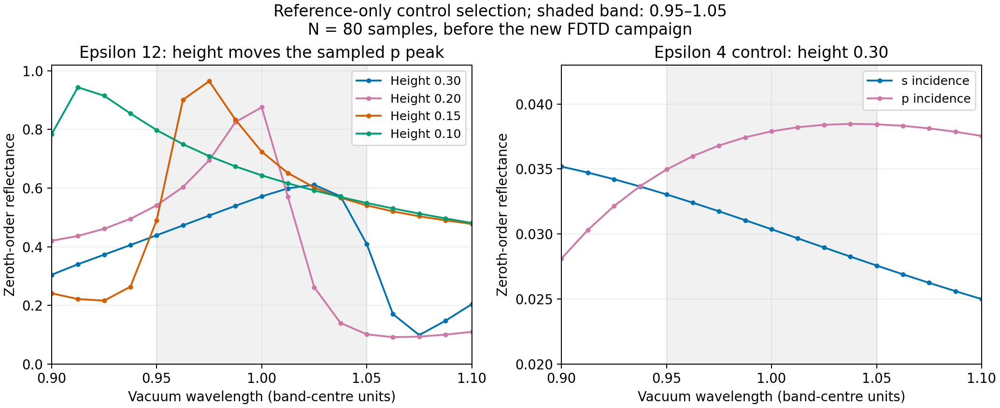
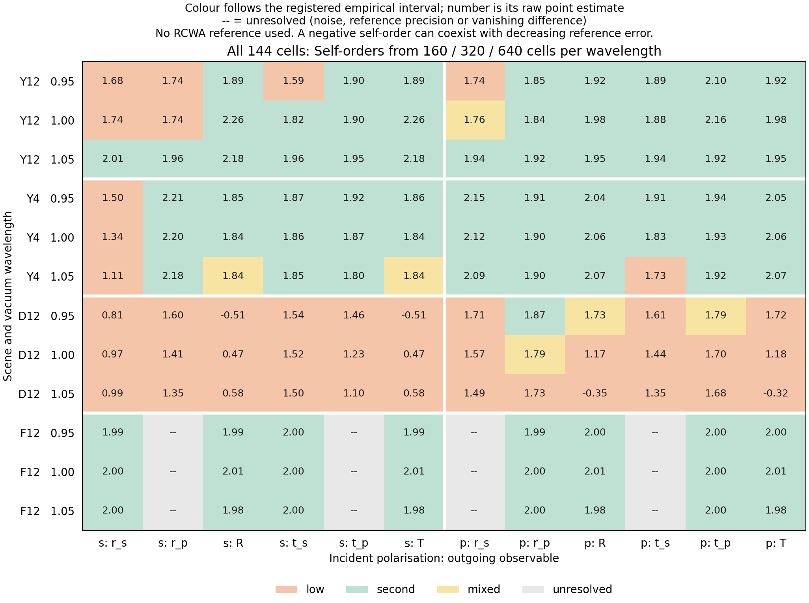
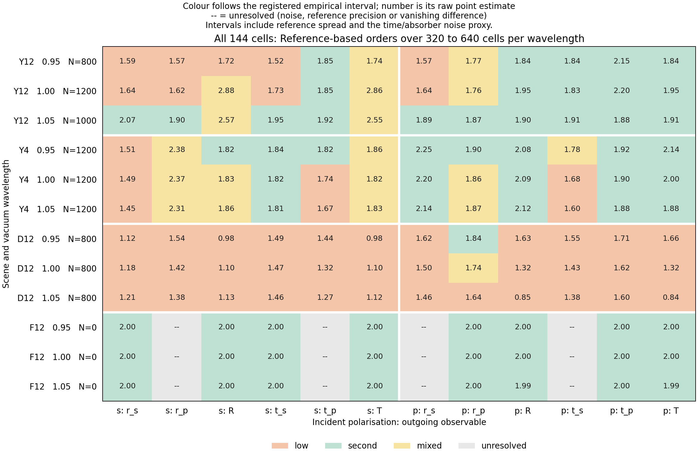
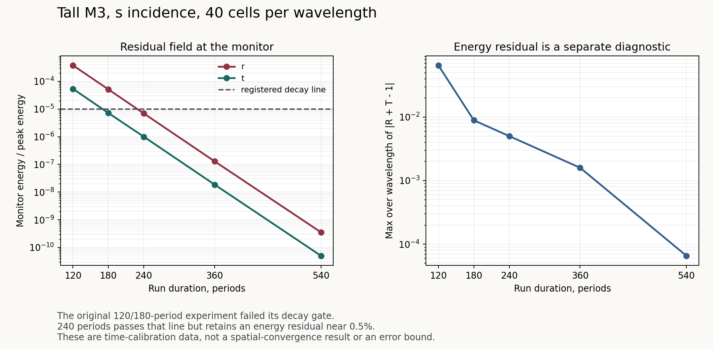
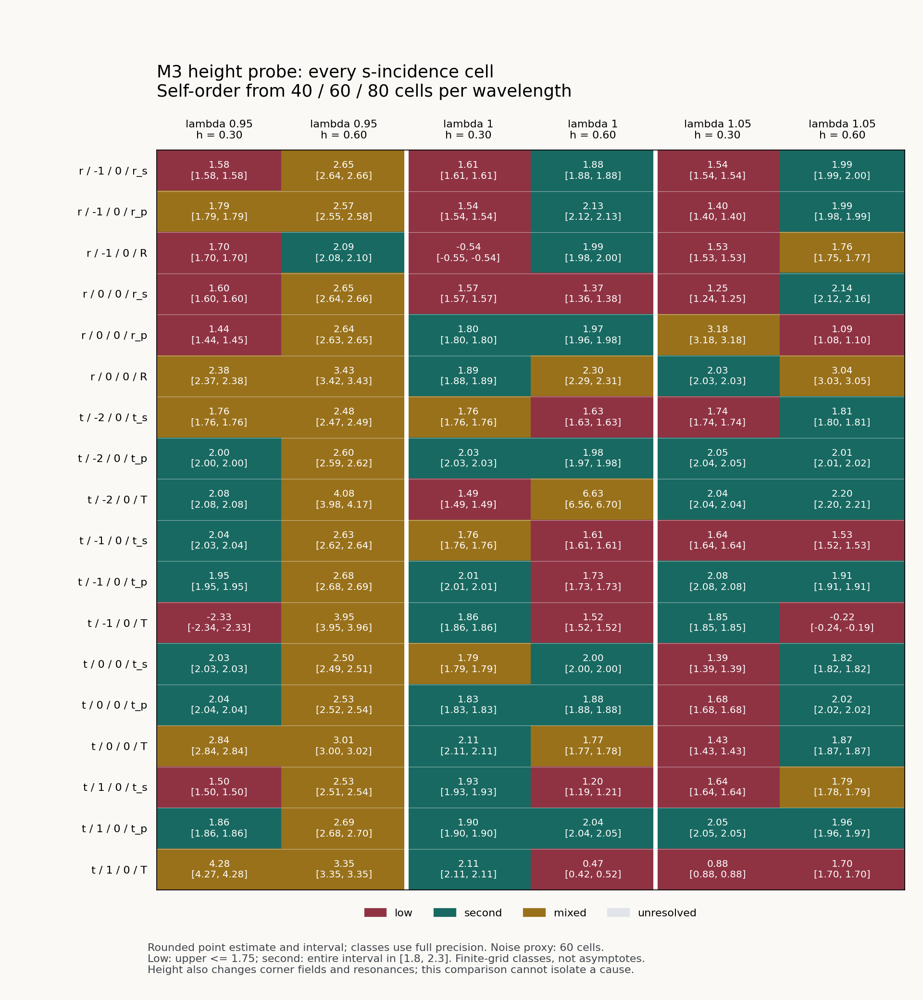

# A periodic metasurface against RCWA (stage 4, C7)

Written: 2026-10-03

Targets: `studies/cross_solver/metasurface/fdtd_metasurface_rcwa.py`, `studies/cross_solver/metasurface_corners/fdtd_metasurface_corners.py`,
`studies/cross_solver/metasurface_lifted/fdtd_metasurface_lifted.py`, `studies/cross_solver/metasurface_ridges/fdtd_metasurface_ridges.py`,
`studies/cross_solver/metasurface_fine/fdtd_metasurface_fine.py`,
`studies/cross_solver/metasurface/fdtd_metasurface_mutations.py`,
`tests/fdtd/test_fd_metasurface.py`, `tests/references/fd_metasurface_rows.json`,
`src/wavebit/fdtd/_post.py`, `src/wavebit/fdtd/_assemble.py`, `src/wavebit/fdtd/_monitors.py`,
`docs/guide/fdtd/fd-metasurface.md`.

## TL;DR

**C7 does not pass under its registered rule (campaign of 2026-10-03, report
`studies/cross_solver/metasurface/records/fdtd_metasurface_rcwa_report.log`).** The public path agrees with RCWA
wherever the comparison can judge it; what fails is the convergence order of one scene and one
cell RCWA holds at zero.

* **M1** (epsilon-4 cylinder, 8 orders) **passes** both polarisations: worst amplitude error
  2.9e-2, 7.4e-3, 2.1e-3 at 20, 40, 80 cells per wavelength (order 1.90 s, 1.97 p), every one
  of 72 cells consistent with RCWA, both controls failing as registered.
* **M3** (epsilon-12 box, conical incidence) **fails criterion 3**: it agrees with RCWA in all
  54 cells (criterion 4), but converges at order 1.64 (s) and 1.75 (p) in amplitude and 1.51 /
  1.62 in efficiency, under the 1.8 line -- 2.2e-2, 7.1e-3, 3.6e-3 at 40, 80, 120 for s.
* **M2 p fails criterion 4 in one cell of 27**: the cross-polarised `t_s` of the `(0, 0)` order at
  1.05, which RCWA holds at zero by the scene's mirror symmetry. FDTD's grid is not symmetric
  about the pillar, and the depolarisation it makes there (2.7e-4 at 100 cells per wavelength)
  falls slower than second order; the cell misses the band by 6%. Every amplitude and
  efficiency that RCWA makes non-zero passes, at orders 1.97 and 2.01.
* **M2 s is not judgeable**: its efficiencies converged at order 2.48, to 3.9e-4 at 100 cells,
  past what its RCWA ladder resolves (`u_F` 1.9e-4, against a third of 3.9e-4). Its amplitudes
  pass at order 1.80.

Every validity check held in every run: decay below 1e-5, 180 periods moving no cell by more
than 8e-7, JAX and Torch within 1e-14 of NumPy, `sum R + sum T` within about 1e-6 of 1, the frame
and shift instruments within 2e-11, the protocol the registered one. The prediction stated
before the data -- the cylinders, at the junction campaign's 1.73-1.74, might fail criterion 3
-- did not come true; the box did.

**The first suspect for M3, the corners' field singularity, did not show in its xz
cross-section** at the resolutions these runs use. A registered follow-up ran that cross-section
as a ridge, whose only corners are its edges, and it converged at second order from 40 to 320
cells per wavelength at epsilon 12 and 4 alike ("Is it the corners?" below). That study read
what lowers M3's order as three-dimensional. The third follow-up below takes away part of that
reading's premise.

**Nor does it need the junction's rim.** A second registered follow-up lifted the box 0.10 off
its glass. It converges at the same order: self-convergence orders 1.69 / 1.54 (amplitudes /
efficiencies), against 1.63 / 1.47 for the flush box. This statistic needs no reference. On C7's
own rows it puts M3 s, and M3 p's efficiencies, below second order as C7 did. M3's low order
does not need the rim; whether the rim adds a low-order error of its own in the flush box, the
lift cannot say ("Is it the rim?" below).

**The y faces: second by the registered rule, and not cleared.** A third registered follow-up
ran M3's yz cross-section as a 2D ridge. Its rule was settled by three reviews before any FDTD
row of its epsilon-12 scenes. Its registered statistic, the worst cell over three wavelengths,
read second order (1.91 to 1.95 between 80 and 320 cells per wavelength), and every control
held. That worst cell sits at the ridge's resonance.

Split by wavelength after the campaign, the worst amplitude cell away from the resonance
converges at 1.65 (wavelength 0.95) and 1.82 (1.0) between 160 and 320. Both orders have fallen
at every step, and one single cell reads 1.56. The xz ridge's worst cell reads 2.00 to 2.02 at
every wavelength. So the y faces and the edges along x are a suspect again, but a loose one: at
M3's coarser rungs the yz ridge's worst amplitude cell reads 1.86 to 1.90, where M3 s's
zeroth order is already below 1.65 at every wavelength ("Is it the y faces?" below).

**The cellwise extension through 640 resolves low orders in y ridges.** The fourth follow-up
registers every wavelength and observable separately. After its time and absorber checks,
the reference-free rule classifies 6 of 36 original-ridge cells as low, 4 of 36 epsilon-4
cells, and 32 of 36 cells of a ridge reduced to height 0.10. The cornerless film's 24 resolved
cells are second order; its 12 vanishing cross-polarised cells remain unresolved. The lower
ridge's strong sampled reflection peak is outside the measured band, so that in-band peak
is not necessary for low order in a y ridge. Its tail remains, and changing height changes
the corner fields too. These finite-grid results do not identify the mechanism or establish
that it causes M3's coarser-grid behaviour ("The y ridge through 640 cells" below).

## The question

Stage 4's use case (a) is a periodic metasurface lit by an oblique plane wave and read as
diffraction orders. C7 asks whether the public path -- `fd.plan` and `fd.run` with every
default, so the `'voxel'` discretisation and `Structure(junction='split')` where a pillar stands
flush on its substrate -- gives `wavebit.rcwa`'s answer for every propagating order's complex
amplitude, co- and cross-polarised, and for its efficiency, and whether it converges to that
answer at second order. The junction campaign ([`fd-subpixel-occupancy.md`](fd-subpixel-occupancy.md),
"The junction") compared the zeroth order of subwavelength cells at normal incidence; C7 asks
for the orders a metasurface is built to steer, at oblique and conical incidence.

The protocol, the scenes and the rule are registered in the docstring of
`studies/cross_solver/metasurface/fdtd_metasurface_rcwa.py`, written before the campaign ran; this document records why
they are what they are and what the campaign found.

## The scenes

| Scene | Pillar | Substrate | Cell | Incidence | Orders (R + T) | Rungs |
| --- | --- | --- | --- | --- | --- | --- |
| M1 | cylinder, epsilon 4, diameter 0.40, height 0.6 | 2.25 | 0.85 x 1.00 | theta 35, phi 0 | 2 + 6 | 20 / 40 / 80 |
| M2 | cylinder, epsilon 5.8, diameter 0.32, height 0.6 | 2.13 | 0.60 x 0.60 | theta 30, phi 0 | 1 + 2 | 25 / 50 / 100 |
| M3 | box, epsilon 12, 0.30 x 0.20, height 0.3 | 2.25 | 1.30 x 0.50 | theta 25, phi 30 | 2 + 4 | 40 / 80 / 120 |

Lengths are in vacuum wavelengths at the band centre; rungs are cells per vacuum wavelength.
Every scene is solved for both incident polarisations at three wavelengths, 0.95, 1.0 and 1.05,
from a source band of relative width 0.04. M2 splits the transmitted light between its `(0, 0)`
and `(-1, 0)` orders; in the pilot's slightly smaller pillar the `(-1, 0)` order carried 60% of
the incident s power at 0.95, 21% at 1.0 and 13% at 1.05.

**The same geometry in cells at every rung.** The pillar's axis sits a fixed fraction of a cell
past a node line, the substrate plane a fixed fraction of a cell above a node plane, and every
height, side and radius is a whole number of cells at every rung, so each face the lowering
reads sits at the same fraction of a cell at every rung (the study's `layout` checks it). The
pilot's scenes did not: M2's top sat 0.375, 0 and 0.25 of a cell above a node plane at 25, 50
and 100 cells per wavelength, and M3's narrow sides moved likewise. A face moving within the
cell from rung to rung changes the error's constant between rungs, which a convergence order
reads as convergence; the review that found it measured M2's lowest-rung efficiency error
doubling when only the substrate plane's place in the cell moved.

**Why these periods and angles.** `fd.PlaneWave` keeps the transverse wavevector fixed across
its band, so each wavelength has its own angle (`res['r'].theta_at`), and an order whose
transverse wavevector is `q` (in units of the band centre's vacuum wavenumber) sits at
`lambda q` at wavelength `lambda`: the band moves every order. The cells and angles were
searched for ones where every order that propagates anywhere in 0.95 .. 1.05 propagates
everywhere in it, leaving at `cos theta >= 0.5` in its own medium -- the grazing rule refuses
below 0.41 at these run lengths, and at the 24-cell layer with target 1e-12 a mode at 0.5
returns about 3e-6 -- and every other order sits at least 8% past its cutoff, so no Rayleigh
anomaly falls among the three wavelengths. Such layouts are rare: with a glass substrate and a
+-5% band, a square cell at normal incidence cannot carry the +-1 orders in air without
putting the +-2 orders in glass at grazing.

**The source's band is narrower than the pilot's.** The pulse's spectrum reaches further than
the three wavelengths it is read at. At a relative width of 0.06 it reached the reflected
orders' cutoffs near frequency 1.15 to 1.17 (about 2.6 standard deviations out), and M2's
reflection decayed as a power law, to 2.2e-5 of its peak after 60 periods. At 0.04 those
cutoffs sit 3.8 to 4.2 deviations out and the same run decayed to 5.9e-8, its orders unchanged
to 1e-5.

**Why rectangular cells.** The first pilot's M1 and M3 were square cells lit at phi 45 with the
pillar offset equally along x and y. Such a scene reads the same with x and y exchanged, so a
defect that transposes the two axes -- where this package's two axis-order rules meet, arrays
running v first and hand-written pairs x first -- would agree with RCWA all the same. The
pilot's transmitted `(-1, 0)` and `(0, -1)` orders were equal to round-off. Both scenes were
replaced by the rectangular cells above. M2's square cell with equal offsets and a round pillar
still reads the same transposed; only its incidence breaks the exchange. M1 and M2, lit in the
xz plane by an axially symmetric pillar, are mirror-symmetric in y about the pillar's axis: M2's
cross-polarised amplitudes vanish in RCWA (to 1e-12), and M1's `(m, +-1)` cross-polarised
amplitudes are equal and opposite. Only M1 propagates orders with `n != 0`, so only M1 tests the
y half of the lateral phase correction below; only M3, a rectangular box under conical
incidence, has no mirror at all.

## The reference

`wavebit.rcwa` solves the identical geometry with the shape centred on the cell, both incident
polarisations from one solve, at the run's own `theta_at` per wavelength, over a truncation
ladder. The cylinders take RCWA's shape path (closed-form Fourier coefficients, the
normal-vector-field factorisation). The epsilon-12 box does not, because there RCWA itself
converges too slowly to judge an FDTD error of a few 1e-3. Measured at the band centre against
the ladder's top (half-widths along x and y):

| Box path | Truncation | Worst change in an amplitude |
| --- | --- | --- |
| shape (NVF), half-widths in proportion to the periods | (32, 12) against (39, 15) | 2.3e-3 |
| raster, Li's rule, exact series, same proportion | (32, 12) against (39, 15) | 9.1e-4 |
| raster, Li | (39, 10) against (39, 15) | 1.7e-3 |
| raster, Li | (26, 15) against (39, 15) | 2.5e-4 |
| raster, Li, equal half-widths | (24, 24) against (28, 28) | 2.6e-4 |

The narrow side of the box (0.18 of a 0.50 period) wants as many orders as the long one, and
Li's rule on a raster whose pixel edges carry the box's edges -- with the exact
(`fourier_coefficients='integrated'`) series the raster then *is* the box -- converges where
the shape path's normal field, discontinuous at the corners, does not. The campaign's box
ladder is therefore the raster's, at equal half-widths (20, 26, 28, 30, 32). These pilot
numbers are for the first box, 0.30 x 0.18; the campaign's 0.30 x 0.20 box runs the same ladder.
An epsilon-6 box of the same size converged to 7.5e-5 on the old ladder; an epsilon-12
cylinder of diameter 0.25 to 3.5e-4. The high-index box is kept because it is the scene a
silicon metasurface is.

The cylinders' shape-path ladders converge slowly too, and not in step: M2's at 0.95, against
(24, 24), moves 4.3e-4, 1.5e-4, 1.3e-4 and 9.3e-5 in an amplitude at (12, 12), (15, 15),
(18, 18) and (21, 21). The normal field the rule reads is sampled on a grid (`normal_grid`,
1024 by default); at 4096 every one of those numbers is the same to the digit, so the slow
part is not that sampling. Each ladder's spread enters the rule as `u`, and a reference whose
spread is too large for the error it judges is reported as such, not used.

Two instruments hold the comparison's frame. `frame`: a box spanning the cell along one axis
has a constant normal, where the normal-vector-field rule is Li's, and the raster and shape
paths agree to 3.1e-12 (along x) and 7.2e-12 (along y) at an offset centre. `shift`: RCWA
centres its shape at the origin and fd's pillar sits at `(xc, yc)`, so order `(m, n)`'s
amplitude differs by `exp(-2 pi i (m xc/Px + n yc/Py))` and its efficiency not at all; RCWA
solved at the offset matches the centred solve times that factor to 5.6e-12 or better on all
three scenes. fd's amplitudes are multiplied by the inverse factor before any comparison.

That factor is the pilot's one surprise. Compared without it, M2's `(-1, 0)` transmission
amplitude missed RCWA by 0.30 at 25 cells per wavelength and 0.058 at 50 -- an error that falls
with the grid only because the pillar's offset, fixed in cells, shrinks with the cell. With it,
the miss is 0.065 and 0.019. Nothing in either solver is wrong; the two place the pillar
differently, and a comparison of the non-zero orders' phases has to say where.

## The rule

Registered in the study's docstring and recorded (the file's hash and a copy, with each scene's
RCWA ladder) at 2026-10-03T02:19:40+0900, before any FDTD row existed; the report compares the
file it runs from with that record. A *cell* is one compared number: an order's outgoing
amplitude (phase-corrected) or its efficiency, at one wavelength and one incident polarisation.
`A(n)` and `F(n)` are the largest amplitude and efficiency errors over a scene's cells at rung
`n`. `u_A` and `u_F` are the largest distances, over the amplitude and the efficiency cells, of
the three ladder truncations below the top from the top -- one number per kind, as the junction
campaign's `u_ref` was one per scene. The Richardson pair is the finest rung and the finest one
at most two thirds of it: 40 and 80 for M1, 50 and 100 for M2, 80 and 120 for M3.

1. **Validity.** No plan is refused and no value is missing or non-finite; every rung run and
   every 180-period run settles (both monitors' decay below 1e-5) without a growth or unsettled
   warning, and reports the fixed-k angle. A rung run that does not settle at 120 periods is
   solved once more at 180 and that run stands for it. At the middle rung the 180-period run
   moves no cell by more than a tenth of the finest rung's error of its kind, and at the lowest
   rung JAX and Torch agree with NumPy to 1e-10 over amplitudes and efficiencies.
2. **A reference that can judge.** `u_A` and `u_F` are at most a third of the finest rung's
   errors; otherwise the pair is reported *not judgeable*.
3. **Second order.** `A` and `F` fall at every refinement, at a least-squares order of at least
   1.8 over the three rungs.
4. **Consistency.** In every cell the reference lies within `3 u + 0.1 |X(n_f) - X(n_c)|` of the
   segment of Richardson limits for orders 1.4 to 2 -- the junction campaign's band.

Two controls are judged by the same rule and must fail it: FDTD's amplitudes referred to a
pillar one cell off its axis (a first-order position error) must fail criteria 3 and 4, and every
reference value moved by the finest rung's error must fail criterion 4. A pair that would pass
while a control does not fail is reported *rule inert*. Before the finer rungs ran, a check
(`project`) compared each ladder's `u` with a third of the finest-rung error projected from the
lowest rung at order 1.8, and the campaign would not start the finer rungs until every ladder
held; a ladder may only grow at its top.

The rule was rewritten twice before it ran, each time after an adversarial review. The changes
that matter for reading the results: every face of every pillar now sits at the same fraction
of a cell at every rung (the first draft's M2 top and M3 sides moved within the cell from rung
to rung); M3's rungs became 40/80/120 (at 40/60/80 the slope leaned too hard on the ends); the
source band narrowed from 0.06 to 0.04; the controls' required outcomes were written down, and
the phase control became a one-cell misplacement (dropping the correction gave M3, at 120 cells,
an error only 1.3 to 1.6 times FDTD's own); the cells RCWA holds at zero by symmetry share their
kind's `u` instead of having none. The study's docstring lists every amendment.

*Stated before the data:* the junction campaign measured this same worst-cell statistic for its
pillar scenes at orders 1.74 (epsilon 4 on 2.25, height 0.6, 20/40/80 -- M1's materials and
rungs), 1.73 (epsilon 5.8 on 2.13 -- M2's), 1.48 and 1.77 for its other cylinders, and 1.89
and 2.02 for its box and ridge. Cylinders may fail criterion 3 here for the reason C3 named,
the default voxel rule's curved wall ([`fd-mie-validation.md`](fd-mie-validation.md)).

## Results

The worst error over a pair's cells at each rung, its least-squares order over the three
rungs, the ladder's spread, and the verdict (`report` of 2026-10-03T10:52:18+0900, protocol
`f34cb37f2f16c405`, the registered one):

| Pair | `A` at the three rungs | order | `F` at the three rungs | order | `u_A`, `u_F` | Verdict |
| --- | --- | --- | --- | --- | --- | --- |
| M1 s | 2.93e-2, 7.40e-3, 2.10e-3 | 1.90 | 1.74e-2, 4.58e-3, 1.36e-3 | 1.84 | 1.9e-4, 1.9e-4 | pass |
| M1 p | 2.78e-2, 6.60e-3, 1.81e-3 | 1.97 | 1.36e-2, 3.50e-3, 9.06e-4 | 1.96 | 2.3e-4, 1.7e-4 | pass |
| M2 s | 7.41e-2, 2.02e-2, 6.08e-3 | 1.80 | 1.21e-2, 2.05e-3, 3.87e-4 | 2.48 | 2.0e-4, 1.9e-4 | not judgeable |
| M2 p | 3.48e-2, 8.58e-3, 2.27e-3 | 1.97 | 1.80e-2, 4.48e-3, 1.11e-3 | 2.01 | 1.5e-4, 8.5e-5 | FAIL (4: one cell) |
| M3 s | 2.21e-2, 7.10e-3, 3.64e-3 | 1.64 | 1.16e-2, 4.09e-3, 2.19e-3 | 1.51 | 3.4e-4, 2.3e-4 | FAIL (3) |
| M3 p | 1.29e-2, 3.72e-3, 1.91e-3 | 1.75 | 6.02e-3, 1.95e-3, 1.02e-3 | 1.62 | 3.0e-4, 1.9e-4 | FAIL (3) |

Rungs are 20/40/80 (M1), 25/50/100 (M2) and 40/80/120 (M3) cells per vacuum wavelength; `A`
is the worst amplitude error and `F` the worst efficiency error over every propagating order,
both outgoing polarisations and the three wavelengths.

**M3's order is steady, not noisy.** Its local orders are 1.64 (40 to 80) and 1.65 (80 to 120)
for s, 1.80 and 1.64 for p. The reference cannot account for it: `u_A` is a tenth of
`A(120)`, and a reference off by that much at every rung tilts a three-rung slope with these
rungs by under 0.1. Nor can the run length (8e-7) or the backends. And the error is
consistent with RCWA: in all 54 cells the reference lies inside the band around the Richardson
limits for orders 1.4 to 2. What this campaign cannot say is which part of the box's
discretisation converges at first order: the candidates are the box's creases (its vertical
and top edges, where the cross terms take the nearest surface's normal as a stand-in,
[`fd-subpixel-occupancy.md`](fd-subpixel-occupancy.md)), the junction's rim where box, glass
and air meet, and the conical incidence that only M3 has. The junction campaign's own epsilon-12
box (D', normal incidence, the zeroth order only) converged at 1.89. The corners' own singularity was tested
first, in the xz cross-section, and did not show there at these resolutions (below, "Is it the
corners?"; but see "Is it the y faces?").

**M2 p's one cell.** The cross-polarised `t_s` of the `(0, 0)` order is zero in RCWA (1e-13);
FDTD's runs give 1.68e-3, 6.0e-4 and 2.65e-4 at 1.05 and 25, 50 and 100 cells per wavelength
(the same order's cell at 0.95 goes 1.18e-3, 1.90e-4, 1.56e-4). The pillar's axis sits a
quarter cell off a node line along y, so the grid is not mirror-symmetric about it and leaks a
little of one polarisation into the other; the leak shrinks with the cell, but erratically and
slower than second order, and the band, 3 `u_A` plus a tenth of the last step, is 5.2e-4 where
the cell sits 5.5e-4 from the Richardson segment. M1, mirror-symmetric too, leaks at most
2.9e-5 at 80 cells.

**M2 s's reference.** The `project` check, run before the finer rungs, found every ladder
sufficient for an error falling at order 1.8. M2 s's efficiencies fell at 2.48 instead, to
3.9e-4 at 100 cells, and the cylinder's shape-path ladder levels off near 2e-4 (its top three
truncations against (24, 24): 1.9e-4 at most). The rule then reports the pair as not
judgeable rather than read a reference that cannot tell.

**The controls failed as registered on every pair.** Referring FDTD's amplitudes to a pillar
one cell off its axis gives amplitude orders of 0.87 to 1.12 and leaves 3 to 30 cells outside
the band; moving every reference value by the finest rung's error leaves 19 to 70 cells
outside. So criteria 3 and 4 can fail on these numbers, and a pass is not a pass by default.

**Costs.** On this machine (12 logical CPUs, JAX on the CPU): M1 at 80 cells per wavelength
took 20 minutes, M2 at 100 19 minutes, M3 at 120 84 minutes per run; the RCWA ladders took
16 minutes (M1), 18 (M2) and 2.3 hours (M3, whose top truncation took 18 minutes per
wavelength).

## Is it the corners? (2026-10-03)

The first explanation for M3 was the one the subpixel-smoothing literature gives for sharp
dielectric corners: the field there goes as `r^(nu - 1)`, and an integrated quantity's
smoothing error falls as `dx^(2 nu)` rather than `dx^2` (Farjadpour et al., Opt. Lett. 31, 2972
(2006); Oskooi et al., Opt. Lett. 34, 2778 (2009)). The owner chose to test it before anything
else. `studies/cross_solver/metasurface_corners/fdtd_metasurface_corners.py` registered a prediction and a rule before its
campaign (hash recorded at 2026-10-03T20:52:08+0900) and ran it.

**The prediction.** A transfer-matrix condition gives each corner's exponent; two independent
derivations (a parity and nodal-system one with closed forms, and a spectral-element angular
eigenproblem checked by a graded finite-volume solve) agree with it to 1e-9, and a third check
to 40 digits (`studies/cross_solver/metasurface_corners/records/fdtd_metasurface_corners_crosscheck.md`).
For an epsilon-12 right angle in air `nu` is 0.7219 (order 1.444); for the base edge where an
epsilon-12 pillar, air and the 2.25 glass meet, 0.6845 (order 1.369); at epsilon 4 the two give
1.612 and 1.591. Farjadpour et al. quote 0.702 for their epsilon-12 corner; its exact exponent
is `(2/pi) arccos(11/26) = 0.7219`, and none of the derivations could produce 0.702 from the
paper's geometry -- the measured 1.4 they report agrees with 1.444 either way.

**The test.** M3's cross-section made a ridge uniform along y -- its only corners the four
edges, its run two-dimensional and cheap enough for 320 cells per wavelength -- at epsilon 12
(R12) and epsilon 4 (R4), and an epsilon-12 film with no corner at all (F12), all under M3's
conical incidence, against 1D RCWA references converged to 1e-5. The rule asked the local order
between 160 and 320 cells per wavelength to fall within 0.25 of the prediction for both ridges,
R4's above R12's, with F12 at least 1.8 as the control.

| Scene | Predicted | `A` at 40 / 80 / 160 / 320 | Local order 160 to 320 (`A`, `F`) |
| --- | --- | --- | --- |
| R12 | 1.37 - 1.44 | 6.1e-2 / 1.4e-2 / 3.5e-3 / 8.8e-4 | 2.00, 2.01 |
| R4 | 1.59 - 1.61 | 7.6e-3 / 1.9e-3 / 4.7e-4 / 1.2e-4 | 2.00, 2.01 |
| F12 | 2 | 8.7e-2 / 2.2e-2 / 5.5e-3 / 1.4e-3 | 2.00, 2.00 |

**The explanation is contradicted.** Every run settled, every reference could judge, the
control held -- and both ridges converge at second order from 40 cells to 320, every step a
factor of four, the median cell's local order 2.00 as well. Within the resolutions any
metasurface run uses, the corners of a ridge -- the epsilon-12 right angles and the base edges
where pillar, air and glass meet -- do not hold the order down under this smoothing. Whatever
makes M3 converge at 1.5 to 1.75 is three-dimensional: the box's vertical edges, its vertices,
or the junction's rim where it turns a corner. The asymptotic `dx^(2 nu)` regime may lie beyond
320 cells per wavelength; the measurement says only that it does not reach down to where these
runs live. (The third follow-up, "Is it the y faces?", later found M3's yz cross-section not
cleared, which takes away part of this reading's premise.)

Before registration a dry run of every command on a toy configuration (rungs 40 and 80, 40
periods, a small RCWA ladder) was seen: local orders between 40 and 80 of 2.10 / 2.05 (R12), 2.00
/ 1.99 (R4) and 1.99 / 1.95 (F12). The rule was written before that run and not changed after;
the study's docstring says so. The dry run's rows and report, `fdtd_metasurface_corners_dryrun.jsonl`
and `fdtd_metasurface_corners_dryrun_report.log`, are archived outside the repository.
The registration records the study file's SHA-256, and the file committed with the results is
that file byte for byte.

The follow-up changed no production source. Its gates: the full fd/docs tier 2745 passed and 8
skipped of 2753, the slow tier 81 of 81, the four freezers 143/288/140/570 arrays bit for bit,
`ruff check .` and `sphinx-build -W` clean (recorded in `fdtd_metasurface_corners_validation.json`,
with the logs in the controls directory `fdtd_metasurface_corners_controls`; both are archived
outside the repository). A first attempt stopped on the
documentation contract -- the cross-check record cited its scripts from its own folder, and a
copy of the registered study, kept beside the logs as C7's is, cited paths from the study's
directory; the record was corrected, the copy dropped (the committed study is the registered
file), and the attempt's logs are archived with the others.

## Is it the rim? (2026-10-04)

With the cross-section's corners ruled out, this study named three suspects, all
three-dimensional: the box's four vertical edges, its eight vertices, and the junction's rim,
where pillar, air and glass meet along the base perimeter and turn the box's corners. A fourth
was missed until a review after this campaign: the box's y faces and its edges along x, which
the ridge of "Is it the corners?" (uniform along y) did not have. The rim was the one suspect a
single change could remove. The owner chose to lift the box off its glass and see whether the order came
back. The study is `studies/cross_solver/metasurface_lifted/fdtd_metasurface_lifted.py`; its rule was registered before its first
FDTD row.

**The scene.** The scene is M3 in every respect except that the box's base sits `GAP = 0.10`
above the glass. That is 4, 8 and 12 cells at 40, 80 and 120 cells per wavelength, so every face
keeps its fraction of a cell. At the lowest rung, three voxels of pure air separate the box's
smoothed base from the glass's smoothed face, so no voxel holds pillar and glass together.
Lifting the box also gives its base four edges and four vertices in air. The study can therefore
show one of two things:

* the order comes back without the rim (the rim is *implicated*);
* the order does not come back (the rim is *not necessary* for the low order: the box itself
  suffices, through its edges, its vertices or its y faces).

The reference is C7's: the raster with Li's rule and the exact series, with the air layer added
under the box. Only s incidence is run.

**The statistic does not lean on RCWA.** A first draft judged the lifted box by the local
order, between 80 and 120 cells, of the error against the top of the RCWA ladder. That is the
corner study's statistic. C7's own criterion 3 fits the slope over all three rungs, which is why
C7 quotes 1.64 / 1.51 where the table below has 1.65 / 1.53. An adversarial review of that draft
found the statistic still moving with the ladder. C7's flush M3 s reads these local orders
against each ladder top:

| Ladder top | 20 | 26 | 28 | 30 | 32 |
| --- | --- | --- | --- | --- | --- |
| amplitude | 1.42 | 1.55 | 1.60 | 1.61 | 1.65 |
| efficiency | 1.23 | 1.42 | 1.46 | 1.51 | 1.53 |

The reference was still converging at the size where the draft's thresholds, 0.05 apart, would
have decided. The verdict therefore rests on the *self-convergence order*, which has no reference
in it. Let `D1` be the largest change of any cell between rungs 40 and 80, and `D2` the largest
between 80 and 120. The order `p` solves `(40^-p - 80^-p) / (80^-p - 120^-p) = D1 / D2`.

On C7's own rows, this statistic puts M3 below second order where C7 did, with one exception.
Flush M3 s reads 1.63 (amplitudes) and 1.47 (efficiencies), and M3 p reads 1.90 and 1.64. M3 p's
amplitudes would clear a 1.8 line by this statistic, where C7 had 1.75 for them. Its efficiencies
would not, so C7's fail for M3 p stands either way. For M3 s and M3 p's efficiencies, the
sub-second order is in the FDTD answers themselves, not in the reference. The control cell M1
reads 2.04 / 2.03 (s) and 2.14 / 1.97 (p). M1 s's amplitudes, referred to a pillar misplaced by
one cell (an error first order in the cell), read 0.92. A misplacement does not touch
efficiencies, which stay at 2.03.

**The rule.** Write `dA` and `dF` for the lifted box's self-convergence orders minus the flush
box's (amplitudes and efficiencies):

* *implicated*: both rise by at least 0.2, and the lifted orders both reach 1.8;
* *partial*: both rise by at least 0.2, but the lifted orders do not both reach 1.8;
* *not necessary*: neither rises by more than 0.1;
* *inconclusive*: anything else.

RCWA keeps two jobs:

* it must show the lifted runs converging toward their own reference (local order at least 1);
* it gives a second view of the change, lifted minus flush, at each of three ladder tops. A
  verdict the reference contradicts there becomes *inconclusive (the reference disagrees)*.

Validity is C7's criterion 1 applied to each run: it settles at 120 periods or its one
180-period repeat does, with no growth or unsettled warning, not marked unstable, at the
fixed-k angle, and with every cell present and finite. C7's backend comparison is not repeated:
each lifted rung ran on one backend only, 40 on NumPy and 80 and 120 on JAX (the 80-cell rung's
180-period run-length check also on JAX). The run-length check and the
controls are this study's own:

* the run-length line is a tenth of `D2` (C7's was a tenth of the finest error against the
  reference), applied to the lifted box's 80-cell pair and to the flush box's;
* the controls are the two M1 readings above, which must be at least 1.8 and at most 1.5.

The lifted rows must also be compared at the flush box's rungs and ladder tops.

**The rim is not necessary.** The campaign ran from 12:08 to 15:13 on 2026-10-04 (report
`studies/cross_solver/metasurface_lifted/records/fdtd_metasurface_lifted_report.log`). Every run settled at 120 periods. The
middle rung's repeat at 180 periods moved no cell by more than 2.4e-7, against lines of 4.3e-4
and 3.1e-4. Every control
held. Lifting the box changed the order by less than 0.1:

| Box | `D1` / `D2`, amplitudes | `D1` / `D2`, efficiencies | `p_A` | `p_F` | Median cell |
| --- | --- | --- | --- | --- | --- |
| flush (C7's rows) | 1.50e-2 / 3.46e-3 | 7.47e-3 / 1.89e-3 | 1.633 | 1.471 | 1.809 |
| lifted 0.10 | 1.93e-2 / 4.30e-3 | 1.27e-2 / 3.10e-3 | 1.690 | 1.538 | 1.831 |

`dA` is +0.057 and `dF` is +0.067. The reference's view lets the verdict stand: lifted minus
flush, the local orders against the tops 20, 26 and 28 differ by -0.19 / -0.04, -0.08 / -0.01
and -0.06 / +0.01, none of them near the 0.2 rise the rule tests. The view is a weak instrument,
though. Its amplitude differences have the opposite sign to `dA`, and they drift by 0.13 across
the three tops, more than the change being measured. The premise that the reference's error
largely cancels between the two boxes did not hold well. Against its own top (28), the lifted box's worst errors fall from 2.8e-2 to
9.2e-3 to 4.9e-3 (amplitudes) and from 2.0e-2 to 6.9e-3 to 3.8e-3 (efficiencies). That is local
orders 1.54 and 1.47: it converges toward its reference. Rung 28 could not judge absolute
accuracy by C7's standard: the truncations below it spread by `u` = 1.7e-3, more than a third
of the finest amplitude error. The rule does not ask it to. The lifted box is *less* accurate
than the flush one at every rung, each against its own top 28: its amplitude errors are 1.27 to
1.31 times the flush box's, its efficiency errors 1.62 to 1.68 times. The two scenes differ
optically, so that ratio is not a count of creases. It converges at the same rate.

So M3's low order does not need the junction: without the rim the box converges as slowly.
This does not show that the rim adds nothing in the flush box, because the lift also gives the
base edges and vertices in air. Three candidates are left: the box's vertical edges, its
vertices, and its y faces with the edges along x, which no ridge here had. The corner
cross-check's vertex exponent does not point at the vertices either. It is `lambda` 0.58
at an epsilon-12 box's corner, so a vertex should contribute `dx^(2 lambda + 1)`, about
`dx^2.16`. The ridge's edges showed that this asymptotic theory need not hold at these
resolutions, and no vertex's convergence was measured, so that prediction does not rule the
vertices out.

**What was seen first.** The harness was tried twice on an epsilon-6 box, a different material,
against toy ladders:

* The first draft (`GAP` 0.05, rungs 40 / 60 / 80) ran end to end under its own statistic: the
  local order against a toy top, which could not judge. It printed no self-convergence order.
* The file the second dry run used (SHA-256 `f71c2dd2...`), at rungs 30 / 40 / 60, read
  self-convergence orders 2.30 and 2.48. A first attempt at 20 / 30 / 40 had been refused by the
  plan as under-resolved.

The registered rule replaced the draft's after the first dry run: that run's numbers were seen
before the self-convergence statistic, its thresholds and `GAP` 0.10 were written. The rule was
written before the second dry run. Since then it has changed only at the second registration
below. The dry runs' rows and reports, and the second's copy of its file, are kept in the
dry-run directory `fdtd_metasurface_lifted_dryrun`, archived outside the repository.

**A second registration.** The rule was first registered with C7's whole ladder (20 to 32). The
campaign was stopped by hand before any FDTD row, after four RCWA rows. An RCWA solve of this
size allocates about 34 complex matrices of size 2N x 2N, for one layer or two alike
(measured in the memory record `fdtd_metasurface_lifted_memory`, archived outside the
repository). That is some 23 GB at rung 28, 31 GB at
rung 30 and 39 GB at rung 32, against 21 GB of free memory and 31 GB of free commit on this
machine that day. Rung 28 fits only by paging, rung 30 would leave under 1 GB of commit, and
rung 32 exceeds it.

The rule was registered again with the ladder ending at rung 28, with the reference's view
taken at tops 20, 26 and 28, where C7's flush rows exist. The rung-28 solves ran. During the first
of them, the only one whose memory was recorded, free memory fell to 3.5 GB and free commit to
9.1 GB, so it paged. Two more things in the code changed with the
second registration, and `part_register`'s docstring with them:

* the registration guard now refuses only when the log holds FDTD rows (it had refused on any
  row), which is what let the second registration stand over four RCWA rows;
* the slice the spread `u` reads (printed for information only) went from `LADDER[-4:-1]` to
  `LADDER[:-1]`. On the three-rung ladder both select rungs 20 and 26, so no printed number
  depends on it.

The four RCWA rows were reused: their provenance key covers the solve, not the ladder. Three
things from the first attempt are preserved, archived outside the repository:

* the first registration;
* the stopped campaign's log;
* the first registration's file, `fdtd_metasurface_lifted_registered_attempt1.py.txt`. It was
  rebuilt from the second dry run's copy and the one paragraph it changed, and checked against
  the registered hash.

The study file committed with the results hashes to the second registration.

**Corrections to the registered docstring.** The study file is left as registered, so its
docstring keeps seven inaccuracies a review found after the campaign. Six are in its prose. The
seventh is the wording of rule item 1, which the code applies as described in the last bullet.
The rule's thresholds and its code are not among them.

* It calls the local order "C7's statistic". C7's criterion 3 is a least-squares slope.
* It says this machine "cannot hold" C7's top two rungs. C7's ladder ran them on 2026-10-03. What
  could not hold them was the memory and commit free on 2026-10-04.
* Its registration history says "nothing else changed". The guard and the `u` slice changed too
  (above).
* It says the registration records M1 s's readings at 0.25 and 0.5 of a cell off its axis (1.61
  and 1.05). The registration records only the one-cell reading. The review recomputed the other
  two as 1.609 and 1.053.
* It reads a *not necessary* outcome as "the vertical edges and vertices suffice". The y faces
  and the edges along x belong in that list.
* Its disclosure paragraph calls the second dry run's file "This file (SHA-256 `f71c2dd2...`)",
  and the kept copy "the second's copy of this file". The registered file hashes to
  `5af4a441...` and was never dry-run. `f71c2dd2` is the dry run's file, identical to the first
  registration's file (`fe87f8f9`) but for that paragraph, as the docstring says. The changes
  from it to the registered file are listed in the `README.md` of the dry-run directory
  `fdtd_metasurface_lifted_dryrun`, archived outside the repository.
* Rule item 1's "C7's own run-length check included" means the flush box's own 120- and
  180-period pair. It is judged by this study's line, a tenth of `D2`, not by C7's.

Separately, the docstring's expectation that the reference's error "largely cancels" between the
two boxes was tested by the campaign. It held for the efficiencies, whose difference drifts by
0.05 across the three tops, but not for the amplitudes, which drift by 0.13 (above).

This follow-up changed no production source either: the fd source SHA-256 is still
`50574088a3e1e766f334890bcbbd5dbd5ad1dc600c9469766f65d63c949832d9`. Its gates:

* the full fd/docs tier: 2745 passed and 8 skipped of 2753 (2316 seconds);
* the slow tier: 81 of 81 (1226 seconds);
* the four freezers: 143/288/140/570 arrays, bit for bit;
* `ruff check .` (0.16.2): clean (`ruff.log`);
* `sphinx-build -W`: clean, before and after the review's corrections
  (`sphinx_before_review.log`, `sphinx_after_review.log`);
* the documentation contract, rerun after the corrections: 66 passed
  (`docs_contract_after_review.log`).

Reported totals match collection, with no INTERNALERROR and no worker crash. The pytest tiers and
the freezers are recorded in `fdtd_metasurface_lifted_validation.json`. It and all the logs
named above, which are in the controls directory `fdtd_metasurface_lifted_controls`, are archived
outside the repository.

## Is it the y faces? (2026-10-04)

The corner study's ridge was M3's xz cross-section. M3's yz cross-section -- the box's y faces
and its edges along x -- had not been tried. The owner chose to run it. The study is
`studies/cross_solver/metasurface_ridges/fdtd_metasurface_ridges.py`. Its rule was registered at 22:41:09 on 2026-10-04, before
any FDTD row of its epsilon-12 scenes and after three adversarial reviews (22, 25 and 18
confirmed findings).

**What a 2D scene can test.** A first draft also differenced each ridge's uniform axis on the
grid, with a Bloch phase over 4 cells. It asked whether differencing along an edge lowers the
order, as 3D M3 differences every edge. A review showed that on a uniform axis this is the
`Axis1D` problem at `k_eff = (2/dx) sin(k dx/2)`: a smooth shift of order `dx^2`, which cannot
lower an order. Its RCWA solve at `k_eff` reproduced, cell by cell, the difference between the
dry run's Bloch and `Axis1D` yz ridges. Those scenes were dropped. M3's finite edges, its
vertices and its edges along z have no 2D twin.

**The scenes.**

* `Y12` is M3's yz cross-section: an epsilon-12 ridge 0.20 wide in a 0.50 cell, 0.30 high on the
  glass, uniform along x, under M3's wave, its axis placed as M3's.
* `X12` is `Y12` turned a quarter turn about z. The turn maps the Yee grid onto itself, so a
  solver that treats x and y alike gives the same numbers.
* `F12` is the corner study's film, the control.

The rungs are 40, 80, 160 and 320, s and p, zeroth order only. The RCWA reference ladder runs to
N = 800.

**The rule.** A scene's class reads four local orders: `A` and `F`, at the steps 80 -> 160 and
160 -> 320, each the worst cell over the three wavelengths and both incident polarisations.

* *second* when all four lie in [1.8, 2.3];
* *low* when all four are at most 1.75;
* *mixed* otherwise.

The step 40 -> 80 is printed but not judged. An RCWA scan found a p resonance of the epsilon-12
yz ridge at the band's long end (R_p 0.61, 0.41 and 0.10 at 1.025, 1.05 and 1.075), and a grid
error that shifts it answers nonlinearly at coarse rungs. The upper line keeps out of *second*
an order above 2. Such an order can come from a first-order term cancelling the second-order one,
from a higher-order term, or from the resonance's nonlinear response.

The controls:

* `F12`'s local orders are at least 1.8 at every step, 40 -> 80 included, and it reproduces the
  corner study's rows;
* *the xz premise*: the corner study's `R12` rows, scored under this rule, must class second;
* *a first-order control in two signs*: `Y12`'s rows, scored against a ridge narrower and one
  wider by 1/32 of a cell at each rung, must not class second;
* *symmetry*: `X12` reproduces `Y12` to 1e-10.

**The registered verdict: second.** The campaign ran from 22:41 to 23:28 on 2026-10-04 (report
`studies/cross_solver/metasurface_ridges/records/fdtd_metasurface_ridges_report.log`). Every run settled, and every check held:

* the reference's spread `u` was 3.8e-6, against a gate of 2.6e-5;
* the run-length check moved no cell by more than 4.7e-7;
* `X12` matched `Y12` to 4.8e-14;
* the film reproduced the corner study's rows to 0.0.

| Scene | 40 -> 80 (not judged) | 80 -> 160 | 160 -> 320 | Class |
| --- | --- | --- | --- | --- |
| `Y12`, the yz ridge | 1.90 / 1.89 | 1.92 / 1.95 | 1.91 / 1.94 | second |
| `R12`, the corner study's xz ridge, under this rule | -- | 2.00 / 2.01 | 2.00 / 2.01 | second |
| `F12`, the film | 1.99 / 1.95 | 2.00 / 1.99 | 2.00 / 2.00 | (control) |
| `Y12` against a ridge 1/32 cell narrower | -- | 1.35 / 1.35 | 1.22 / 1.22 | low |
| `Y12` against a ridge 1/32 cell wider | -- | 0.17 / -0.38 | 0.56 / 0.57 | low |

The orders are given as `A` / `F`. `Y12`'s worst errors are:

* `A`: 6.9e-2, 1.8e-2, 4.9e-3 and 1.3e-3 at 40, 80, 160 and 320;
* `F`: 7.1e-2, 1.9e-2, 5.0e-3 and 1.3e-3.

Its reference-free self-convergence orders read 1.91 / 1.86 (40, 80, 160) and 1.92 / 1.95 (80,
160, 320).

The wider-ridge control's step 80 -> 160 reads near zero because, at rung 80, its injected term
and `Y12`'s own error nearly cancel. At 160 and 320 the term is 2.3 to 4.4 times `Y12`'s
amplitude error and 2.4 to 4.7 times its efficiency error.
Both controls class low, as the rule requires. Both inject a term several times `Y12`'s own
error, because the proxy the docstring cites over-predicted that error by 1.6 to 2.7 times. So
they show that the rule catches a first-order term that large, not one a fraction of `Y12`'s
error.

**But the y faces are not cleared.** After the campaign, a review split the same rows by
wavelength (`studies/cross_solver/metasurface_ridges/instruments/fdtd_metasurface_ridges_split/split.py`; its
output, `split.log`, is archived outside the repository). The rule did not register this analysis. At every rung the worst cell is a p cell at
1.05, near the resonance, and it converges at about 1.9; that cell sets the registered statistic.
Away from the resonance the amplitudes converge more slowly, and their order keeps falling:

| `Y12` amplitudes, worst cell | 40 -> 80 | 80 -> 160 | 160 -> 320 |
| --- | --- | --- | --- |
| at 0.95 | 1.86 | 1.70 | 1.65 |
| at 1.0 | 1.89 | 1.86 | 1.82 |
| at 1.05 | 1.90 | 1.92 | 1.91 |
| at 0.95, s incidence, `t_s` alone | 1.73 | 1.62 | 1.56 |

Other readings:

* The reference-free self-convergence of the amplitudes at 0.95 reads 1.95 (40, 80, 160) and
  1.73 (80, 160, 320), so the fall is not the reference's.
* The worst efficiency cell reads 1.90 to 2.00 at every wavelength at the judged steps. Single
  efficiency cells scatter more: under s incidence the order falls 2.15, 2.00, 1.84 at 0.95,
  and rises to 2.36 at 1.0.
* The xz ridge `R12`'s worst cell reads 2.00 to 2.02 at every wavelength at the judged steps.

A local order that keeps falling below 2 as the grid refines means a term weaker than second
order is overtaking the second-order one. Three things could be that term, and four rungs do not
separate them:

* a corner singularity, whose `dx^(2 nu)` term outlasts the `dx^2` one (the corner study's
  exponents are 1.44 for an epsilon-12 right angle in air and 1.37 for the base);
* a first-order term smaller than the ones the controls inject;
* a term the resonance amplifies.

The xz ridge `R12` has the same two kinds of corner, with the same exponents, and it read 2.00
up to 320 cells; a corner explanation does not yet account for that.

The match with M3 is loose, too:

* the yz ridge's worst amplitude cell at each wavelength falls below 1.8 only from the step
  80 -> 160 on. At M3's coarser rungs (40 -> 80) it reads 1.86 to 1.90, where M3 s's worst
  amplitude cell already reads 1.63. Single cells of the ridge read lower there: at 0.95, 1.73
  to 1.77, including the cell that reaches 1.56. At 1.0 and 1.05 none reads below 1.77;
* compared on the zeroth order, the only order the ridge has, M3 s's amplitudes self-converge
  at 1.61, 1.59 and 1.43 at 0.95, 1.0 and 1.05 (rungs 40, 80, 120). Over 40, 80 and 160 the yz
  ridge's amplitudes self-converge at 1.95, 1.90 and 1.91. So M3 s is low at every wavelength
  at rungs where the ridge is not. M3 p's zeroth order reads 1.90, 1.81 and 1.85.

So the registered reading -- that what holds M3 down is three-dimensional -- loses part of its
premise, though nothing here refutes it. The yz cross-section carries a sub-second component of
its own at 0.95 and 1.0, clearest beyond 80 cells. That was read after the fact from one campaign. It
makes the y faces and the edges along x a suspect again. It does not show that they hold M3 down,
and its mechanism is not known.

The larger error is not only the resonance's either. `Y12`'s amplitude error at rung 320 is 3.0
times `R12`'s at 0.95 (1.10e-3 against 3.65e-4), away from the resonance. Only the efficiency
excess sits at the resonant wavelength.

**What was seen first.** Three dry runs tried the harness on epsilon-6 ridges against a toy
ladder before registration. Their numbers are disclosed in the study's docstring, and their
overrides, passes and digests in the `README.md` of the dry-run directory
`fdtd_metasurface_ridges_dryrun`, archived outside the repository. The
epsilon-6 ridges have no resonance in the band (R_p 0.019 to 0.028 from 0.95 to 1.05), so the
dry runs could not show it. The judged steps moved to 80 -> 160 and 160 -> 320 on the RCWA scan
and a review's RCWA proxy, not on an FDTD row of these ridges.

**Corrections to the registered docstring.** The study file is left as registered. Its
docstring keeps these inaccuracies:

* Its *second* reading ("What holds M3 down is three-dimensional") loses part of its premise
  to the per-wavelength split of the same rows (above).
* It calls the first-order control's term "not large" against `Y12`'s own error. It cites a
  proxy that put `Y12`'s A at 0.8 to 1.3e-2 at rung 160 and 2.1 to 3.2e-3 at 320. The measured
  errors are 1.6 to 2.7 times smaller, so the term was 2.3 to 4.4 times `Y12`'s amplitude
  error and 2.4 to 4.7 times its efficiency error.
* It says an order above 2 "comes from cancellation". It can also come from a higher-order term
  or from the resonance's nonlinear response.
* It gives the epsilon-6 ridges' R_p as 0.019 to 0.031. In the band it is 0.019 to 0.028; the
  0.031 is at 1.125.
* Its list of how it differs from dry run 3's draft leaves out two changes:
  * the verdict now names every reason a *second* `Y12` is not read, where the draft named the
    first;
  * item 2's rationale for the control was rewritten.
* "A review before registration showed this identity on the dry run's rows": the review's RCWA
  solve at `k_eff` reproduced the Bloch-minus-`Axis1D` difference of the dry run's yz ridge cell
  by cell. The dropped Bloch twin of the corner ridge had no `Axis1D` partner.

The campaign took 47 minutes:

* RCWA ladders: 15 minutes;
* the control references: 18 minutes;
* FDTD: 14 minutes.

No production source changed either: the fd source SHA-256 is still `50574088...`. Its gates:

* the full fd/docs tier: 2745 passed and 8 skipped of 2753 (2289 seconds);
* the slow tier: 81 of 81 (1129 seconds);
* the four freezers: 143/288/140/570 arrays, bit for bit;
* `ruff check .` (0.16.2): clean (`ruff.log`);
* `sphinx-build -W`: clean (`sphinx.log`);
* the documentation contract, rerun after the record's corrections: 66 passed
  (`docs_contract_after_review.log`).

Reported totals match collection, with no INTERNALERROR and no worker crash. The pytest tiers and
the freezers are recorded in `fdtd_metasurface_ridges_validation.json`. It and all the logs
named above, which are in the controls directory `fdtd_metasurface_ridges_controls`, are archived
outside the repository.

## The y ridge through 640 cells (2026-10-05--06)

The owner chose to extend the y-ridge study before C8. This follow-up registers
every wavelength and observable separately, after the previous campaign's
worst-cell statistic hid slower cells. `studies/cross_solver/metasurface_fine/fdtd_metasurface_fine.py` was
registered at 20:42:24 KST on 2026-10-05, before its new FDTD rows. Its saved copy,
registration, ledger, worker logs and report use the file-name prefix `fdtd_metasurface_fine`.
The report stays in the study's records
(`studies/cross_solver/metasurface_fine/records/fdtd_metasurface_fine_report.json`, with its
`.log`); the saved copy, registration, ledger and worker logs are archived outside the
repository. The registration fingerprints the study,
its dependencies, the package, the historical inputs and numerical versions.

**Choosing the controls before FDTD.** Reference-only scans used N = 40 and 80
at 17 wavelengths from 0.90 to 1.10, in steps of 0.0125. The original height-0.30
ridge has a sampled p-reflection peak near 1.025. Halving the height to 0.15 did
not remove the peak: it moved to 0.975 and reached 0.965. Height 0.20 moved it to
1.0 (0.876). Height 0.10 moved the strong peak to 0.9125 (0.944), outside the
measured band 0.95--1.05, and was selected as `D12`. Its sampled p reflectance in
that band decreases from 0.798 to 0.550. The largest N = 40 to 80 change in p
reflectance among all five scanned scenes was 5.6e-5. These scans select a
geometry; the campaign uses a much finer reference ladder to measure errors.

The rejected heights and their raw rows remain in `fdtd_metasurface_fine_scan`
and `fdtd_metasurface_fine_scan_more` (`.py`, `.jsonl` and `.log`). The first scan
called height 0.15 `D12`; the registered campaign's `D12` means height 0.10,
called `H10` in the second scan. The explicit height in each row disambiguates
them. A smooth sampled band does not prove that no resonance is present. The
strong peak's tail remains, and changing height also changes the corner fields.



The plot uses N = 80 samples and straight connecting segments, not a search for
the exact resonance maximum (`studies/cross_solver/metasurface_fine/fdtd_metasurface_fine_plot.py`). The shaded
band is where the FDTD convergence is measured.

| Scene | Epsilon | Height | Purpose |
| --- | --- | --- | --- |
| `Y12` | 12 | 0.30 | Extend the original yz ridge |
| `Y4` | 4 | 0.30 | Lower dielectric contrast |
| `D12` | 12 | 0.10 | Move the sampled strong peak outside the measured band |
| `F12` | 12 | 0.30 | Cornerless propagation control |

The ridges retain width 0.20, period 0.50, substrate epsilon 2.25, theta 25,
phi 30 and the old placement within a cell. The rungs are 80/160/320/640, both
incident polarisations and wavelengths 0.95/1.0/1.05. Each scene reports all 36
cells: four outgoing complex amplitudes and two efficiencies, for each incident
polarisation and wavelength. Historical `Y12` and `F12` rows through 320 are
reused with their input hashes checked. A new `Y12` 160 s replay must reproduce
the old 18 numbers within 1e-10.

**The registered measurement rule.**

* Every FDTD run must satisfy the preceding ridge study's finite-value, angle,
  stability, decay and warning checks. An unsettled 120-period run gets one
  180-period replacement.
* At 320, every scene and incident polarisation also runs for 180 periods and
  with 48 absorber cells instead of 24. The sum of the two absolute changes is
  a per-cell numerical noise proxy. If twice this proxy exceeds one tenth of
  either final grid change, both controls also run at 640. The larger proxy is
  retained; a failed uncertainty gate makes the cell unresolved.
* RCWA starts at N = 300/400/600/800. The maximum distance from the last three
  preceding truncations to the top is a per-cell reference spread. If it exceeds
  2% of a resolved error in the final three rungs, that scene and wavelength
  extend to 1000, then 1200. At the cap, unresolved references stay unresolved.
* Each cell reports direct orders at 160 -> 320 and 320 -> 640, and a reference-free
  self-order from the changes across 160/320/640. Direct intervals use the
  reference spread plus the noise proxy; self-order intervals use twice the
  proxy. These are empirical intervals, not rigorous error bounds.
* An interval wholly in [1.8, 2.3] is *second*, with upper end at most 1.75 is
  *low*, otherwise *mixed*. A failed uncertainty or positivity gate is
  *unresolved*. Differences at or below 1e-10 are unresolved. The per-wavelength
  maximum errors are descriptive and never override a slower resolved cell.
* `F12` must be second in its worst amplitude and efficiency at each wavelength
  over the final step. Exactly vanishing cross-polarised cells need not have a
  resolved order.

**FDTD controls and reference-free results.** All 49 FDTD rows pass the finite-value,
angle, stability, decay and warning checks; 12 are reused base rows. The 16 new
320-cell time/absorber variants pass the noise gate for all 132 cells with resolved
grid changes. The largest ratio of twice the noise proxy to the smaller final
grid change is 0.08284 (the `Y4` s-reflected `r_s` at wavelength 1.05), below 0.1.
No condition triggers a 640-cell control repeat, and no unsettled base run needs
replacement. Across all FDTD rows, the largest absolute `R + T - 1` is 1.30e-6.
The film's six worst-amplitude/efficiency interval checks all classify as second.

| Scene | Low self-order | Second | Mixed | Unresolved |
| --- | --- | --- | --- | --- |
| `Y12` | 6 | 29 | 1 | 0 |
| `Y4` | 4 | 30 | 2 | 0 |
| `D12` | 32 | 1 | 3 | 0 |
| `F12` | 0 | 24 | 0 | 12 |

Each row contains all 36 cells. These self-orders use the 160/320/640 differences
and their measured noise proxies; RCWA precision cannot change them. `F12`'s
unresolved cells are its vanishing cross-polarised amplitudes. In `Y12`, the
s-to-s transmitted amplitude at wavelength 0.95, tracked before this extension,
has a self-order interval [1.5841, 1.5874]. Its direct 320-to-640 interval is
[1.4984, 1.5456], using the sufficient N = 800 reference ladder at this wavelength.
Both classify as low. Its raw direct orders over 80-to-160, 160-to-320 and
320-to-640 are 1.619, 1.563 and 1.522, with the same reference: there is no return
to second order in this measured range. The contrast control's three s-reflected `r_s` cells also
have low self-order intervals, despite their much smaller absolute errors.



**Final references and direct orders.** Five scene/wavelength groups required
the registered reference refinement. Nine extra solves brought every ridge
cell's spread below 2% of its smallest reference error at 160/320/640. The film
uses the N = 0 uniform-layer reference. N is the RCWA truncation setting, not
the FDTD resolution or a literal count of Fourier components.

| Scene | Wavelength | Final N | Largest reference spread / smallest final-three-rung error |
| --- | --- | --- | --- |
| `Y12` | 0.95 | 800 | 1.311% |
| `Y12` | 1.00 | 1200 | 1.056% |
| `Y12` | 1.05 | 1000 | 1.441% |
| `Y4` | 0.95 | 1200 | 1.133% |
| `Y4` | 1.00 | 1200 | 1.281% |
| `Y4` | 1.05 | 1200 | 1.500% |
| `D12` | 0.95 | 800 | 1.412% |
| `D12` | 1.00 | 800 | 1.274% |
| `D12` | 1.05 | 800 | 1.389% |

These empirical spreads satisfy the registered precision gate; they are not
rigorous bounds on the reference's distance to the continuum solution. With
those references, the final 320-to-640 direct interval classes are:

| Scene | Low direct order | Second | Mixed | Unresolved |
| --- | --- | --- | --- | --- |
| `Y12` | 9 | 20 | 7 | 0 |
| `Y4` | 7 | 18 | 11 | 0 |
| `D12` | 34 | 1 | 1 | 0 |
| `F12` | 0 | 24 | 0 | 12 |



The numbers in both plots are point estimates; the colours classify the entire
empirical interval. A mixed cell can lie above 2.3 as well as between the low
and second bands. Direct and self-orders need not agree on these finite rungs:
for example, `Y12`'s s-to-s transmitted amplitude at wavelength 1.0 is direct-low
([1.7265, 1.7369]) but self-second ([1.8240, 1.8248]). This is evidence against
treating every cell as a single error power already at its asymptote.

At 640, `Y4`'s three s-reflected `r_s` errors are only 3.91e-6, 2.94e-6 and
2.14e-6, but their direct intervals are all low: [1.4367, 1.5866],
[1.3803, 1.5962] and [1.2838, 1.6265]. For the lower `D12`, the s-to-s
transmitted amplitude has direct orders 1.485, 1.473 and 1.464; all three
intervals are low. These are finite-grid measurements, not fitted corner
exponents.

The descriptive worst-amplitude errors of `Y12` at 640 are 3.646e-4, 2.184e-4
and 3.540e-4 at wavelengths 0.95, 1.0 and 1.05; their last-step orders are
1.590, 1.752 and 1.878. The overall maximum has moved from wavelength 1.05
through 320 to wavelength 0.95 at 640. The corresponding worst-efficiency
orders are 1.843, 1.945 and 1.903. These maxima do not replace the cellwise rule
or retroactively change the previous study's registered verdict.

**A negative self-order is not a negative asymptotic exponent.** `D12`'s
s-reflected efficiency at wavelength 0.95 has reference errors 1.002e-4,
7.448e-5 and 3.778e-5 at 160/320/640: the errors decrease. Its two grid changes
are 2.569e-5 and 3.670e-5, so the self-order is -0.514, with interval
[-0.5433, -0.4857]. The increasing changes do not mean that the reference error
increased. These rungs are not described by one error power, and the registered
finite-grid class must not be promoted to an asymptotic or causal conclusion.

This extension stops at 640. The low cells in `D12` show that the original
ridge's in-band strong sampled peak is not necessary for low order in a y ridge;
they do not eliminate every resonance effect. A contrast trend can be consistent
with corner exponents without identifying the mechanism. In particular, the
small `Y4` reflection cells and `D12` efficiency cells do not all follow one power
over these rungs. M3's coarser-grid behaviour remains a separate question: the
3D box has no new convergence ladder here, and this extension does not explain why the earlier xz
ridge looked second order through 320. This study cannot change C7's original
failed gate into a pass.

The inherited worker metadata names `9f67bbf2` as the base commit. Its injected
`dirty: false` field is not a measurement of Git cleanliness: these study files
were uncommitted during the run. The registration's source and package hashes,
checked by every worker, identify the actual numerical code.

The procedural audit (`studies/cross_solver/metasurface_fine/fdtd_metasurface_fine_audit.py`, output
`fdtd_metasurface_fine_audit.log`, archived outside the repository) checks all 103 ledger rows:
33 imported rows retain their original values, and 70 new rows match their raw
worker JSONs, with exit 0 and no repeated attempts. It reconstructs the
conditional control and reference-refinement decisions using only the reference
levels available at each decision, and compares all 144 saved cells to the
frozen reporter. The replay gap is exactly zero. This is a single-agent
procedural audit, not an independent physical model or independent agent review.

**Validation of the 640-cell extension.** The full fd/docs tier collected 2753
cases and exited 0 with 2745 passed and 8 skipped (2130.36 seconds). The separate
slow tier collected and passed all 81 cases, exit 0 (1117.10 seconds), including
the existing 40-cell M3 campaign-row replay. That replay is a regression check,
not a new 3D convergence ladder. The reported totals match collection, with no
INTERNALERROR or worker crash. The four read-only freezers reproduced
143/288/140/570 arrays bit for bit, 1141 in total; nothing was rewritten.
The validation record `fdtd_metasurface_fine_validation.json` holds the exit codes, counts,
elapsed times and unchanged fd source hash `50574088...`.

The raw logs, including pytest's diagnostic warnings, are in the controls directory
`fdtd_metasurface_fine_controls`; it and the validation record are archived outside the
repository. Ruff 0.16.2 reports no findings;
the repository-wide scan retains filesystem-access warnings, while the explicit
`wavebit tests studies docs` scan and the seven new study scripts are clean
(`ruff_source_trees.log`, `ruff_study.log`). The final documentation contract
passes all 66 cases (`docs_contract.log`), and `sphinx-build -W` succeeds
(`sphinx.log`). The initial method-only Sphinx attempt's four blocked public
inventory fetches remain in `sphinx_method_preview.log`; the successful retry
and subsequent builds are retained separately. No new pytest function or
production source change was introduced by this extension.

## Readiness for a 3D height probe (2026-10-06)

`studies/cross_solver/metasurface_height/fdtd_metasurface_height_preflight.py` is a preparation and historical-data
audit, **not a registered tall-box campaign**. It performs no new FDTD or RCWA
field solve. Its output, `fdtd_metasurface_height_preflight.json` with a matching `.log`, is
archived outside the repository; it retains all 108 old M3 cells, source/input hashes,
geometry checks, cost estimates and a resource snapshot. These findings were seen before any proposed height-study protocol.

The script reads the existing 40/80/120 M3 rows and the 80-cell 180-period
controls. Unlike the earlier worst-cell statistic, it computes each cell's
self-order separately. It inverts the unequal-rung ratio with its continuous
zero-order limit and retains negative finite-grid orders; analytic sequences
check the instrument at negative, first and second orders. The same
[1.8, 2.3] / upper-at-most-1.75 bands are applied to intervals using twice the
time-only proxy. **There is no absorber-variation proxy here**, so these are
provisional, post-hoc categories rather than fully controlled classifications:

| Incidence | Low, time-only | Second, time-only | Mixed | Unresolved |
| --- | --- | --- | --- | --- |
| s | 24 | 23 | 7 | 0 |
| p | 28 | 21 | 5 | 0 |

Twice the time proxy divided by the smaller grid change is at most 0.001811
for s and 0.010053 for p, both below the inherited 0.1 line. A height study
still needs absorber checks on the baseline as well as the changed scene.
Category counts do not rank total error between polarisations, establish an
asymptotic exponent, or revise C7's original registered verdict.

The proposed height change is 0.30 to 0.60, retaining the original footprint,
periods, incidence and glass contact. All six faces retain their fractions of
a cell at 40/80/120: (0.25, 0.25, 0.35, 0.35, 0.15, 0.15). Both heights pass
the public 40-cell plan, with the same step count. The finer grids are layout
estimates, not executed plans or field solves. The tall grids would be
52 x 20 x 161, 104 x 40 x 273 and 156 x 60 x 385. Scaling the previous s-run
wall times by cell count estimates about 111, 823 and 5531 seconds, roughly
1.8 hours for the three base runs alone. Time/absorber controls, references and
regression checks are additional; these estimates are not new timing measurements.

Reference memory is a material constraint. The earlier lifted-box study measured
about 34 dense complex matrices of side twice the Fourier-order count. Applied
to the proposed one-layer reference, that estimate gives:

| RCWA truncation setting N | Estimated peak, GiB |
| --- | --- |
| 20 | 5.73 |
| 24 | 11.68 |
| 26 | 15.99 |
| 28 | 21.39 |
| 32 | 36.18 |

The saved snapshot has 17.62 GiB of available physical memory and 23.56 GiB
of commit headroom. Among the sampled settings, N = 24 is the largest that
fits both with a 2-GiB resource reserve. This is an allocation estimate and
time-specific snapshot, not a permanent machine limit or a physics tolerance.
A future protocol should check resources again, fix a bounded ladder before
new FDTD data, and leave reference-based orders unresolved if that ladder
cannot judge them. Reference-free cellwise orders can be the primary statistic.

Changing height alters vertical-edge length, the fields at vertices and the
resonances together. The question a height probe can answer is whether the
measured low order changes with height. It cannot by itself assign the cause
to edges, vertices or resonances. A bounded next candidate is the original
s incidence with all 54 cells retained, a baseline absorber check and matched
time/absorber controls on the tall scene; no outcome from that candidate has
been measured or preregistered here.

## Registered bounded height comparison (2026-10-06)

`studies/cross_solver/metasurface_tall/fdtd_metasurface_tall.py` defines the follow-up to the readiness study.
It compares the original height 0.30 with height 0.60 at 40/80/120 cells per
wavelength, retaining the footprint, glass contact, incidence, fractional face
positions and phase conventions. Only s incidence has a new FDTD convergence
ladder. The reference solver also returns p coefficients; they are retained but
not classified here. Every
propagating amplitude and efficiency is retained at each of the three
wavelengths, giving 54 cells per height. The baseline data and the earlier
time-only analysis were already known; the tall response is prospective.

The primary statistic uses the phase-corrected changes between adjacent grids.
It inverts the unequal-rung power-law ratio separately in every cell, retaining
negative finite-grid orders and the continuous zero-order limit. For a single
leading error proportional to `n^(-p)`, the change ratio is
`(2^p - 1) / (1 - (2/3)^p)`, with limit `log(2)/log(1.5)` at zero.
Inverting the measured ratio does not prove that the three complex values
actually follow one power. Both heights
have 80-cell time and absorber controls: 180 versus 120 periods and 48 versus
24 PML cells. Their summed absolute moves form an empirical noise proxy. Twice
that proxy must be at most one tenth of the smaller grid change; the same
twice-proxy also widens the two changes when calculating the self-order interval.
The inherited interval classes are second inside [1.8, 2.3], low when the upper
end is at most 1.75, and mixed otherwise. Failed validity, noise or positivity
checks, and changes at or below 1e-10, remain unresolved.

This bounded protocol has no conditional finer absorber/time controls. An
80-cell proxy is not a rigorous bound on the 120-cell calculation. A merely
unsettled base run receives one 180-period replacement; failed controls do not
receive an unregistered extension. A fresh original-height 40-cell replay must
match every raw value and phase-corrected cell to 1e-10 before new target runs.

The tall RCWA ladder is fixed at N = 12/16/20/24, with a resource check before
each solve. The baseline retains its previously measured N = 20/26/28/30/32
ladder. The maximum distance of the preceding three truncations from the top
is the empirical reference spread. Direct error orders require this spread to
be at most 2% of both endpoint errors, along with the noise and positivity
checks. The unequal reference ladders are reported explicitly. Reference-free
self-orders remain available when the capped reference cannot resolve a direct
order. No tolerance or reference cap changes in response to the tall results.

Tall-minus-baseline intervals are descriptive. Changing height simultaneously
changes vertical-edge length, fields at corners and resonances, so this
comparison cannot assign the cause to one of them, establish an asymptote,
describe a new p-incidence convergence result, or certify C7. Registration, a frozen source
copy, original inputs, worker attempts and the complete cell report carry the file-name
prefix `fdtd_metasurface_tall`. The abort, time and settled reports stay in the study's
records, as do the two tall 40-cell worker rows the time calibration below reads; the
registration, source copy, ledger, other raw worker attempts and audit logs are archived
outside the repository. All workers check the registered
code, dependency, package, version and input identities. The companion audit
recomputes all cells and verifies imported data and raw worker records; it is a
single-agent procedural audit, not independent physical or agent review.

**Original execution: stopped after a validity failure, incomplete.** All 12 new
tall-box reference solves finished, the baseline 40-cell replay reproduced every
raw value exactly, and the new baseline 80-cell absorber control passed. With
both time and absorber proxies, the baseline has 24 low, 23 second and 7 mixed
self-order cells; none fails the noise gate, whose largest share is 0.003005
against the registered 0.1 line. Under this experiment's per-cell 2% reference
spread rule, its final direct-error order is unresolved in 53 cells and mixed
in one. This is a separate baseline check, not a completed height comparison.

The tall 40-cell run did not settle within the registered time budget:

| Duration, periods | Reflection decay | Transmission decay | Valid at the 1e-5 line? |
| --- | --- | --- | --- |
| 120 | 3.77124e-4 | 5.34255e-5 | No |
| 180, registered replacement | 5.10871e-5 | 7.15925e-6 | No |

Both runs are numerically stable, but the selected 180-period row still has an
unsettled-field warning. Its largest absolute energy residual is 0.0088462;
the 120-period row's is 0.0646909. These are insufficient-duration results,
not accepted spatial-convergence data. The running tall 80-cell base worker
was deliberately stopped once the invalid selected 40-cell row was confirmed:
finishing the remaining rungs cannot repair that failure within the frozen
protocol. Its empty raw log, nonzero worker exit, controller failure and the
reason in `fdtd_metasurface_tall_halt.json` are retained, archived outside the
repository. No tall 80- or 120-cell result or tall spatial-order verdict was produced. This operational early stop
does **not** count as completion of the preregistered experiment.

`fdtd_metasurface_tall_audit.py` checks all 36 original ledger rows: 19 imports,
16 completed new workers, and one intentionally stopped worker. It verifies
the raw files, the exact replay, the unresolved validity failure and the
absence of a completed height report. Its log, `fdtd_metasurface_tall_abort_audit.log`
(archived outside the repository), and
`studies/cross_solver/metasurface_tall/records/fdtd_metasurface_tall_abort_report.json` retain the
audit and all 54 separately valid baseline cells. The original source and registration remain frozen.

A separate time calibration, `studies/cross_solver/metasurface_tall/fdtd_metasurface_tall_time.py`, was
registered after disclosing this failure. It fixes additional durations
240/360/540 at the same tall 40-cell scene before measuring them. It measures
settling and all per-cell time changes, not spatial orders. Any subsequent
spatial experiment must disclose these calibration data and register its own
durations; longer runs do not retroactively rescue the original protocol.

**Time calibration completed.** The 240/360/540-period runs all pass the 1e-5
decay line. Their reflection decays are 6.89956e-6, 1.28594e-7 and 3.53926e-10,
but their largest absolute energy residuals are respectively 0.00499303,
0.00158801 and 0.0000656671. Passing the decay warning line alone does not
establish the precision of a spectral observable. The largest per-cell move
from 360 to 540 periods is 0.000852904; the full 54-cell time record is in
`fdtd_metasurface_tall_time_report.json`. It contains no spatial-order verdict.



### Time-calibrated comparison on 40/60/80

`studies/cross_solver/metasurface_tall/fdtd_metasurface_tall_settled.py` was registered at
2026-10-06T10:54:40+09:00, after disclosing all of the original failure and time
calibration data. Its fingerprint begins `4474580ea1f2712c`. This is a new
experiment: **both heights use 40/60/80**, limiting cost after the time increase.
It does not supply the missing 120-cell tall result. Fractional face positions,
footprints, materials, illumination and phase conventions are unchanged.
The new 60-cell plans and the revised unequal-rung order instrument pass the
preflight. The valid, already observed 540-period tall 40-cell row is imported
explicitly, along with the baseline endpoints, references and earlier exact
baseline replay. No tall 60- or 80-cell result was available for registration.

Baseline runs use 120 periods and the tall runs 540. A merely unsettled base
run gets one replacement at 180 or 720, respectively; a still-invalid selected
row triggers a registered early stop before spending later large runs on an
invalid ladder. The outcome of that stop is an unresolved comparison, never
a spatial-order claim. The validity and classification thresholds are unchanged.

Controls are at 60 cells. Each height runs its longer duration (180 or 720)
with both 24 and 48 PML cells. Both controls must settle, with no further
extension. Noise is `|long24 - base24| + |long48 - long24|`, so the absorber
comparison uses matched times. Twice the proxy must be at most 0.1 of the
smaller adjacent grid change, and also widens the changes in the self-order
interval. A 60-cell proxy is not a rigorous error bound at 80 cells.
The one-power ratio is now `(1.5^p - 1)/(1 - (3/4)^p)`; its zero limit and
negative orders are retained. All 54 cells per height and descriptive
tall-minus-baseline intervals are reported. The inherited references and
per-cell 2% spread rule stay fixed, without new reference refinement.

The longer times and reduced common ladder are calibration-informed design
choices. They cannot be presented as preregistered results of the original
failed campaign, evidence at 120 cells, a causal separation of corners and
resonances, or a C7 pass.

**The calibrated comparison completed, with valid controls.** All seven new
FDTD workers finished on their first attempt; no conditional replacement or
registered stop was needed. The ledger has 31 explicitly imported rows and
seven new rows. All 108 cell records pass the self-order noise gate. The largest
twice-proxy share of the smaller grid change is 0.001250 for the baseline and
0.029962 for the tall box, against the fixed 0.1 line. Across the selected
runs the largest `|R + T - 1|` is 7.25964e-5; that energy check is not an
error bound on individual amplitudes.

| Height | Wavelength | Low | Second | Mixed | Unresolved self-order |
| --- | --- | --- | --- | --- | --- |
| 0.30 | 0.95 | 6 | 7 | 5 | 0 |
| 0.30 | 1.00 | 5 | 10 | 3 | 0 |
| 0.30 | 1.05 | 11 | 6 | 1 | 0 |
| **0.30 total** | **all three** | **22** | **23** | **9** | **0** |
| 0.60 | 0.95 | 0 | 1 | 17 | 0 |
| 0.60 | 1.00 | 7 | 8 | 3 | 0 |
| 0.60 | 1.05 | 4 | 11 | 3 | 0 |
| **0.60 total** | **all three** | **11** | **20** | **23** | **0** |



Height changes the measured finite-grid behaviour, without restoring uniform
second order. Of the baseline's 22 low cells, 11 become second, eight mixed and
three remain low; eight other cells become low in the tall box. Descriptive
tall-minus-baseline intervals are positive in 38 cells and negative in 16.
These are intervals propagated from the empirical noise proxy, not statistical
confidence intervals or proof of an asymptotic exponent. The point estimates
span -2.33 to 4.28 for the baseline and -0.22 to 6.63 for the tall box. Negative
and unusually large finite-grid orders are retained; three samples and their
change magnitudes do not establish a single leading error power.

The capped references cannot resolve the final direct-error order in any of
the tall box's 54 cells under the registered 2% spread rule. For the baseline,
51 are unresolved, one low and two mixed. Reference-free self-order classes
therefore must not be presented as certified accuracy against RCWA. In
particular, fewer low self-order cells do not establish that the tall box is
more accurate. Changing height also changes corner fields and resonances;
this study does not identify M3's slow-convergence mechanism and **C7 remains
unpassed**. There is no new p-incidence ladder or tall 120-cell result.

The new spatial workers took 8843.31 seconds (2.46 hours) in total, from 10:56
to 13:23 KST on 2026-10-06; this excludes the earlier failed campaign and time
calibration. The 80-cell tall run alone took 3492.28 seconds. The full cell
report and descriptive summary stay in the study's records
(`studies/cross_solver/metasurface_tall/records/fdtd_metasurface_tall_settled_report.json` and
`studies/cross_solver/metasurface_tall/records/fdtd_metasurface_tall_settled_summary.json`, each
with a `.log`). The audit log and the order plot, `fdtd_metasurface_tall_settled_audit.log` and
`fdtd_metasurface_tall_settled_orders.svg`, are archived outside the repository. The audit verifies every raw
worker and imported row, recomputes all 108 spatial records and checks the
54-cell calibration without rewriting its frozen report.

**Validation for the height follow-up.** The original-abort audit, calibration
audit and completed-comparison audit pass. The documentation tier collects and
passes all 66 cases, exit 0. No production or test source changed. The full and
slow suites and read-only freezers were **not rerun** for this study: their
recent results from `fdtd_metasurface_fine_validation.json` (archived outside the
repository) are reused only
after verifying the exact package identity and unchanged production/tests since
`33aab0f9`. Those prior runs collected 2753 full-tier cases (2745 passed, eight
skipped), passed all 81 slow cases, and reproduced 1141 freezer arrays bit for
bit. The new audit/docs exits and the explicit evidence-reuse record are in
`fdtd_metasurface_tall_validation.json`, archived outside the repository.

## What the tests hold

`tests/fdtd/test_fd_metasurface.py` keeps three things in the suite.

* **The frame the comparison rests on.** Moving M1's pillar by one cell along x, then along y,
  multiplies every order's amplitude by `exp(-2 pi i (m dx/Px + n dy/Py))` and leaves every
  efficiency, to 1.8e-12 and 8.8e-13 of amplitudes up to 0.44 (without the factor the gap is
  0.16 and 0.11): moving a body by a whole cell is an exact symmetry of the grid. M1 is the
  scene with `n != 0` orders, so the y half is held too.
* **The campaign's rows.** M1 at 20 cells per wavelength (p) and M2 at 25 (s), and, in the slow
  tier, M3 at 40 (s), each solved again on NumPy through `fd.run` and held to the campaign's row
  to 1e-10 in every cell and to its recorded distance from RCWA, the phase referred to the
  centred pillar as the campaign refers it.

Each test function has a production mutation that fails it on an assertion
(`studies/cross_solver/metasurface/fdtd_metasurface_mutations.py`; its logs are in the controls
directory `fdtd_metasurface_controls`, archived outside the repository): the u and the v order projections conjugated,
the half-cell stagger left in the orders, the de-embedding walked the wrong way, a standing
box's u edge mixed by its v wall's weight. Two first attempts are kept with their logs in that
directory: keeping
the v stagger survived M2's test (M2's orders all have `n = 0`, so no v phase reaches it -- the
y half is M1's), and making `'staircase'` every structure's junction default raised a refusal
on the substrate rather than failing an assertion.

## Validation

No production source changed in C7 (fd source SHA-256
`50574088a3e1e766f334890bcbbd5dbd5ad1dc600c9469766f65d63c949832d9`, the tree of `273514f4`).
The full fd/docs tier collected 2753 cases and exited 0 with 2745 passed and 8 skipped
(2123.80 seconds); the separate slow tier collected and passed all 81 cases, the new M3 test
among them, exit 0 (1120.79 seconds). Reported totals match collection, with no INTERNALERROR
or worker crash. The four read-only freezers reproduced all 143/288/140/570 committed arrays
bit for bit; no golden was rewritten. `ruff check .` (0.16.2) and `sphinx-build -W` pass.
Counts and timings are in the run record `fdtd_metasurface_validation.json`, and the raw logs
in the controls directory `fdtd_metasurface_controls`; both are archived outside the repository.
The runner is `studies/cross_solver/metasurface/fdtd_metasurface_validation.py`.

## What this does not show

* **Why M3 converges below second order.** Its xz cross-section has no resolved low-order
  term at the measured rungs ("Is it the corners?"), and the box does not need the junction's
  rim ("Is it the rim?"). The yz ridge's original registered worst-cell statistic reads
  second order ("Is it the y faces?"); the later registered cellwise extension through 640
  resolves low orders in the original ridge, in an epsilon-4 control and in a lower ridge
  whose strong sampled reflection peak is outside the measured band. Thus low order in a
  y ridge does not require that in-band peak. This does not identify M3's cause: its low
  order appears at coarser rungs, the ridge extension ran no new M3 convergence ladder, and changing height
  changes corner fields as well as resonances. The later calibrated 3D height comparison
  on 40/60/80 changes the cellwise self-orders in both directions and retains 11 low
  cells in the tall box. Its capped reference leaves every tall final direct-error
  order unresolved. The vertical edges, vertices and field along finite edges remain
  candidates too; the height result does not separate these causes.
* **One pillar per cell.** No supercell, so no plan with several junctions, as a
  phase-gradient metasurface has.
* **Two body kinds.** Cylinders and unturned boxes, the bodies a junction supports; no prism,
  no turned box.
* **Lossless, non-dispersive dielectrics.** No metal and no pole; their subpixel smoothing is
  C8.
* **Orders off the plane of incidence.** Only M1 propagates orders with `n != 0`, and M1 is
  mirror-symmetric in y; M2's cross polarisation is zero by symmetry and tests only the grid's
  leak. M3, the scene with no symmetry, propagates `n = 0` orders only.
* **Three wavelengths of a fixed-k band.** Each at its own angle; nothing near a Rayleigh
  anomaly, which the scenes were chosen to avoid.
* **Gradients.** The owner left the derivative comparison out of C7; the C6 records stand on
  their own checks.

## Reproducing it

```bash
python studies/cross_solver/metasurface/fdtd_metasurface_rcwa.py
```

runs every part in order and solves only what its logs do not already hold under the current
provenance; the registration step refuses once FDTD rows exist, and the report says whether the
file it runs from is the registered protocol. The campaign of record took 8.5 hours on one
machine (02:19 to 10:52): 2.8 hours of RCWA ladders and 5.6 of FDTD, two thirds of that the M3
runs at 120 cells per wavelength. `python studies/cross_solver/metasurface/fdtd_metasurface_mutations.py` repeats the
tests' mutation witnesses.

`python studies/cross_solver/metasurface_corners/fdtd_metasurface_corners.py` and `python studies/cross_solver/metasurface_lifted/fdtd_metasurface_lifted.py`
run the two follow-ups the same way. The lifted box's campaign of record took 3.1 hours (12:08
to 15:13 on 2026-10-04): 1 hour of RCWA ladder, then 2 hours of FDTD, 1.5 of them the run at 120
cells per wavelength. Four of the nine ladder solves (14 minutes) had run in the stopped first
campaign and were reused, so a run from scratch takes about 3.3 hours.
`python studies/cross_solver/metasurface_ridges/fdtd_metasurface_ridges.py` runs the third follow-up; its campaign took 47
minutes.

`python studies/cross_solver/metasurface_fine/fdtd_metasurface_fine.py run` applies the fourth follow-up's time/absorber
controls and adaptive reference rule, reusing successful rows only under the recorded
identity. Run from the checkout root with `PYTHONPATH` pointing to that checkout and
`OMP_NUM_THREADS`, `OPENBLAS_NUM_THREADS` and `MKL_NUM_THREADS` set to `1`. The recorded
Python and numerical-library versions are required; an identity mismatch stops the run.
The `report` command summarizes saved rows without launching missing calculations; use
`run` to complete the registered procedure first. The six new ridge runs at 640 took
34.6 to 43.2 minutes each on this machine, while each cornerless film run took about
27 seconds. Each numerical worker exits before the next one starts.
The completed campaign ran from 20:45 on 2026-10-05 to 03:09 on 2026-10-06 KST,
about 6.4 hours: new workers recorded 4.60 hours of FDTD and 1.78 hours of RCWA.
Those times exclude the reference-only selection scans and subsequent regression
checks; reused historical rows are not charged again.

`python studies/cross_solver/metasurface_fine/fdtd_metasurface_fine_order_plot.py` draws both complete classification
matrices from the finished report. `python studies/cross_solver/metasurface_fine/fdtd_metasurface_fine_validation.py`
runs the full fd/docs tier, the separate slow tier and the four read-only freezers
sequentially. `python studies/cross_solver/metasurface_fine/fdtd_metasurface_fine_audit.py` checks the saved evidence
without launching numerical solves. Keep the registration, saved source, input scans, ledger and worker logs
together when reproducing or reviewing this extension. The registration, saved source, ledger
and worker logs are archived outside the repository, so the audit does not run on a fresh clone.

The height follow-up has three separately frozen protocols. The original
`studies/cross_solver/metasurface_tall/fdtd_metasurface_tall.py` campaign stopped with an invalid selected
40-cell row and remains incomplete. Do not resume it or append to its ledger:
the subsequent protocols identify that preserved failure record by hash.
`python studies/cross_solver/metasurface_tall/fdtd_metasurface_tall_audit.py` checks its imported evidence,
completed workers and intentional stop without launching field solves.

`studies/cross_solver/metasurface_tall/fdtd_metasurface_tall_time.py` fixes the later 240/360/540-period
calibration; `studies/cross_solver/metasurface_tall/fdtd_metasurface_tall_settled.py` fixes the new common
40/60/80 ladder and its 540/720-period tall runs. The latter's `run` command
reuses recorded successful rows under the exact registered identity and stops
at the registered validity limits; its `report` command only recomputes the
saved rows. Use the same interpreter, checkout `PYTHONPATH` and three thread
environment variables described above. Preserve all registrations, saved
source copies, imported inputs, raw attempts and ledgers together. Most of these
records are archived outside the repository, so neither tall-box audit runs on a
fresh clone.

`python studies/cross_solver/metasurface_tall/fdtd_metasurface_tall_settled_audit.py` checks the raw calibration
and spatial records, recomputes the 54 calibration cell records without rewriting
their frozen report, and verifies all 108 spatial cell records. An incomplete
comparison must retain its registered stop reason; placeholder records do not
count as resolved spatial orders. After a complete comparison,
`python studies/cross_solver/metasurface_tall/fdtd_metasurface_tall_summary.py` summarizes every cell and
`python studies/cross_solver/metasurface_tall/fdtd_metasurface_tall_plot.py` plots the complete classification
matrix. These procedural audits are not independent physics reviews.
